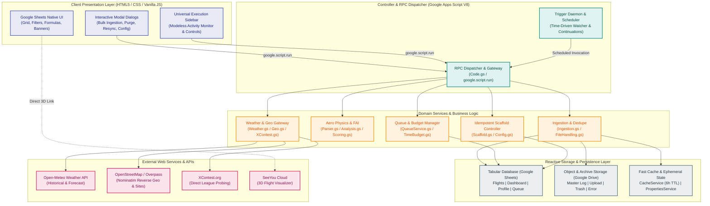
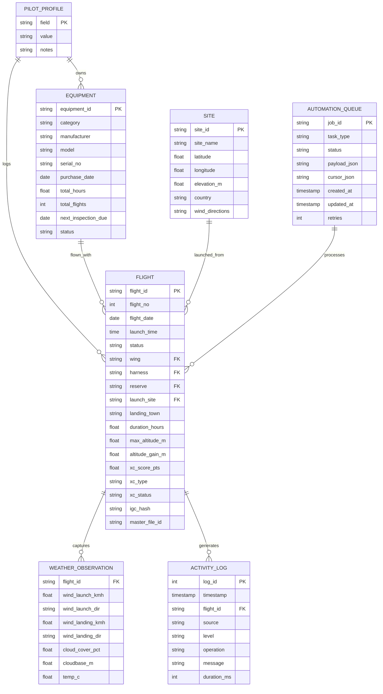
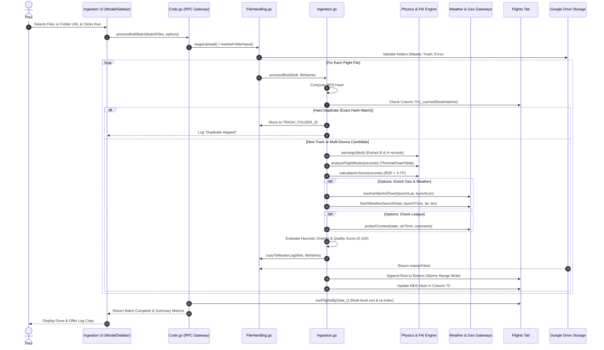
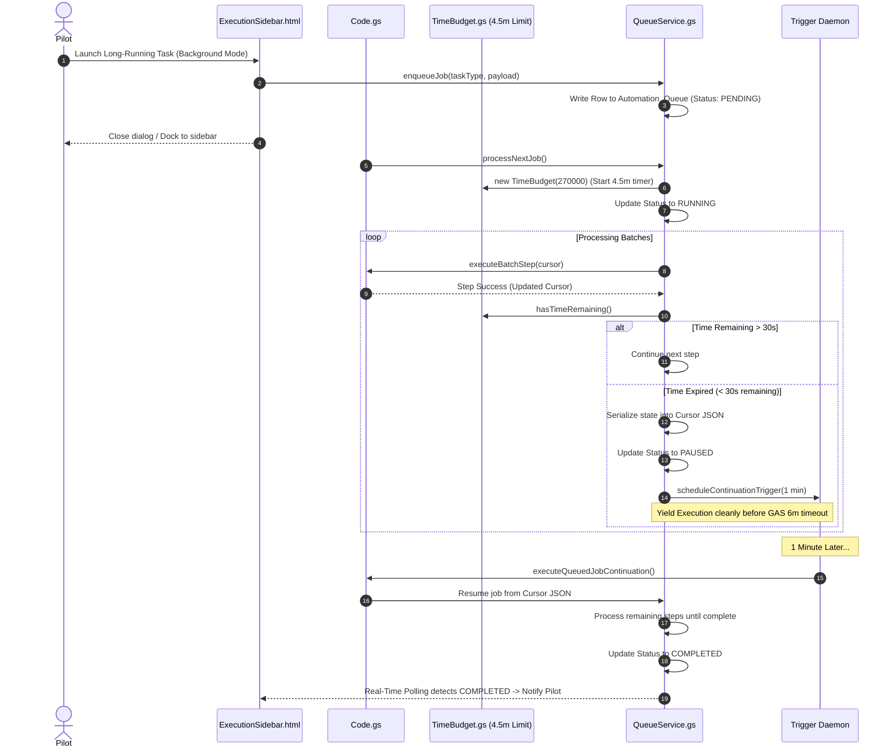

# Systems Architecture & Global Schemas (Source of Truth)

> [!NOTE]
> For code-level patterns, resilience practices, and engineering guardrails, see [`Patterns_and_Practices.md`](file:///g:/My%20Drive/~RS2B/~Projects/ParaFlightLogProject/Docs/Patterns_and_Practices.md).

---

## 1. Architectural Blueprint & Topology

### 1.1 High-Level Distributed Serverless Topology
**ParaFlightLog** implements a modular, serverless, and single-tenant architecture hosted entirely within the Google Cloud / Google Workspace consumer ecosystem. By combining Google Sheets as a reactive tabular database with Google Apps Script (V8 runtime) as a headless execution engine and Google Drive as an object store, the platform achieves enterprise-grade analytics with zero ongoing hosting or database infrastructure costs.



### 1.2 Architectural Invariants & Tenets
Every subsystem in ParaFlightLog must adhere to five non-negotiable architectural tenets:

1. **Tenet 1: Single-Tenant Absolute Data Sovereignty**:
   * All flight data, parsed sensor telemetry, personal credentials, and configuration parameters reside strictly inside the pilot's own Google account.
   * There are no centralized telemetry collectors, external analytics beacons, third-party databases, or phone-home servers.
2. **Tenet 2: Zero-Cost Serverless Execution**:
   * The platform operates 100% within Google's free standard consumer quotas.
   * No virtual machines, microservices, container registries, or paid cloud databases are permitted in the core architecture.
3. **Tenet 3: Zero Black-Box State**:
   * Operational state must be auditable and observable by the user.
   * Flight deduplication hashes (MD5) live directly in spreadsheet rows (Column 70 of `Flights`). Background job queues live on the dedicated `Automation_Queue` tab. Operational logs live on the `Activity Logs` tab.
4. **Tenet 4: Defensive Bounded Execution (4.5-Minute Time Budget)**:
   * Google Apps Script enforces a hard 6-minute execution limit on standalone scripts.
   * All batch processors and background tasks must monitor wall-clock execution against a strict 4.5-minute cutoff (`TimeBudgetService`). Before hitting the threshold, execution serializes state, releases locks, and registers a self-healing continuation trigger.
5. **Tenet 5: Non-Destructive Invariant Scaffolding & Dynamic Formulas**:
   * System setup and updates must never delete or overwrite user data rows, custom columns, or manual notes.
   * Formula links in `Dashboard` and summary views utilize resilient string-constructed formulas (`INDIRECT("Flights!..." & startRow & ":...")`), ensuring that row sorting, row insertion, or flight purges never cause `#REF!` errors.

---

## 2. System Decomposition & Layered Component Architecture

The codebase is organized into five functional layers, maintaining separation of concerns between presentation, orchestration, domain logic, state management, and persistence.

```
Code/
├── Code.gs                   # Layer 2: Orchestration & RPC Gateway
├── Config.gs                 # Layer 5: Configuration Constants & Structural Map
├── Scaffold.gs               # Layer 2: Idempotent Sheet Provisioning & Formatting
├── FileHandling.gs           # Layer 3: Google Drive Pipeline, Staging & Cleanup
├── Ingestion.gs              # Layer 3: Flight Ingestion Pipeline & Row Mapping
├── Parser.gs                 # Layer 3: IGC File Parser (B/H/I/K-Records)
├── Analysis.gs               # Layer 3: Aeronautical Physics & Mode Detection
├── Scoring.gs                # Layer 3: FAI Cross-Country Optimization (RDP)
├── Weather.gs                # Layer 3: Meteorological Enrichment Gateway
├── Geo.gs                    # Layer 3: Geocoding & Takeoff Site Resolution
├── XContest.gs               # Layer 3: League Verification & Deadline Probing
├── Utils.gs                  # Common: Math, Bearing, Haversine & Date Helpers
├── Logger.gs                 # Common: Centralized Activity Logging Engine
├── QueueService.gs           # Layer 4: Persistent Sheet-Backed Task Queue
├── TimeBudget.gs             # Layer 4: Bounded Execution & Resumption Manager
├── Test.gs                   # Layer 4: Automated Offline & In-App Test Harness
├── BulkIngestDialog.html     # Layer 1: High-Speed Batch Ingestion Modal
├── ExecutionSidebar.html     # Layer 1: Universal Tri-Mode Execution Sidebar
├── FlightMaintenanceDialog.html # Layer 1: Unified Flight Maintenance Modal
├── PurgeDialog.html          # Layer 1: Interactive Stepping Flight Purge Modal
├── ResyncDialog.html         # Layer 1: Interactive Master Folder Re-sync Modal
├── LoadConfigDialog.html     # Layer 1: Configuration JSON Import Modal
├── SaveConfigDialog.html     # Layer 1: Configuration JSON Export Modal
├── MarkDuplicatesDialog.html # Layer 1: Duplicate Staging Modal
├── URLDialog.html            # Layer 1: External URL / Cloud Drive Import Modal
├── UploadDialog.html         # Layer 1: Client Drag-and-Drop Uploader Modal
├── ScanDialog.html           # Layer 1: Watch Folder Scanner Modal
├── FolderPickerDialog.html   # Layer 1: In-App Drive Folder Navigator Modal
├── Inspector.html            # Layer 1: Deep Flight Inspection Sidebar
└── Style.html                # Layer 1: Shared Modal CSS Design System
```

### 2.1 Layer 1: Presentation & Interaction (UI)
* **Sheet-Native Views**: High-density tabular views styled with accessible, muted palettes (`#37474F` headers, `#00695C` brand highlights, `#CFD8DC` group separators). Includes auto-complete dropdowns, alternating row banding, and frozen header rows.
* **Modal Dialogs**: Synchronous, high-context interfaces for complex user configuration (e.g. folder selection, batch ingestion options, granular export/import checkboxes). Built using modern CSS flexbox layouts with responsive scrolling.
* **Modeless Universal Execution Sidebar (`ExecutionSidebar.html`)**: A dockable workspace component that enables pilots to monitor long-running background tasks, pause/resume execution, view live activity logs, and export run summaries while continuing to browse or edit the spreadsheet.
* **Custom Menu Hierarchy**: Unified under the top-level `Flight Log` menu:
  * *Sheet Maintenance & Views*: Dashboard refresh, User Guide refresh, Layout/formatting repairs, Backups.
  * *Folder Configuration*: In-app folder pickers for Watch, Upload, Master Log, Error, and Trash folders.
  * *Data Backup*: Save Configuration JSON, Load Configuration JSON.
  * *Automation & Services*: Watch folder trigger setup, Manual background scan.
  * *System Setup & Reset (Danger Zone)*: Complete scaffold, System purge.

### 2.2 Layer 2: Controller & RPC Gateway Layer
* **`Code.gs`**: The central entry point for all user interactions and scheduled events. Contains menu registration (`onOpen`), modal/sidebar launchers, and public RPC endpoints callable from client-side WebViews via `google.script.run`.
* **Client-Server RPC Gateway**:
  * All client-to-server calls return structured JSON responses: `{ success: boolean, data?: any, error?: string }`.
  * Protects against unhandled server exceptions by catching errors and passing descriptive messages to the UI.
* **Event Dispatchers**:
  * `onOpen(e)`: Lightweight simple trigger running within 1 second to construct menus.
  * `scanWatchFolderTrigger()`: Time-driven cron trigger for automated watch folder polling.
  * `executeQueuedJobContinuation()`: Time-driven continuation trigger executing serialized queue tasks.

### 2.3 Layer 3: Domain & Business Logic Services
* **File Pipeline (`FileHandling.gs`)**: Manages Google Drive folder validation, recursive archive traversal (up to 10 folder levels), staged temporary uploads, and strict isolation between `MASTER_LOG_FOLDER_ID`, `TRASH_FOLDER_ID`, and `ERROR_FOLDER_ID`.
* **Ingestion & Deduplication (`Ingestion.gs`)**: Orchestrates the multi-stage ingestion pipeline. Implements row-based MD5 checksum deduplication, multi-criteria heuristic candidate matching (Date $\pm 15$ min launch time, $\le 1{,}000$m distance), and device quality scoring (0–100 pts) to resolve `Dup-Primary` vs `Dup-Others`.
* **Aeronautical Physics Engine (`Parser.gs`, `Analysis.gs`, `Utils.gs`)**:
  * Extracts FAI-standard B-records (timestamp, lat, lon, GPS alt, pressure alt) and H-records (glider, pilot, instrument).
  * Sliding-window mode detection classifies flight segments into **Thermal** ($V_z > 0.3\text{ m/s}$, $\omega > 8^\circ/\text{s}$), **Soaring** ($V_z > -0.2\text{ m/s}$, S-turn heading reversals $> 90^\circ$), and **Glide** ($V_z < 0.2\text{ m/s}$, $\omega < 5^\circ/\text{s}$).
* **FAI Cross-Country Optimization (`Scoring.gs`)**:
  * Trajectory simplification using the Ramer-Douglas-Peucker (RDP) algorithm.
  * Brute-force 3-Turnpoint optimization for Free Flight, Out-and-Return, Flat Triangle (gap $< 20\%$), and FAI Triangle (shortest leg $\ge 28\%$).
* **Meteorological Gateway (`Weather.gs`)**: Queries the Open-Meteo Historical Archive API (with 7-day forecast API fallback) for surface wind speed, direction, temperature, cloud cover %, and computes Lawrence boundary layer cloudbase estimates.
* **Geocoding & Site Intelligence (`Geo.gs`)**: Chain of responsibility (OpenStreetMap Nominatim $\to$ Overpass API) resolving takeoff site names, landing towns, counties, and countries. Cached for 6 hours in `CacheService`.
* **League Integrator (`XContest.gs`)**: Direct flight probing bypassing client-side JavaScript rendering, extracting permanent flight IDs (`fl=...`), and checking the 14-day competition claiming deadline.

### 2.4 Layer 4: Asynchronous Execution & Queue Subsystem
* **Tri-Mode Execution Manager (`DSGN-UI-001`)**: Directs operations into either:
  1. *Foreground Modal*: Real-time UI stepping blocking the sheet view.
  2. *Modeless Sidebar*: Asynchronous stepping updating the dockable sidebar.
  3. *Headless Background*: Hands execution off to `QueueService` and `TimeBudgetService`.
* **Time Budget Controller (`TimeBudget.gs`)**:
  * Instantiated with `new TimeBudget(270000)` (4.5 minutes).
  * Continuously evaluates `budget.hasTimeRemaining()`. If time expires, invokes state checkpointing and schedules a 1-minute continuation trigger.
* **Persistent Job Queue (`QueueService.gs`)**:
  * Maintains state machine rows on `Automation_Queue`.
  * Manages atomic locking (`LockService.getScriptLock()`), prevents concurrent execution collisions, and records step-level progress.

### 2.5 Layer 5: Data & Storage Layer
* **Reactive Relational Store (Google Sheets)**: Structured sheets holding business entities, formulas, and visual dashboards.
* **Unstructured Object Store (Google Drive)**: Secure folder hierarchies holding raw and master `.igc` and `.zip` flight track files.
* **Fast Caching (`CacheService`)**: In-memory caching for geocoding, site lookups, and sheet hashes.

---

## 3. Global Entity-Relationship Model & Unified Data Dictionary

### 3.1 Platform Entity-Relationship Diagram (ERD)



---

### 3.2 Core Sheet Schemas & Contracts

#### 3.2.1 `Flights` Tab (Primary Relational Entity)
* **Sheet Name**: `Flights` (Tab Color: Cyan `#00BCD4`, Index 1).
* **Layout**: Two header rows (Row 3 = Category Divider, Row 4 = Column Name). Data records start at Row 5. Frozen rows = 4, Frozen columns = 4 (`A:D`).
* **Column Dictionary (70 Columns across 10 Functional Groups)**:

| Col # | Column Name | Group | Data Type | Formula / Source | Description |
| :---: | :--- | :--- | :--- | :--- | :--- |
| **1** | `Status` | Identity | String | User / System | `Valid`, `Review?`, `Dup-Primary`, `Dup-Others`, `Remove` |
| **2** | `Flight No` | Identity | Integer | `=IF(ISBLANK(C5), "", ROW()-4)` | Sequential flight counter |
| **3** | `Date` | Identity | Date (`YYYY-MM-DD`) | Parsed IGC | UTC Flight Date |
| **4** | `Launch Time` | Identity | Time (`HH:MM:SS`) | Parsed IGC | Local / UTC Takeoff Time |
| **5** | `Landing Time` | Identity | Time (`HH:MM:SS`) | Parsed IGC | Local / UTC Landing Time |
| **6** | `Duration` | Metrics | Time (`[h]:mm:ss`) | `=E5-D5` | Total airtime duration |
| **7** | `Duration (hrs)` | Metrics | Number (`0.00`) | `=F5*24` | Decimal hours airtime |
| **8** | `Flight Type` | Identity | String | Lookups Validation | `Soaring`, `Thermal XC`, `Hike & Fly`, `Acro`, `Training` |
| **9** | `FlightID` | Links | String | System Generated | Unique ID: `FYYYYMMDD_HHMM` (Hyperlinked to SeeYou Cloud) |
| **10** | `Master IGC` | Links | String | DriveApp | Hyperlink to file in `MASTER_LOG_FOLDER_ID` |
| **11** | `Wing` | Gear | String | Lookups Validation | Glider Model (validated against `Equipment!A:A`) |
| **12** | `Harness` | Gear | String | Lookups Validation | Harness Model |
| **13** | `Reserve` | Gear | String | Lookups Validation | Reserve Parachute Model |
| **14** | `Takeoff Alt (m)` | Metrics | Number (`#,##0`) | Parsed IGC | Elevation at first B-record (GPS/Baro) |
| **15** | `Max Alt (m)` | Metrics | Number (`#,##0`) | Parsed IGC | Highest recorded altitude |
| **16** | `Alt Gain (m)` | Metrics | Number (`#,##0`) | `=O5-N5` | Net altitude gained above launch |
| **17** | `Landing Alt (m)` | Metrics | Number (`#,##0`) | Parsed IGC | Elevation at final B-record |
| **18** | `Max Climb (m/s)` | Metrics | Number (`0.0`) | Physics Engine | Maximum 10s integrated climb rate |
| **19** | `Max Sink (m/s)` | Metrics | Number (`0.0`) | Physics Engine | Maximum 10s integrated sink rate |
| **20** | `Max Speed (km/h)` | Metrics | Number (`0.0`) | Physics Engine | Peak ground speed |
| **21** | `Avg Speed (km/h)` | Metrics | Number (`0.0`) | Physics Engine | Average ground speed over flight track |
| **22** | `Thermal Time` | Physics | Time (`[h]:mm:ss`) | Physics Engine | Accumulated time in thermal mode |
| **23** | `Thermal %` | Physics | Percentage | `=V5/F5` | Percentage of airtime spent climbing |
| **24** | `Soaring Time` | Physics | Time (`[h]:mm:ss`) | Physics Engine | Accumulated time in dynamic ridge soaring |
| **25** | `Glide Time` | Physics | Time (`[h]:mm:ss`) | Physics Engine | Accumulated time in straight glide |
| **26** | `Avg Glide Ratio` | Physics | Number (`0.0`) | Physics Engine | Distance covered / altitude lost during glides |
| **27** | `XC Straight (km)` | Scoring | Number (`0.00`) | Scoring Engine | Direct distance launch-to-landing |
| **28** | `XC Open (km)` | Scoring | Number (`0.00`) | Scoring Engine | Free distance via up to 3 turnpoints |
| **29** | `XC Triangle (km)`| Scoring | Number (`0.00`) | Scoring Engine | Closed triangle distance |
| **30** | `XC Type` | Scoring | String | Scoring Engine | `Free Flight`, `Out & Return`, `Flat Triangle`, `FAI Triangle` |
| **31** | `XC Multiplier` | Scoring | Number (`0.00`) | Scoring Engine | FAI rule weight (e.g. 1.0, 1.2, 1.4, 1.5) |
| **32** | `XC Score (pts)` | Scoring | Number (`0.00`) | `=MAX(AB5, AC5*AD5)` | Official cross-country competition points |
| **33** | `Takeoff Site` | Geo | String | Geo Engine | Geocoded site name or mountain summit |
| **34** | `Takeoff Town` | Geo | String | Geo Engine | Closest municipality to launch |
| **35** | `Takeoff County` | Geo | String | Geo Engine | County / State / Canton |
| **36** | `Takeoff Country`| Geo | String | Geo Engine | Country name |
| **37** | `Landing Site` | Geo | String | Geo Engine | Landing field name |
| **38** | `Landing Town` | Geo | String | Geo Engine | Municipality at landing |
| **39** | `Landing Country`| Geo | String | Geo Engine | Country at landing |
| **40** | `Launch Wind Dir`| Weather | String | Weather Gateway | Wind direction at launch (e.g. `NNW`, `290°`) |
| **41** | `Launch Wind Spd`| Weather | Number (`0.0`) | Weather Gateway | Wind speed at launch (km/h) |
| **42** | `Launch Wind Gst`| Weather | Number (`0.0`) | Weather Gateway | Wind gusts at launch (km/h) |
| **43** | `Landing Wind Dir`| Weather | String | Weather Gateway | Wind direction at landing |
| **44** | `Landing Wind Spd`| Weather | Number (`0.0`) | Weather Gateway | Wind speed at landing (km/h) |
| **45** | `Cloud Cover %` | Weather | Percentage | Weather Gateway | Total cloud cover percentage |
| **46** | `Cloudbase (m)` | Weather | Number (`#,##0`) | Weather Gateway | Lawrence spread estimated cloudbase |
| **47** | `Temp (°C)` | Weather | Number (`0.0`) | Weather Gateway | Ambient surface temperature |
| **48** | `Weather Notes` | Weather | String | Weather Gateway | Weather description summary |
| **49** | `XContest Status`| XContest | String | XContest Gateway | `XC#1234567` (Link), `Claim soon!`, `Expired`, `No Flight` |
| **50** | `XContest Points`| XContest | Number (`0.00`) | XContest Gateway | Points claimed on league server |
| **51** | `Import ID` | System | String | Ingestion Pipeline | Batch execution ID |
| **52–69** | `Ext Metrics` | System | Mixed | Extended Plugins | Extension slots for custom sensors (O2, Heartrate) |
| **70** | `IGC Hash` | System | String (MD5) | Ingestion Pipeline | 32-character hexadecimal MD5 hash for deduplication |

---

#### 3.2.2 `Dashboard` Tab (Dynamic KPI & Leaderboard View)
* **Sheet Name**: `Dashboard` (Tab Color: Purple `#9C27B0`, Index 0).
* **Grid Bounds**: 6 columns (`A:F`), frozen row 0.
* **Layout Zones**:
  1. *Row 1*: Title banner (`ParaFlightLog Personal Cockpit & Currency Monitor`, `#4A148C`).
  2. *Row 2–4*: All-Time Career Summary Banner (Merged KPI cards: Flights, Duration `[h]:mm`, XC Distance `km`).
  3. *Row 5–7*: Year-to-Date (YTD) Summary Banner (Current year metrics with identical layout).
  4. *Row 8–16*: Rolling 6-Month Pilot Currency Grid:
     * Dynamic columns: `Month`, `Flights`, `Duration`, `Distance`, `Currency Rating`.
     * Conditional color formatting: Green (High currency), Yellow (Moderate), Orange (Low currency based on `TIMELINE_FLIGHTS_LOW/MED` and `TIMELINE_HOURS_LOW/MED` config parameters).
  5. *Row 17–38*: 8-Card Dynamic Leaderboard Matrix ($4 \times 2$ grid):
     * *Card 1*: Top 5 Longest Duration Flights
     * *Card 2*: Top 5 Longest XC Distance Flights
     * *Card 3*: Top 5 Highest Altitude Flights
     * *Card 4*: Top 5 Biggest Altitude Gain Flights
     * *Card 5*: Top 5 Best Thermal Climb Flights
     * *Card 6*: Top 5 Longest Dynamic Soaring Flights
     * *Card 7*: Top 5 Highest FAI XC Score Flights
     * *Card 8*: Top 5 Peak Ground Speed Flights
  6. *Row 39–60*: Top Launch Sites & Countries Flown tables.
* **Resilience Invariant**: All formulas query the `Flights` tab using dynamic `INDIRECT()` calls wrapped in `FILTER(..., Flights!Status = "Valid")`, ensuring unreviewed duplicates or deleted rows never corrupt the dashboard formulas.

---

#### 3.2.3 `Pilot_Profile` Tab (Pilot Credentials & Identity)
* **Sheet Name**: `Pilot_Profile` (Tab Color: Teal `#009688`, Index 2).
* **Layout**: 3 columns (`['Field', 'Value', 'Notes / Instructions']`), frozen row 0.
* **Non-Destructive Key-Value Contract**: Configuration updates match on Column A (`Field`) and write strictly into Column B (`Value`), preserving section divider banners and Column C guidelines.
* **Section Dividers & Fields**:
  1. `[ Identity ]`: Full Name, Callsign / Nickname, Email, Phone Number, Home Country & Town, Other Identity Info.
  2. `[ Licensing ]`: National Association, Pilot Rating, National Licence Info, FAI Sporting Licence Info, CIVL ID, Other Licensing Info.
  3. `[ Affiliations ]`: Primary Flying Club, Secondary Clubs, National Federation Member #, Other Affiliations Info.
  4. `[ Emergency / SAR ]`: Primary Emergency Contact Info, 2nd Emergency Contact Info, 3rd Emergency Contact Info, SAR / Evac Provider Info, Medical Insurance Info, Blood Type, Medical Conditions / Allergies, Other Emergency Info.
  5. `[ Tracking / Gear ]`: Garmin inReach IMEI, Garmin MapShare URL, Flymaster Live URL, XContest Live URL, Emergency Beacon Hex ID, Other Tracking / Gear Info.
  6. `[ Progression ]`: Current Season XC Goals, SIV / Maneuver Notes, General Flying Notes, Other Progression Info.

---

#### 3.2.4 `Equipment` Tab (Gear Register & Airworthiness)
* **Sheet Name**: `Equipment` (Tab Color: Amber `#FFC107`, Index 3).
* **Schema**:
  * Col A: `Category` (`Wing`, `Harness`, `Reserve`, `Instrument`, `Accessory`).
  * Col B: `Manufacturer` (e.g. `Ozone`, `Advance`, `Gin`, `Naviter`).
  * Col C: `Model` (e.g. `Rush 6`, `Weightless`, `Yeti Cross 32`).
  * Col D: `Size / Classification` (e.g. `ML / EN-B`).
  * Col E: `Serial Number`.
  * Col F: `Acquisition Date` (`YYYY-MM-DD`).
  * Col G: `Total Flights` (Dynamic formula: `=COUNTIF(Flights!K:K, C2)`).
  * Col H: `Total Hours` (Dynamic formula: `=SUMIF(Flights!K:K, C2, Flights!G:G)`).
  * Col I: `Last Inspection Date`.
  * Col J: `Inspection / Repack Interval (Months)`.
  * Col K: `Next Inspection / Repack Due Date`.
  * Col L: `Airworthiness Status` (`Airworthy`, `Inspection Due Soon`, `Grounded`, `Retired`).
  * Col M: `Notes & Service Log`.

---

#### 3.2.5 `Config` Tab (Consolidated Configuration & Lookups)
* **Sheet Name**: `Config` (Tab Color: Deep Orange `#FF9800`, Index 6).
* **Structure**: Consolidated two-zone architecture:
  * **Zone 1: System Parameters (Columns A:C)**:
    * Col A: `Parameter` (Unique key name).
    * Col B: `Value` (Runtime configuration value).
    * Col C: `Description` (Guidance notes and Drive folder breadcrumbs).
    * 49 centralized parameters grouped into 9 visual sections: `[ Ingestion ]`, `[ Integrations ]`, `[ Geo & Time ]`, `[ Validation ]`, `[ Analysis Rules ]`, `[ Analysis - Adv ]`, `[ Scoring ]`, `[ Format and Units ]`, `[ Dashboard & Currency ]`.
  * **Zone 2: Controlled Lookups & Dynamic Queries (Columns E:N, spacer Col D)**:
    * Cols E–J: Manual controlled vocabularies (`Equipment Categories`, `Flight Status`, `Flight Type`, `XC Classes`, `Date Formats`, `Time Formats`).
    * Cols K–N: Dynamic query formulas auto-populating active gear lists from `Equipment`:
      * Col K: `Wings (Auto)`: `=FILTER(Equipment!C2:C, Equipment!A2:A="Wing", Equipment!L2:L<>"Retired")`
      * Col L: `Harnesses (Auto)`: `=FILTER(Equipment!C2:C, Equipment!A2:A="Harness", Equipment!L2:L<>"Retired")`
      * Col M: `Reserves (Auto)`: `=FILTER(Equipment!C2:C, Equipment!A2:A="Reserve", Equipment!L2:L<>"Retired")`
      * Col N: `Other (Auto)`: `=FILTER(Equipment!C2:C, Equipment!A2:A="Instrument", Equipment!L2:L<>"Retired")`

---

#### 3.2.6 `Activity Logs` Tab (System Audit Ledger)
* **Sheet Name**: `Activity Logs` (Tab Color: Blue Grey `#607D8B`, Index 7).
* **Schema**:
  * Col A: `Timestamp` (`YYYY-MM-DD HH:MM:SS`).
  * Col B: `Flight ID` (or `SYSTEM` / batch execution ID).
  * Col C: `Source` (Module name: `Ingestion`, `Purge`, `Weather`, `Scoring`, `Maintenance`).
  * Col D: `Level` (`INFO`, `WARN`, `ERROR`, `DEBUG`).
  * Col E: `Operation` (Function name: `processDriveFile`, `purgeSingleFlight`, `syncWeather`).
  * Col F: `Message` (Detailed human-readable log message).
  * Col G: `Execution Mode` (`MODAL`, `SIDEBAR`, `BACKGROUND`).
  * Col H: `Duration (ms)` (Execution time for the discrete step).

---

#### 3.2.7 `Automation_Queue` Tab (Asynchronous Task Ledger)
* **Sheet Name**: `Automation_Queue` (Tab Color: Light Blue `#03A9F4`, Index 8).
* **Schema**:
  * Col A: `Job ID` (UUID string: `JOB_YYYYMMDD_HHMMSS_XXX`).
  * Col B: `Task Type` (`BULK_INGEST`, `WEATHER_BACKFILL`, `GEO_BACKFILL`, `PURGE_BATCH`, `RESYNC_MASTER`).
  * Col C: `Status` (`PENDING`, `RUNNING`, `PAUSED`, `COMPLETED`, `FAILED`).
  * Col D: `Payload JSON` (Input targets, options, and file arrays).
  * Col E: `Cursor / State JSON` (Current batch index, processed count, error accumulators).
  * Col F: `Created At` (ISO timestamp).
  * Col G: `Updated At` (ISO timestamp).
  * Col H: `Retries` (Integer counter, max 3).
  * Col I: `Error Details` (Stack traces or failure causes).

---

## 4. End-to-End Execution Lifecycles & Sequence Models

### 4.1 The Complete Flight Ingestion Pipeline



---

### 4.2 Tri-Mode Execution & Time-Budgeted Resumption



---

## 5. External Boundaries, APIs & Rate-Limiting Strategy

ParaFlightLog interacts with five external web endpoints. To maintain compliance and prevent API quota exhaustion, all external gateways implement caching, exponential backoff, and polite query intervals:

| Service | Target URL / Protocol | Method | Rate Limit & Politeness Policy | Caching Strategy | Fallback Pathway |
| :--- | :--- | :---: | :--- | :--- | :--- |
| **Open-Meteo Historical** | `https://archive-api.open-meteo.com/v1/archive` | `GET` | Max 10 calls/min. Bounded bounding box. | Keyed by `YYYYMMDD_LAT_LON` in memory | Fallback to Open-Meteo 7-day Forecast API |
| **Open-Meteo Forecast** | `https://api.open-meteo.com/v1/forecast` | `GET` | Used strictly for flights $\le 7$ days old. | In-memory batch map | Visual Crossing Timeline API (if key supplied) |
| **OpenStreetMap Nominatim** | `https://nominatim.openstreetmap.org/reverse` | `GET` | Strict 1.0s sleep between requests. Custom `User-Agent` identifying instance. | 6-hour TTL via `CacheService` | Overpass API bounding query $\to$ Return raw coords |
| **Overpass API** | `https://overpass-api.de/api/interpreter` | `POST` | Bounded $25\text{km}$ query radius for `sport=paragliding`. | 6-hour TTL via `CacheService` | Graceful fallback to nearest town name |
| **XContest.org** | `https://www.xcontest.org/world/en/flights/detail:...` | `GET` | Polite direct HTTP probing. Tolerance $\pm 2$ min UTC. | No caching (real-time league status) | Hyperlink direct flight search URL if unconfirmed |
| **SeeYou Cloud** | `https://cloud.seeyou.cloud/o/flight?...` | Client `URL` | Direct browser navigation using Master IGC Drive ID. | Browser-cached | Open raw Google Drive file preview |

---

## 6. Security, Privacy & Threat Model

### 6.1 Zero-PII Exfiltration Policy
* ParaFlightLog collects **zero telemetry, zero analytics, and zero crash logs**.
* Flight coordinates, pilot names, phone numbers, emergency contact information, and equipment serial numbers are never transmitted to any central server.
* The only external network requests made by the application are direct outbound queries to Open-Meteo, OpenStreetMap, and XContest.org for flight enrichment.

### 6.2 Scoped OAuth Permissions
The project manifest (`appsscript.json`) enforces the principle of least privilege:
```json
{
  "timeZone": "Etc/UTC",
  "dependencies": {},
  "exceptionLogging": "STACKDRIVER",
  "runtimeVersion": "V8",
  "oauthScopes": [
    "https://www.googleapis.com/auth/spreadsheets",
    "https://www.googleapis.com/auth/drive",
    "https://www.googleapis.com/auth/script.external_request",
    "https://www.googleapis.com/auth/script.scriptapp"
  ]
}
```

### 6.3 Formula Injection & Data Sanitization
* Pilot names, glider types, and site names parsed from untrusted external IGC files could theoretically contain formula injection vectors (e.g. leading `=`, `+`, `-`, or `@`).
* **Sanitization Invariant**: The parser strips or prepends a single quotation mark (`'`) to any string field beginning with formula trigger characters before passing values to `SpreadsheetApp` write buffers.

---

## 7. Guidelines for Autonomous AI Agents & Developers

When inspecting, modifying, or extending ParaFlightLog, AI coding assistants (such as Antigravity, Gemini CLI, Claude Code) and human developers must observe the following conventions:

1. **Schema Modifications**:
   * If adding a new column to `Flights`, you must update:
     1. `Docs/Architecture.md` (Section 3.2.1 Column Dictionary).
     2. `Docs/Technical_Specification.md` (Data Schema section).
     3. `Code/Scaffold.gs` (`scaffoldFlights_` and header column arrays).
     4. `Code/Ingestion.gs` (`buildFlightRowArray_`).
     5. The offline test mock definitions in `scratch/run_all_offline_tests.js`.
2. **Never Use Hardcoded Row Limits**:
   * Always dynamically calculate target rows using `sh.getLastRow()` or `getActualFlightRows_(sh)`. Trailing formatted blank rows must be safely ignored.
3. **Always Batch Spreadsheet Writes**:
   * Never write cell-by-cell in a loop. Collect updates into two-dimensional arrays and write them in a single atomic `range.setValues()` call.
4. **Run Offline Tests Before Committing**:
   * Before pushing any code changes, execute the headless Node.js test suite to verify that parsing, scoring, and deduplication logic remain 100% regression-free.

---

## 8. Document Revision History

| Version | Date | Author | Description of Changes |
| :--- | :--- | :--- | :--- |
| **1.0** | 2026-10-02 | Core Architecture Team / AGY | Initial formal release establishing the System Topology, 5-Layer Component Model, Global Schemas, ERD, and External Gateways. |
