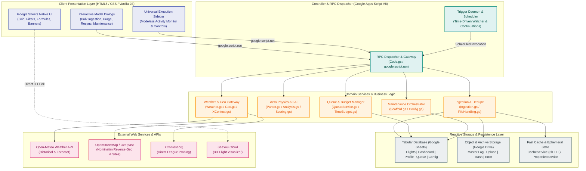

# Systems Architecture & Global Topology

> [!NOTE]
> For authoring guidelines, two-way linking rules, and in-code commenting standards, see [`Documentation_Standards.md`](./Documentation_Standards.md).
> For code-level patterns and guardrails, see [`Patterns_and_Practices.md`](../Patterns_and_Practices.md).

---

## 1. Architectural Blueprint & Topology

### 1.1 High-Level Distributed Serverless Topology
**ParaFlightLog** implements a modular, serverless, single-tenant architecture hosted entirely within the Google Cloud / Google Workspace consumer ecosystem. By combining Google Sheets as a reactive tabular database with Google Apps Script (V8 runtime) as a headless execution engine and Google Drive as an object store, the platform achieves enterprise-grade analytics with zero ongoing hosting or database infrastructure costs.



---

## 2. Architectural Invariants & Tenets

Every subsystem in ParaFlightLog must adhere to five non-negotiable architectural tenets:

1. **Tenet 1: Single-Tenant Absolute Data Sovereignty**:
   * All flight data, parsed sensor telemetry, personal credentials, and configuration parameters reside strictly inside the pilot's own Google account.
   * There are no centralized telemetry collectors, external analytics beacons, third-party databases, or phone-home servers.
2. **Tenet 2: Zero-Cost Serverless Execution**:
   * The platform operates 100% within Google's free standard consumer quotas.
   * No virtual machines, microservices, container registries, or paid cloud databases are permitted in the core architecture.
3. **Tenet 3: Zero Black-Box State**:
   * Operational state must be auditable and observable by the user.
   * Flight deduplication hashes (MD5) live directly on flight rows (Col 70 of `Flights`). Background job queues live transparently on `Automation_Queue`. Operational logs live on `Activity Logs`.
4. **Tenet 4: Defensive Bounded Execution (4.5-Minute Time Budget)**:
   * Google Apps Script enforces a hard 6-minute execution limit on standalone scripts.
   * All batch processors and background tasks must monitor wall-clock execution against a strict 4.5-minute cutoff (`TimeBudgetService`). Before hitting the threshold, execution serializes state, releases locks, and registers a self-healing continuation trigger.
5. **Tenet 5: Non-Destructive Invariant Scaffolding & Dynamic Formulas**:
   * System setup and updates must never delete or overwrite user data rows (Rows 5:N on `Flights`), custom equipment, or manual notes.
   * Formulas utilize resilient dynamic column resolution (`getColLetter_`) and workbook Named Ranges (`LOOKUP_*`, `DASHBOARD_REVIEW_FILTER`), ensuring that column reordering or row deletion never causes `#REF!` errors.

---

## 3. Four-View Architecture Index

To separate aeronautical problem domain logic from platform-specific technical constraints, the architecture is decomposed across four orthogonal views and three cross-cutting specifications:

### The 4 Architectural Views:
* [`Views/01_Functional_View.md`](./Views/01_Functional_View.md): Subsystem functional decomposition, domain capabilities, and pilot operational workflows.
* [`Views/02_Execution_and_Runtime.md`](./Views/02_Execution_and_Runtime.md): Google Apps Script V8 runtime, execution lifecycles, 4.5m TimeBudget, QueueService, triggers, and client-server RPC.
* [`Views/03_Data_and_Storage_Model.md`](./Views/03_Data_and_Storage_Model.md): Tabular database model, ERD, 8-tab schema, Named Ranges, dynamic formula resolution, and Google Drive object storage.
* [`Views/04_Integration_and_APIs.md`](./Views/04_Integration_and_APIs.md): External integration gateways (Open-Meteo, OpenStreetMap / Overpass, XContest, SeeYou Cloud).

### Cross-Cutting System Specifications:
* [`Cross_Cutting/Security_and_Privacy.md`](./Cross_Cutting/Security_and_Privacy.md): Pilot PII protection, single-tenant data sovereignty, OAuth scopes, token security.
* [`Cross_Cutting/Resilience_and_Evolution.md`](./Cross_Cutting/Resilience_and_Evolution.md): Script-to-sheet decoupling, dual-state lag tolerance, soft guardrails (`setWarningOnly`), and safety backups.
* [`Cross_Cutting/Quotas_and_Performance.md`](./Cross_Cutting/Quotas_and_Performance.md): Google Apps Script quota limits, in-memory quality scoring, batch array formulas, and cold-start optimization.

---

## 4. Codebase Decomposition & Layered Runtime Map

Production runtime code in `Code/` strictly contains 33 files deployed to Google Apps Script. Developer tests and audit tooling reside in `tests/` and `tools/` and are excluded from deployment via `.claspignore`:

```
ParaFlightLogProject/
├── Code/                             # TIER 1: PRODUCTION RUNTIME (33 Files)
│   ├── Code.gs                       # Layer 2: Orchestrator, Triggers & RPC Gateways
│   ├── Config.gs                     # Layer 5: Canonical Schemas, Manifests & Lookups
│   ├── Scaffold.gs                   # Layer 2: Scaffolding & System Maintenance Orchestrator
│   ├── FileHandling.gs               # Layer 3: Google Drive Pipeline, Staging & Quarantine
│   ├── Ingestion.gs                  # Layer 3: Ingestion Pipeline, Dedupe & Quality Scoring
│   ├── Parser.gs                     # Layer 3: IGC File Parser (B/H/I/K-Records)
│   ├── Analysis.gs                   # Layer 3: Aero Physics, Thermals & Mode Detection
│   ├── Scoring.gs                    # Layer 3: FAI Cross-Country Optimization (RDP)
│   ├── Weather.gs                    # Layer 3: Meteorological Enrichment Gateway
│   ├── Geo.gs                        # Layer 3: Geocoding & Takeoff Site Resolution
│   ├── XContest.gs                   # Layer 3: League Verification & Deadline Probing
│   ├── Logger.gs                     # Common: Centralized Activity Logging Engine
│   ├── QueueService.gs               # Layer 4: Persistent Sheet-Backed Task Queue
│   ├── TimeBudget.gs                 # Layer 4: 4.5-Minute Safety Budget & Self-Continuation
│   ├── Utils.gs                      # Common: Math, Bearing, Haversine & Date Helpers
│   ├── appsscript.json               # Manifest: OAuth Scopes & Runtime Configuration
│   └── *.html                        # Layer 1: 17 Modal Dialogs & Universal Sidebar
│
├── tests/                            # TIER 2: DEVELOPER TESTING & FIXTURES (Git Only)
│   ├── README.md                     # Testing Guide & Execution Instructions
│   └── Test.gs                       # 13 Automated Offline & Regression Test Suites
│
├── tools/                            # TIER 2: AUDIT & BUILD SCRIPTS (Git Only)
│   ├── code_check_audit.js           # Static Analyzer & Pattern Invariant Verifier
│   └── run_all_offline_tests.js      # Headless Node.js Test Runner
│
└── Docs/                             # TIER 3–5: 5-TIER DOCUMENTATION SYSTEM (Git Only)
```
