# Architecture View 01: Functional & Domain View
**Subsystem Decomposition, Business Rules & Operational Workflows**

* **Status**: `Living Specification`
* **Parent Architecture**: [`Docs/Architecture/README.md`](file:///g:/My%20Drive/~RS2B/~Projects/ParaFlightLogProject/Docs/Architecture/README.md)
* **Governing Pattern**: [Pattern 20 (`Docs/Patterns_and_Practices.md`)](file:///g:/My%20Drive/~RS2B/~Projects/ParaFlightLogProject/Docs/Patterns_and_Practices.md)

---

## 1. Domain Overview & Problem Space

The functional domain of **ParaFlightLog** centers on capturing, interpreting, and preserving the complete lifetime operational history of a paraglider or hang glider pilot.

The domain is decomposed into 7 autonomous functional capabilities:

```mermaid
graph LR
    classDef domain fill:#E8F5E9,stroke:#2E7D32,stroke-width:2px,color:#1B5E20;
    classDef storage fill:#ECEFF1,stroke:#455A64,stroke-width:2px,color:#263238;

    IGC["1. Raw IGC Stream<br>(GNSS, Pressure Baro)"]:::domain
    Ingest["2. Ingestion & Dedupe<br>(Quality Scoring 0-100)"]:::domain
    Physics["3. Aero Physics Engine<br>(Thermals, Glides, Climbs)"]:::domain
    Scoring["4. FAI XC Optimizer<br>(RDP, 5-Point Graph Search)"]:::domain
    Enrich["5. Weather & Geo<br>(Open-Meteo, OSM, XContest)"]:::domain
    Logbook["6. Pilot Logbook<br>(Rows 5:N on Flights)"]:::storage
    Dashboard["7. Analytics & Currency<br>(KPI Banners, Timeline)"]:::domain

    IGC --> Ingest
    Ingest --> Physics
    Physics --> Scoring
    Scoring --> Enrich
    Enrich --> Logbook
    Logbook --> Dashboard
```

---

## 2. Functional Subsystems Detail

### 2.1 Subsystem 1: Intelligent Flight Ingestion & Extraction
* **Purpose**: Automated discovery, validation, and multi-source ingestion of flight tracklogs.
* **Sources Supported**:
  1. *Watch Folder*: Background recursive traversal of up to 10 subfolder levels in Google Drive.
  2. *Drag-and-Drop*: Client-side chunked upload via [`Code/UploadDialog.html`](file:///g:/My%20Drive/~RS2B/~Projects/ParaFlightLogProject/Code/UploadDialog.html).
  3. *Cloud Drive / Web URL*: Direct import from Google Drive links or remote HTTP endpoints.
  4. *High-Speed Bulk Batch Ingestion*: Multi-file batching (3, 5, 10 files per RPC) with atomic bottom-appending and deferred sort.
* **Master Mirror & Isolation**: Every ingested file is mirrored into `MASTER_LOG_FOLDER_ID` for SeeYou Cloud integration, while corrupt files are safely quarantined in `ERROR_FOLDER_ID`.

### 2.2 Subsystem 2: Aeronautical Physics & Mode Detection
* **Purpose**: Reconstruct flight aerodynamics from high-density GNSS and pressure altitude fixes ($1\text{ Hz}$).
* **Modes Classified**:
  * **Thermal ($V_z > 0.3\text{ m/s}$, $\omega > 8^\circ/\text{s}$)**: Sustained circling climb. Detects core thermal count, average climb rate, and thermal apex.
  * **Soaring ($V_z > -0.2\text{ m/s}$, S-turn reversals $> 90^\circ$)**: Ridge or dune lift.
  * **Glide ($V_z < 0.2\text{ m/s}$, $\omega < 5^\circ/\text{s}$)**: Straight-line transit. Calculates instantaneous and glide ratio $L/D$.
* **Physics Metrics Computed**: True duration, max GNSS altitude, max pressure altitude, total height gain, max climb rate ($1\text{s}, 20\text{s}$ integrated), max sink rate, and average groundspeed.

### 2.3 Subsystem 3: FAI Cross-Country Scoring & Optimization
* **Purpose**: Evaluates flight tracklogs against official FAI Sporting Code (Section 7) scoring rules for free flight.
* **Algorithmic Pipeline**:
  1. *Ramer-Douglas-Peucker (RDP) Trajectory Simplification*: Compresses 10,000+ raw GPS trackpoints down to a critical convex hull of 100–300 vertices using configurable tolerance (`RDP_TOLERANCE: 25.0m`).
  2. *5-Point Combinatorial Graph Search*: Identifies optimal Takeoff, Turnpoint 1, Turnpoint 2, Turnpoint 3, and Landing points maximizing distance and multiplier.
  3. *Triangle Closure Validation (FAI Rule 4.4.2)*: Validates if closing distance $\le 20\%$ of total distance or $\le 3\text{ km}$.
  4. *Multipliers*: Free Distance ($1.5\text{ pts/km}$), Flat Triangle ($1.75\text{ pts/km}$), FAI Triangle ($2.0\text{ pts/km}$).

### 2.4 Subsystem 4: Automated Deduplication & Device Overlap Triage
* **Purpose**: Prevents duplicate entries when pilots record flights with multiple instruments (e.g. phone running XCTrack + vario + smartwatch).
* **Two-Stage Triage**:
  * *Hard Dedupe*: Identical MD5 checksum match on raw file content. Preserves existing row, re-links Master file ID, and trashes source.
  * *Heuristic Quality Scoring (0–100 pts)*: Evaluates candidate overlap (Date, $\pm 15$ min launch time, $\le 1{,}000$m proximity) strictly in memory:
    * *Device Authority (Max 40 pts)*: Dedicated Vario (25 pts), XCTrack (35 pts), Generic phone app (15 pts).
    * *Sensor Barometric Integrity (Max 30 pts)*: Authentic pressure curve (30 pts), single max altitude (15 pts).
    * *Duration & Distance (Max 20 pts)*: $> 30\text{ min}$ (15 pts), $> 10\text{ min}$ (10 pts).
    * *Equipment Richness (Max 10 pts)*: Identified wing (+10 pts).
  * *Reciprocal Candidate Tagging*: Highest score receives `Dup-Primary` (gold); backups receive `Dup-Others` (orange) with reciprocal cross-reference notes (`[DupRef: D01 | Primary: F...]`).

### 2.5 Subsystem 5: Meteorological & Geographic Enrichment
* **Purpose**: Automatically reconstructs atmospheric and topological launch context without pilot manual entry.
* **Features**:
  * *Open-Meteo Archive/Forecast*: Pulls launch temperature, 10m wind speed, cardinal direction, gust speed, and surface pressure.
  * *Lawrence Cloudbase Formula*: Calculates convective condensation level: $\text{Cloudbase (AGL)} = (T - T_d) \times 125\text{ m}$.
  * *Geocoding*: Reverse geocodes takeoff coordinates via OpenStreetMap Nominatim and matches takeoff sites against Paragliding Earth catalogs.
  * *XContest Probing*: Evaluates UTC launch times against XContest.org records to extract permanent flight IDs (`fl=...`) and checks 14-day competition claiming deadlines.

### 2.6 Subsystem 6: Pilot Analytics & Currency Dashboard
* **Purpose**: Real-time operational awareness, currency compliance, and statistical visualization.
* **Metrics Tracked**:
  * *Lifetime Summary*: Total logged hours, flight count, total XC distance, max altitude, longest flight.
  * *Rolling Currency Timeline*: 6-month rolling monthly flight hours and takeoff counts.
  * *Gear Hours Aggregation*: Dynamically tallies total airtime hours and flight counts per wing and harness directly from `Flights` rows.
  * *Validation Gating*: Strictly filters for `Status = "Valid"`, shielding statistics from unreviewed or duplicate tracks.

### 2.7 Subsystem 7: System Evolution & Maintenance Cockpit
* **Purpose**: Safe, granular, and non-destructive evolution of active Google Sheets.
* **Capabilities**:
  * *2D Matrix Scope*: Granular sheet $\times$ element targeting across 8 sheets and 7 element types.
  * *Three-Tier Invariants*: Auto-enforces mandatory elements (formulas, named ranges, lookups) regardless of user sheet gating.
  * *Dual Pre-Flight Backups*: Automatic in-workbook sheet clones (`_MNT_BAK_*`) and client-side Config JSON snapshot download before executing structural changes.

---

## 3. Implementation & Code Mapping

| Subsystem | Primary Code Module | Supporting Files | Design Specification | Automated Tests |
| :--- | :--- | :--- | :--- | :--- |
| **1. Ingestion** | [`Code/Ingestion.gs`](file:///g:/My%20Drive/~RS2B/~Projects/ParaFlightLogProject/Code/Ingestion.gs) | `FileHandling.gs`, `BulkIngestDialog.html`, `UploadDialog.html`, `URLDialog.html` | [`DSGN-CORE-001`](file:///g:/My%20Drive/~RS2B/~Projects/ParaFlightLogProject/Docs/Design/DSGN-CORE-001_Flight_Ingestion_and_Deduplication_Engine.md) | `tests/Test.gs` (`testDedupeAndQualityScoring_`) |
| **2. Physics** | [`Code/Analysis.gs`](file:///g:/My%20Drive/~RS2B/~Projects/ParaFlightLogProject/Code/Analysis.gs) | `Parser.gs`, `Utils.gs` | [`DSGN-CORE-002`](file:///g:/My%20Drive/~RS2B/~Projects/ParaFlightLogProject/Docs/Design/DSGN-CORE-002_Aeronautical_Physics_and_FAI_Scoring.md) | `tests/Test.gs` (`testParser_`, `testAnalysis_`) |
| **3. Scoring** | [`Code/Scoring.gs`](file:///g:/My%20Drive/~RS2B/~Projects/ParaFlightLogProject/Code/Scoring.gs) | `Utils.gs` | [`DSGN-CORE-002`](file:///g:/My%20Drive/~RS2B/~Projects/ParaFlightLogProject/Docs/Design/DSGN-CORE-002_Aeronautical_Physics_and_FAI_Scoring.md) | `tests/Test.gs` (`testScoring_`) |
| **4. Dedupe** | [`Code/Ingestion.gs`](file:///g:/My%20Drive/~RS2B/~Projects/ParaFlightLogProject/Code/Ingestion.gs) | `PurgeDialog.html`, `MarkDuplicatesDialog.html`, `ScanDialog.html` | [`DSGN-CORE-001`](file:///g:/My%20Drive/~RS2B/~Projects/ParaFlightLogProject/Docs/Design/DSGN-CORE-001_Flight_Ingestion_and_Deduplication_Engine.md) | `tests/Test.gs` (`testDedupeEngineEnhancements_`) |
| **5. Enrichment** | [`Code/Weather.gs`](file:///g:/My%20Drive/~RS2B/~Projects/ParaFlightLogProject/Code/Weather.gs) | `Geo.gs`, `XContest.gs` | [`DSGN-CORE-003`](file:///g:/My%20Drive/~RS2B/~Projects/ParaFlightLogProject/Docs/Design/DSGN-CORE-003_Meteorological_and_Geocoding_Gateways.md) | `tests/Test.gs` (`testXContest_`, `testWeather_`, `testGeo_`) |
| **6. Dashboard** | [`Code/Scaffold.gs`](file:///g:/My%20Drive/~RS2B/~Projects/ParaFlightLogProject/Code/Scaffold.gs) | `Config.gs`, `Inspector.html` | [`DSGN-CORE-004`](file:///g:/My%20Drive/~RS2B/~Projects/ParaFlightLogProject/Docs/Design/DSGN-CORE-004_Google_Sheets_Database_Substrate_and_Formula_Engine.md) | `tests/Test.gs` (`testDashboardAndSchema_`, `testDynamicFormulaResilience_`) |
| **7. Maintenance** | [`Code/Scaffold.gs`](file:///g:/My%20Drive/~RS2B/~Projects/ParaFlightLogProject/Code/Scaffold.gs) | `SystemMaintenanceDialog.html`, `SystemInfoDialog.html` | [`DSGN-MNT-001`](file:///g:/My%20Drive/~RS2B/~Projects/ParaFlightLogProject/Docs/Design/DSGN-MNT-001_Unified_Update_Manager_and_Maintenance_Orchestrator.md) | `tests/Test.gs` (`testSystemMaintenanceAndManifest_`) |
