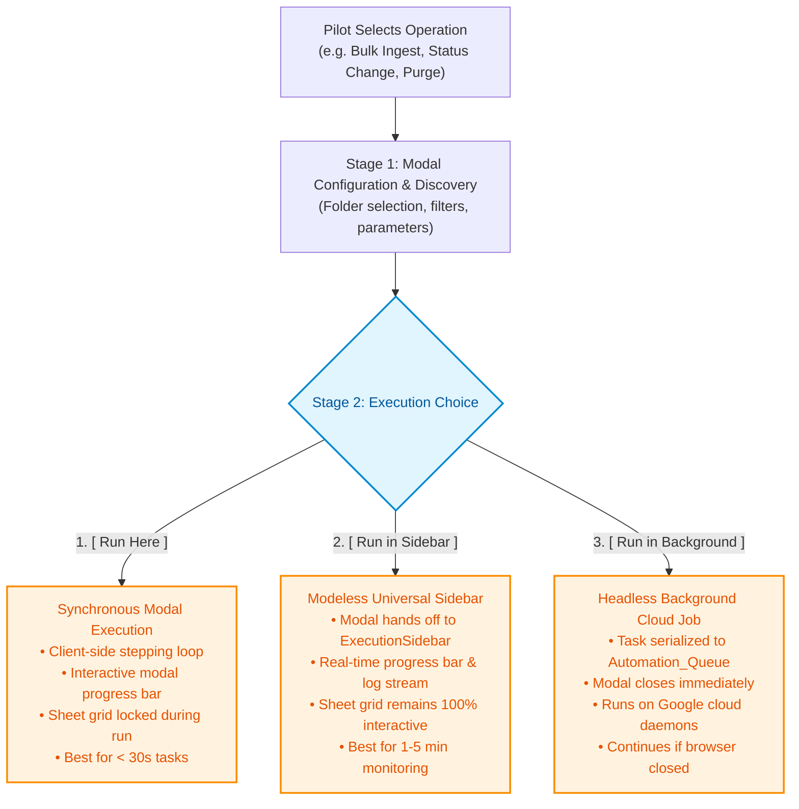
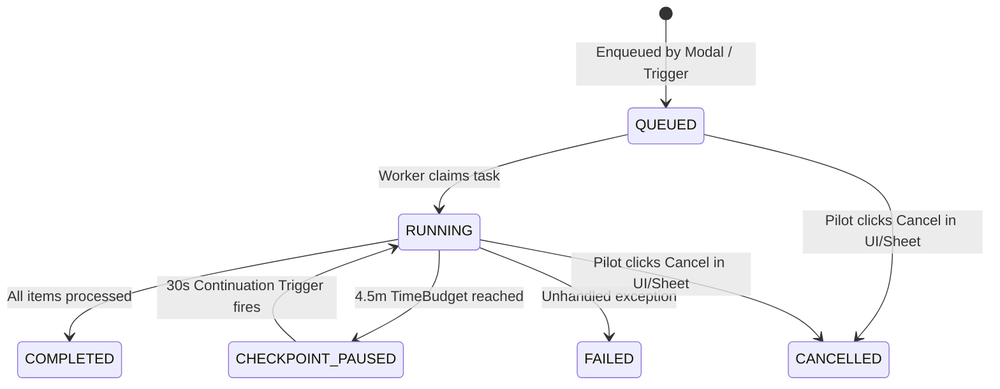

# Architecture View 02: Execution & Runtime Architecture
**Google Apps Script V8 Engine, Concurrency, Quotas & Tri-Mode Execution**

* **Status**: `Living Specification`
* **Parent Architecture**: [`Docs/Architecture/README.md`](file:///g:/My%20Drive/~RS2B/~Projects/ParaFlightLogProject/Docs/Architecture/README.md)
* **Governing Pattern**: [Pattern 4, 13, 14 (`Docs/Patterns_and_Practices.md`)](file:///g:/My%20Drive/~RS2B/~Projects/ParaFlightLogProject/Docs/Patterns_and_Practices.md)

---

## 1. Runtime Environment: Google Apps Script V8

**ParaFlightLog** executes entirely within the Google Apps Script (GAS) modern V8 engine. While offering zero hosting costs and deep Google Workspace integration, Apps Script imposes rigid platform constraints:

| Platform Constraint | Quota / Hard Limit | Architectural Guardrail |
| :--- | :--- | :--- |
| **Max Execution Time** | **6 minutes (360 seconds)** | **4.5-Minute Safety Threshold (`TimeBudgetService`)** checkpointing and self-continuation triggers. |
| **Simple Trigger Timeout** | **30 seconds** | `onOpen()` strictly restricted to lightweight menu registration (< 1s); never executes I/O. |
| **Client-Side RPC Timeout** | **~30–45 seconds** | Client-side chunked stepping (5–10 files per RPC) with UI progress bars. |
| **PropertiesService Storage** | **9 KB per property, 500 KB total** | **`Automation_Queue` Sheet Tab** provides unlimited persistent storage for large job payloads. |
| **URLFetch Daily Quota** | **20,000 calls / day** | 6-hour caching in `CacheService` and batch geocoding. |

---

## 2. Tri-Mode Execution Lifecycle

To prevent long-running tasks from locking the Google Sheets user interface, all long-running processes implement the **Tri-Mode Execution Pattern** ([`DSGN-UI-001`](file:///g:/My%20Drive/~RS2B/~Projects/ParaFlightLogProject/Docs/Design/DSGN-UI-001_Tri_Mode_Execution_and_Universal_Sidebar.md)):



---

## 3. Bounded 4.5-Minute Execution & Self-Continuation Engine

To prevent catastrophic script termination at Google's 6-minute cutoff, all batch processors run under the supervision of `TimeBudgetService` ([`Code/TimeBudget.gs`](file:///g:/My%20Drive/~RS2B/~Projects/ParaFlightLogProject/Code/TimeBudget.gs)):

```javascript
var budget = TimeBudgetService.create(270000); // 4.5 minutes safety threshold

while (hasMoreWork && budget.hasTimeRemaining()) {
  processNextBatch();
}

if (hasMoreWork) {
  // Checkpoint running cursor and state to Automation_Queue
  queueService.saveCheckpoint(jobId, currentState);
  // Schedule continuation trigger to resume automatically in 30 seconds
  ScriptApp.newTrigger('executeQueuedJobContinuation')
    .timeBased()
    .after(30000)
    .create();
}
```

---

## 4. Persistent Sheet-Backed Task Queue (`QueueService`)

Instead of relying on fragile script properties, long-running state is tracked on the dedicated `Automation_Queue` tab:



* **Schema**: `['Job ID', 'Type', 'Status', 'Progress', 'Started At', 'Updated At', 'Payload & State', 'Last Error']`.
* **Zero Quota Limit**: Stores large JSON flight manifests and cursor indices without hitting the 9 KB `PropertiesService` limit.
* **Pilot Transparency**: Pilots can inspect, monitor, or cancel running jobs directly by editing the `Status` cell on the `Automation_Queue` tab.

---

## 5. Client-Server RPC Gateway Architecture

Communication between HTML5 WebViews and Google Apps Script follows strict security and architecture rules:

1. **Public vs. Private Convention**:
   * Functions ending in trailing underscore (`function getRows_()`) are **private** and cannot be invoked from client-side WebViews.
   * Only explicit public wrapper functions in [`Code/Code.gs`](file:///g:/My%20Drive/~RS2B/~Projects/ParaFlightLogProject/Code/Code.gs) are callable via `google.script.run`.
2. **Standardized Response Envelope**:
   Every RPC handler returns a structured JSON envelope:
   ```json
   {
     "success": true,
     "data": { ... },
     "error": null
   }
   ```
3. **Chunked Stepping**:
   Batch operations (e.g. bulk ingestion, flight updates) process items in small chunks (5–10 items per RPC call). The client manages the progress bar and fires the next chunk, preventing the browser from hanging on long HTTP timeouts.

---

## 6. Implementation & Code Mapping

* **Orchestration & RPC Dispatcher**: [`Code/Code.gs`](file:///g:/My%20Drive/~RS2B/~Projects/ParaFlightLogProject/Code/Code.gs)
* **Time Budget Engine**: [`Code/TimeBudget.gs`](file:///g:/My%20Drive/~RS2B/~Projects/ParaFlightLogProject/Code/TimeBudget.gs)
* **Queue Service**: [`Code/QueueService.gs`](file:///g:/My%20Drive/~RS2B/~Projects/ParaFlightLogProject/Code/QueueService.gs)
* **Universal Sidebar UI**: [`Code/ExecutionSidebar.html`](file:///g:/My%20Drive/~RS2B/~Projects/ParaFlightLogProject/Code/ExecutionSidebar.html)
* **Automated Unit Tests**: [`tests/Test.gs`](file:///g:/My%20Drive/~RS2B/~Projects/ParaFlightLogProject/tests/Test.gs) (`testTimeBudget_`, `testQueueConstants_`, `testWorkerBatchRouting_`)
