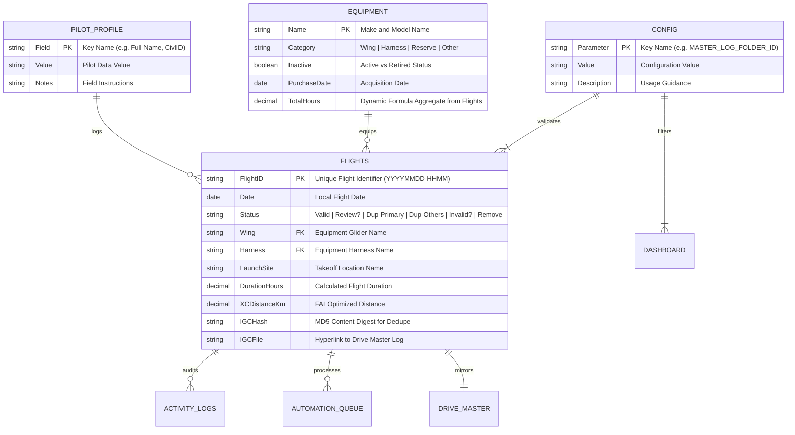

# Architecture View 03: Data & Storage Model
**Tabular Database Engine, Global Schemas, Named Ranges & Drive Object Store**

* **Status**: `Living Specification`
* **Parent Architecture**: [`Docs/Architecture/README.md`](file:///g:/My%20Drive/~RS2B/~Projects/ParaFlightLogProject/Docs/Architecture/README.md)
* **Governing Pattern**: [Pattern 1, 2, 7, 8, 14 (`Docs/Patterns_and_Practices.md`)](file:///g:/My%20Drive/~RS2B/~Projects/ParaFlightLogProject/Docs/Patterns_and_Practices.md)

---

## 1. Storage Paradigm: Google Sheets as a Reactive Database

**ParaFlightLog** utilizes Google Sheets as a single-tenant, reactive tabular relational database:
* **Cell Capacity**: Operates comfortably within Google Sheets' 10,000,000 cell ceiling (~70 columns $\times$ 10,000 flights = 700,000 cells $\approx 7\%$ of maximum capacity).
* **Reactive Compute**: Formulas compute instantly within Google's cloud spreadsheet engine, providing immediate feedback without server latency.
* **Separation of Metadata and Data**:
  * Rows 1–2: Title, system status, and filter banners.
  * Rows 3–4: Visual category grouping and column names.
  * Rows 5:N: **Zero-Loss Data Records** (treated as strictly read-only by automated maintenance scripts).

---

## 2. Entity Relationship Model (ERD)



---

## 3. The 8 Core Spreadsheet Tabs

The workbook enforces a strict 8-tab canonical structure:

| Index | Tab Name | Tab Color | Primary Purpose | Frozen Dimensions |
| :---: | :--- | :--- | :--- | :---: |
| **1** | **`Dashboard`** | Deep Navy (`#1A237E`) | KPI metrics, rolling currency timeline, top-5 leaderboards. | Rows 1–2 |
| **2** | **`Flights`** | Forest Green (`#1B5E20`) | Primary flight records substrate (70 columns). | Rows 1–4, Cols A–C |
| **3** | **`Pilot_Profile`** | Teal (`#00695C`) | Pilot identity, certifications, club affiliations, emergency SAR. | None |
| **4** | **`Equipment`** | Slate (`#455A64`) | Glider, harness, reserve inventory and airtime aggregation. | Rows 1–2 |
| **5** | **`User Guide`** | Charcoal (`#37474F`) | In-sheet operational instructions and metric dictionary. | None |
| **6** | **`Config`** | Amber (`#FF9800`) | Unified Parameters (Cols A–C) and Lookups (Cols E–N). | Rows 1–2 |
| **7** | **`Activity Logs`**| Dark Red (`#D32F2F`) | Operational event logs, audit history, process runs. | Rows 1–2 |
| **8** | **`Automation_Queue`**| Deep Purple (`#4A148C`)| Background task execution state and resume payloads. | Rows 1–2 |

---

## 4. Resilient Formulas & Named Ranges Infrastructure

To prevent formula `#REF!` errors when users add, remove, or reorder columns, all dynamic lookups and dashboard cards rely on **Workbook Named Ranges** ([`CR-SYS-009`](file:///g:/My%20Drive/~RS2B/~Projects/ParaFlightLogProject/Docs/Backlog.md)):

### Registered Named Ranges:
* **Dropdown Lookups**: `LOOKUP_EQUIPMENT_CATS`, `LOOKUP_FLIGHT_STATUSES`, `LOOKUP_FLIGHT_TYPES`, `LOOKUP_XC_CLASSES`.
* **Active Gear Lookups**: `LOOKUP_ACTIVE_WINGS`, `LOOKUP_ACTIVE_HARNESSES`, `LOOKUP_ACTIVE_RESERVES`, `LOOKUP_ACTIVE_OTHER` (Powered by native `=SORT(FILTER(...))` on `Config!K3:N`).
* **Dashboard Filter**: `DASHBOARD_REVIEW_FILTER` (`Dashboard!$B$2`), allowing KPI cards to bind dynamically without coordinate drift.

### Dynamic Column Map Pattern:
Code never assumes physical column letters (e.g. `col 11 = Wing`). It dynamically inspects Row 4 headers via `getColumnMap_()`:
```javascript
var map = getColumnMap_(sheet, 4);
var wingColIdx = map['Wing']; // Returns 0-based column index dynamically
```

---

## 5. Google Drive Object Store Taxonomy

All binary files (raw `.igc` tracklogs, `.zip` archives, `.json` backups) are organized in Google Drive across dedicated isolated folders:

```
Google Drive/
├── MASTER_LOG_FOLDER_ID/   <-- Canonical archive; SeeYou Cloud visualizer mirror
├── UPLOAD_FOLDER_ID/       <-- Staged incoming files from browser uploads
├── TRASH_FOLDER_ID/        <-- Soft-deleted duplicates and purged flights
└── ERROR_FOLDER_ID/        <-- Quarantined corrupt or unparseable tracklogs
```

* **Folder Authority Rule**: All folder IDs must be registered in the `Config` tab. The system **never** creates folders in Google Drive root. Missing folders immediately abort operations with clear pilot error dialogs.

---

## 6. Implementation & Code Mapping

* **Configuration & Schema Maps**: [`Code/Config.gs`](file:///g:/My%20Drive/~RS2B/~Projects/ParaFlightLogProject/Code/Config.gs)
* **Scaffolding & Named Ranges**: [`Code/Scaffold.gs`](file:///g:/My%20Drive/~RS2B/~Projects/ParaFlightLogProject/Code/Scaffold.gs)
* **Google Drive Pipeline**: [`Code/FileHandling.gs`](file:///g:/My%20Drive/~RS2B/~Projects/ParaFlightLogProject/Code/FileHandling.gs)
* **Automated Unit Tests**: [`tests/Test.gs`](file:///g:/My%20Drive/~RS2B/~Projects/ParaFlightLogProject/tests/Test.gs) (`testDashboardAndSchema_`, `testNativeSheetsResilience_`, `testDynamicFormulaResilience_`)
