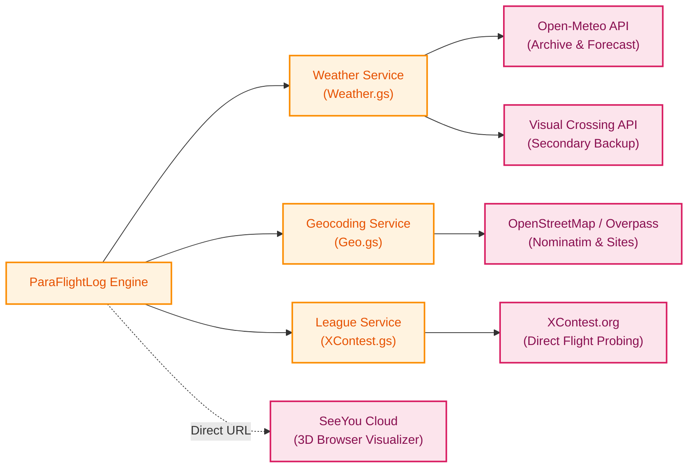

# Architecture View 04: Integration & External Gateways
**Third-Party Web Services, Weather APIs, Reverse Geocoding & League Verification**

* **Status**: `Living Specification`
* **Parent Architecture**: [`Docs/Architecture/README.md`](file:///g:/My%20Drive/~RS2B/~Projects/ParaFlightLogProject/Docs/Architecture/README.md)
* **Governing Pattern**: [Pattern 8, 9, 10 (`Docs/Patterns_and_Practices.md`)](file:///g:/My%20Drive/~RS2B/~Projects/ParaFlightLogProject/Docs/Patterns_and_Practices.md)

---

## 1. External Integration Overview

To provide rich flight context without forcing pilots into manual research, **ParaFlightLog** interfaces with four external web platforms using defensive, quota-aware HTTP gateways:



---

## 2. Gateway Specifications

### 2.1 Open-Meteo Weather Gateway (`Weather.gs`)
* **Dual-Endpoint Fallback Strategy**:
  1. *Recent Flights ($\le 5$ days old)*: Queries Open-Meteo Forecast API with `past_days=7` for high-resolution rapid atmospheric observations.
  2. *Historical Flights ($> 5$ days old)*: Queries Open-Meteo Historical Archive API (ERA5-Land reanalysis).
  3. *Secondary Fallback*: If Open-Meteo is unreachable, queries Visual Crossing Timeline API using `VISUAL_CROSSING_API_KEY`.
* **Atmospheric Math**:
  * *Lawrence Cloudbase Spread*: Calculates convective condensation level:
    $$\text{Cloudbase (AGL)} = (T_{\text{ambient}} - T_{\text{dew}}) \times 125\text{ m}$$
  * *16-Point Cardinal Wind Formatting*: Converts degree bearings to standard aviation compass text (e.g. `14 km/h WNW (gust 20)`).

### 2.2 Geographic Gateway (`Geo.gs`)
* **Reverse Geocoding (Nominatim)**:
  * Resolves raw GPS coordinates ($\text{lat}, \text{lon}$) to human-readable City, Region/State, and Country.
  * *Rate Limit & Quota Protection*: Enforces a mandatory $1.0\text{s}$ pause between consecutive external calls and caches responses in `CacheService` with a 6-hour TTL.
* **Site Detection (Overpass & Paragliding Earth)**:
  * Queries bounding-box geographic features tagged `sport=paragliding` and `sport=hang_gliding`.
  * Matches launch and landing fixes against cataloged site names within a $1{,}500\text{m}$ radius.

### 2.3 XContest Verification & Direct Flight Probing (`XContest.gs`)
* **Direct Flight Probing**:
  * Bypasses client-side JavaScript rendering and Cloudflare Turnstile token verification by probing deterministic URL endpoints using UTC flight dates and candidate launch times ($\pm 2\text{ min}$ tolerance).
* **UTC Midnight Protection**:
  * Converts dates using UTC epoch offsets rather than local script timezones, preventing Western hemisphere timezones (UTC-6/7) from rolling back flight dates when processing tracks logged near midnight UTC.
* **Competition Claim Deadline (FAI Rule 3.1)**:
  * If a flight is found, extracts the internal database flight ID (`fl=...`) and creates a clickable hyperlink (e.g. `=HYPERLINK(..., "XC#6952654")`).
  * If unmatched, evaluates the flight date against the strict 14-day competition deadline:
    * $\le 14\text{ days}$: Sets status to `'Claim soon!'`.
    * $> 14\text{ days}$: Sets status to `'Expired'`.

### 2.4 SeeYou Cloud 3D Visualizer Link
* Generates zero-install, interactive 3D flight visualization links directly on Column 6 of `Flights`:
  ```
  https://seeyou.cloud/flight?file=https://drive.google.com/uc?export=download&id=<MASTER_FILE_ID>
  ```
* Pilots click the link to immediately open high-resolution 3D terrain replay, barogram inspection, and thermal turn analysis in any browser.

---

## 3. Implementation & Code Mapping

* **Weather Gateway**: [`Code/Weather.gs`](file:///g:/My%20Drive/~RS2B/~Projects/ParaFlightLogProject/Code/Weather.gs)
* **Geocoding & Takeoff Gateway**: [`Code/Geo.gs`](file:///g:/My%20Drive/~RS2B/~Projects/ParaFlightLogProject/Code/Geo.gs)
* **XContest Probing**: [`Code/XContest.gs`](file:///g:/My%20Drive/~RS2B/~Projects/ParaFlightLogProject/Code/XContest.gs)
* **Automated Unit Tests**: [`tests/Test.gs`](file:///g:/My%20Drive/~RS2B/~Projects/ParaFlightLogProject/tests/Test.gs) (`testXContest_`, `testWeather_`, `testGeo_`)
