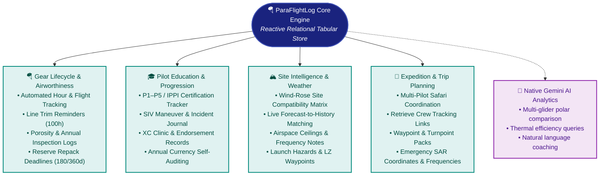

# 🪂 ParaFlightLog: The Intelligent, Sovereign Paragliding Platform
### *A Modern Flight Analytics, Gear Lifecycle & Automation Engine Built on Open Principles*

---

> **"Your Flight Data. Sovereign. Intelligent. Infinitely Extensible."**
> 
> *A high-performance, private, zero-cost personal flight operations center that runs entirely within your personal Google Workspace. No monthly subscriptions. No proprietary clouds. No vendor lock-in.*

---

## 1. The Manifesto: Flight Data in an Era of Walled Gardens

### The Pilot's Dilemma
Every free-flight pilot understands the struggle of fragmented data. Over a flying career, your tracklogs become scattered across a dozen incompatible ecosystems:
* Dedicated flight computers (**Flymaster**, **XC Tracer**, **Oudie**, **Syride**).
* Mobile cockpit apps (**XCTrack**, **FlyMe**, **SeeYou Navigator**, **Garmin**).
* Online contest servers (**XContest**, **DHV-XC**, **Leonardo**).
* Miscellaneous folders of `.igc` and `.gpx` files lost across multiple hard drives.

When a commercial flight-tracking service introduces a monthly subscription, changes its terms, or shuts down, **your hard-earned airtime and flight history are held hostage**. Commercial flight logbooks treat your data as their proprietary asset, locking your statistics behind paywalls and denying you the ability to deeply query, customize, or extend your records.

### The ParaFlightLog Vision
**ParaFlightLog** was born from a fundamental belief: **A pilot should have absolute sovereignty over their flight records.**

We built an enterprise-grade flight analytics, equipment maintenance, and automation engine that runs **100% inside your personal Google Drive and Google Sheets**. It combines the zero-cost scalability of cloud serverless computing with the familiar, flexible power of a spreadsheet—empowered by native **Gemini AI** to deliver insights no closed app can match.

---

## 2. Core Capabilities: Flight Logging Reimagined

```
┌────────────────────────────────────────────────────────────────────────┐
│                        PARAGLIDING FLIGHT ENGINE                       │
├─────────────────┬───────────────────┬─────────────────┬────────────────┤
│ 📥 INGESTION    │ 🧮 PHYSICS        │ 🌦️ ENRICHMENT   │ 📊 COCKPIT     │
│ • Drag & Drop   │ • Thermal Detect  │ • Open-Meteo    │ • KPI Banners  │
│ • Cloud URLs    │ • Ridge Soaring   │ • Wind at Launch│ • 6-Mo Currency│
│ • Watch Folders │ • Glide L/D Ratio │ • Cloudbase (m) │ • 8 Leaderboard│
│ • Multi-Archive │ • FAI XC Scoring  │ • OSM Geocoding │ • Dynamic Top 5│
│ • Smart Dedupe  │ • RDP Optimizer   │ • XContest Sync │ • SeeYou 3D    │
└─────────────────┴───────────────────┴─────────────────┴────────────────┘
```

### 📥 1. Zero-Friction Multi-Source Ingestion
* **Drag-and-Drop Web Uploader**: Drop single IGC files or compressed archives directly into the browser.
* **Continuous Drive Watch Folders**: Set up a dedicated folder in Google Drive. Drop your flight files from your phone or instrument, and ParaFlightLog automatically ingests, processes, and archives them in the background.
* **Bulk Archive Unpacking**: High-speed batch processing for `.zip` and `.gz` archives, effortlessly onboarding 500+ historical flights in minutes.
* **Smart Heuristic Deduplication**: Multi-criteria matching pairs dual-device recordings (e.g. your phone running XCTrack plus your backup audio vario), grading track quality (0–100 pts) and labeling primary vs. secondary logs without corrupting your statistics.

### 🧮 2. Aeronautical Physics & FAI Scoring Engine
* **Automated Flight Regime Classification**: Sliding-window physics algorithms decompose every second of your flight into **Thermal Climb**, **Dynamic Ridge Soaring**, and **Straight Glide**.
* **Climb & Glide Diagnostics**: Computes peak integrated 10s climbs, maximum sink, average thermal efficiency, and true aerodynamic glide ratios ($L/D$).
* **FAI Cross-Country Optimization**: Built-in Ramer-Douglas-Peucker (RDP) trajectory simplification and brute-force 3-Turnpoint optimization for **Free Distance**, **Out-and-Return**, **Flat Triangle**, and **FAI Triangle** scoring.

### 🌦️ 3. Meteorological & Geographic Enrichment
* **Historical Weather Backfill**: Automatically queries meteorological archives to pinpoint surface wind speeds, gusts, cardinal directions, ambient temperature, cloud cover %, and estimated boundary-layer cloudbase heights at the exact minute and coordinates of takeoff and landing.
* **Automated Site Resolution**: Uses OpenStreetMap and global paragliding site databases to automatically identify takeoff site names, landing towns, counties, and countries.

### 🏆 4. Competition & League Sync
* **Native XContest Probing**: Directly validates flights against XContest.org servers, links permanent competition IDs, and alerts you if a flight is approaching the strict 14-day claiming deadline.
* **One-Click 3D Visualization**: Instant hyperlink generation to inspect your flight in 3D terrain on **SeeYou Cloud**.

### 📊 5. Personal Cockpit & Currency Dashboard
* **Instant KPI Banners**: High-contrast career and year-to-date summaries displaying total flights, cumulative airtime hours, and cross-country kilometers.
* **Rolling 6-Month Pilot Currency Monitor**: Dynamic safety indicators (Green / Yellow / Orange) monitoring your recent airtime to ensure you stay current and safe.
* **8-Card Personal Hall of Fame**: Dynamic leaderboards celebrating your top 5 longest flights, highest altitudes, biggest thermal climbs, and peak ground speeds.

---

## 3. A Peek Under the Hood: The Genius of Google Sheets + Apps Script

Why build an advanced flight operations platform on **Google Sheets** and **Google Apps Script** instead of a traditional mobile app or web SaaS?

| Traditional Flight Apps (SaaS) | The ParaFlightLog Model |
| :--- | :--- |
| **Subscription Lock-in**: $50–$120/year forever. | **100% Free Forever**: Runs on Google's free consumer tier. |
| **Data in Silos**: Your flights reside on corporate servers. | **Absolute Sovereignty**: Stored directly in your private Google Drive. |
| **Rigid Layouts**: You can only view what the developer designed. | **Infinitely Hackable**: Create custom charts, pivot tables, and columns. |
| **App Discontinuation Risk**: If the startup fails, data is lost. | **Permanent Durability**: Standard spreadsheet and IGC files last for decades. |
| **Limited AI**: Generic stats or rudimentary summaries. | **Native Gemini AI**: Query your flight history in plain English. |

### 🛠️ The Power of Single-Tenant Serverless
* **Zero Infrastructure Overhead**: No Docker containers to manage, no Linux updates, no database connection strings. Google manages 99.9% uptime, backup redundancy, and security.
* **Universal Multi-Device Access**: Seamlessly review and log flights on your desktop workstation, your iPad in the campervan, or your smartphone at the landing field via native Google Sheets mobile apps.
* **Complete Portability**: Your data is always ready for instant export to CSV, Microsoft Excel, GeoJSON, or JSON.

---

## 4. The AI Powerhouse: Native Gemini Intelligence

Because ParaFlightLog lives inside Google Sheets, you unlock direct integration with **Google Gemini**. You can interrogate your entire flying history using natural human language—no complex formulas required:

> **💬 "Gemini, compare my glide ratios and ground speeds on my Ozone Rush 6 versus my previous wing when flying into headwinds exceeding 15 km/h."**

> **💬 "Gemini, analyze all flights launched from Mount Tamalpais over the last two years. What wind direction and time of day yielded my highest thermal climb rates?"**

> **💬 "Gemini, summarize my airtime progression, thermalling percentage, and highest altitude gains over the past 12 months in a format suitable for my FAI Advanced Pilot certification renewal."**

Gemini acts as your personal aerodynamicist and flight coach, transforming passive tracklogs into actionable flying intelligence.

---

## 5. Beyond the Logbook: An Expandable Flight Operations Platform

ParaFlightLog is engineered not merely as a historical diary, but as a **comprehensive paragliding operations center**:



### 🪂 1. Intelligent Equipment Lifecycle & Airworthiness
* **Automated Usage Logging**: Your gliders, harnesses, and reserves automatically accumulate flight hours and launch counts directly from your flight rows.
* **Proactive Safety Alerts**: Visual indicators flag when a wing reaches its 100-hour line trim check, when fabric porosity testing is recommended, or when a reserve parachute reaches its 180-day / 360-day repack deadline.

### 🎓 2. Pilot Education & Progression Matrix
* **Rating & Endorsement Tracking**: Structured competency tracking for national associations (USHPA, BHPA, DHV, HPAC) and international FAI / IPPI licensing.
* **SIV & Maneuver Journal**: Record maneuvers executed during safety clinics (asymmetric collapses, stalls, spirals) with wing-specific notes and instructor feedback.

### 🏔️ 3. Flying Site Intelligence & Weather Matrix
* **Centralized Site Registry**: Maintain detailed notes on launches, landing fields, frequency channels, site regulations, and airspace ceilings.
* **Predictive Weekend Matching**: Compare upcoming weekend meteorological forecasts with your personal historical flight data to recommend which local site offers the highest probability of good flying.

### 🧭 4. Expedition & Trip Planning
* Store launch coordinates, LZ waypoints, emergency radio frequencies, retrieve vehicle contact details, and Garmin inReach MapShare links for cross-country flying safaris.

---

## 6. Execution Freedom: The Tri-Mode Engine

Long-running flight imports and historical backfills should never lock up your computer. ParaFlightLog introduces the **Tri-Mode Execution Subsystem** (`DSGN-UI-001`):

```
[ 🚀 Run Here ]          [ 📌 Run in Sidebar ]         [ ⚙️ Run in Background ]
Modal dialog execution    Modeless execution docked     Headless batch queue
with instant feedback.    to the side while you work.   with auto-continuation.
```

1. **Run Here (Modal)**: Traditional high-context dialog for quick, single-flight tasks.
2. **Run in Sidebar (Modeless)**: Docks execution to a compact 300px side panel. Continue browsing your logbook, filtering flights, or checking gear while progress bars update in real time.
3. **Run in Background (Headless)**: Closes the interface immediately and delegates the workload to an automated queue. Bounded by an intelligent **4.5-minute time budget**, large batch jobs automatically save progress and self-schedule continuation triggers without hitting Google Apps Script timeouts.

---

## 7. Where We Stand Today: Current Operational Capabilities

ParaFlightLog is currently in **active production deployment (v1.x / v2.0 Ready)**, powering daily personal flight operations with rock-solid reliability:

| Capability Area | Current Operational Status | Key Subsystems & Highlights |
| :--- | :---: | :--- |
| **Multi-Source Ingestion** | ✅ **Live & Operational** | Drag-and-drop web uploader, Drive folder/URL import, `.zip`/`.gz` extraction, continuous Watch Folder scanning, and high-speed bulk batching. |
| **Aero Physics Engine** | ✅ **Live & Operational** | Sliding-window thermalling, ridge soaring, and glide detection; climb/sink rate integration; $L/D$ aerodynamic efficiency. |
| **FAI Cross-Country Scoring** | ✅ **Live & Operational** | RDP trajectory optimization, 3-turnpoint brute-force solver, Free Flight, Out-and-Return, Flat Triangle, and FAI Triangle scoring. |
| **Meteorological Backfill** | ✅ **Live & Operational** | Open-Meteo historical archive API with 7-day forecast fallback; surface winds, gusts, temps, cloud cover, and Lawrence cloudbase spread. |
| **Geographic Site Resolution** | ✅ **Live & Operational** | OpenStreetMap Nominatim reverse geocoding & Overpass API site detection; 6-hour caching in `CacheService`. |
| **Contest League Probing** | ✅ **Live & Operational** | Direct XContest flight probing with Cloudflare bypass, UTC date shifting, permanent flight ID linking, and 14-day claim deadline countdown. |
| **Cockpit Dashboard** | ✅ **Live & Operational** | Resilient 6-column layout with career/YTD KPI banners, 6-month pilot currency alerts (Green/Yellow/Orange), and 8 dynamic leaderboards. |
| **Tri-Mode Execution** | ✅ **Live & Operational** | Foreground Modal (`Run Here`), Modeless Sidebar (`Run in Sidebar`), and Headless Background Queue with 4.5-minute time budgeting. |
| **Data Integrity & Dedupe** | ✅ **Live & Operational** | Row-based MD5 hashing on `Flights` (Col 70), multi-criteria heuristic overlap detection, 0–100 pt sensor quality scoring, and duplicate pairing. |
| **Configuration Management**| ✅ **Live & Operational** | 49 parameters across 9 sections, 10 lookups, and granular 5-group JSON export/import with dynamic UI protection. |

---

## 8. Strategic Roadmap: The 5 Horizons of Evolution

ParaFlightLog is evolving systematically from a private flight operations engine into a globally accessible, community-governed open-source platform:

```mermaid
timeline
    title ParaFlightLog Strategic Evolution
    section Horizon 1 : Current State
      Single-Pilot Core Engine : Aeronautical Physics : Weather & Geo Backfill : Zero Black-Box Dedupe : Cockpit Dashboard
    section Horizon 2 : v2.0 Active
      Tri-Mode Execution : Universal Execution Sidebar : Persistent Automation_Queue : Table-Driven Automation Engine
    section Horizon 3 : v2.5 Pre-OSS
      Multi-Instance Distribution & Updater : Guided Task Wizards : Pre-OSS Quality & Security Audit : Automated AI Testing Harness
    section Horizon 4 : v3.0 Public Launch
      Public Open-Source Release : Golden Starter Sheet : Community Governance & RFCs : Plugin Architecture
    section Horizon 5 : v3.5+ Global Ecosystem
      Equipment Airworthiness Engine : Pilot Progression & SIV Matrix : Site Intelligence & Weather Matrix : Expedition Planning
```

### Roadmap Highlights:
* **Horizon 2 (v2.0)**: Extends our live Tri-Mode Execution engine into a full **Table-Driven Automation Engine** (`DSGN-AUT-001`), allowing pilots to configure recurring automation triggers and pipelines from a simple spreadsheet tab.
* **Horizon 3 (v2.5)**: Introduces a **Non-Destructive Multi-Instance Updater** (`RQ-SYS-010`) to deploy code and schema updates across distributed pilot sheets without touching flight data, paired with automated AI test suites (`CR-DEV-004`) and strict PII scrubbers (`CR-SEC-001`).
* **Horizon 4 (v3.0)**: **Public Open-Source Launch** on GitHub under the MIT License, featuring a one-click **Golden Starter Sheet** that allows any pilot in the world to launch their own sovereign logbook in under 3 minutes.
* **Horizon 5 (v3.5+)**: Full expansion into **Equipment Airworthiness Management**, **Pilot Education & Progression**, and **Flying Site Intelligence**.

---

## 9. Open Source, Community & Extensibility

ParaFlightLog is **100% open source** released under the permissive **MIT License**.

* **No Walled Gardens**: Built by pilots, for pilots. The code is completely auditable, transparent, and forkable.
* **Plugin-Ready Architecture**: Easily create custom hardware parsers, connect to regional league servers, or integrate local weather stations.
* **Community-Driven Evolution**: Participate in design discussions, propose new features via RFCs, and contribute improvements back to the global free-flight community.

---

## 10. Take Flight in 3 Minutes

Getting started requires no software installation, no command line, and no server configuration:

1. **Make a Copy**: Open the public **Golden Starter Sheet** and click `File > Make a copy` into your personal Google Drive.
2. **Run the Setup Wizard**: Click `Flight Log > First-Time Setup Wizard`. The system guides you through selecting your Drive storage folders and entering your pilot name.
3. **Drop Your Flights**: Drag and drop your `.igc` files or paste a Google Drive folder link.
4. **Enjoy Sovereign Analytics**: Watch your personal dashboard populate with rich aeronautical data, weather, and leaderboards!

---

*Fly far, fly safe, and own your sky.* 🪂✨
