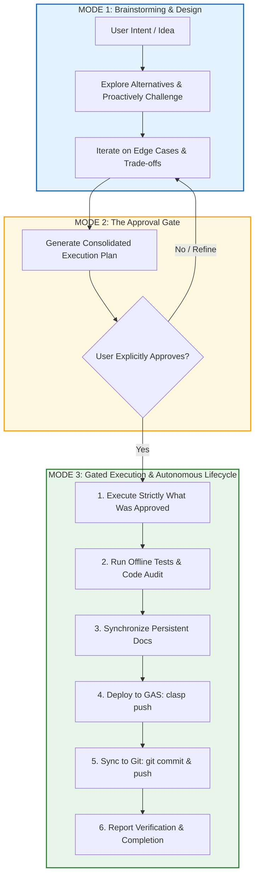

# Project Context & Ways of Working (Source of Truth)

## 🧠 Agent Memory & Context
**Status**: Active Production & Continuous Evolution (v2.2.2)
**Last Session Focus**: Flight Updates Sidebar Resync Flight IDs Execution, Authoritative Date Column Parity Repair, Full-Height Sidebar Console, and Complete Activity Logs Telemetry (`Bug-UI-013`), Flight Updates Redesign (`CR-MNT-006`), Codebase Restructuring & Modularization Exploration (`CR-DEV-005`), Dashboard Leaderboards Decoupling (`CR-DSH-003`).
**Next Focus**: Codebase Restructuring & Architectural Modularization (`CR-DEV-005`), Pilot Resources Directory (`CR-SYS-012`), Flight Data Export Utility (`CR-EXP-001`), and CSV Flight Import (`CR-ING-010`).

This file is the **long-term memory** for the project. Read this first to understand *how* we work and *where* we are.

---

## 📂 Project Organization & File Structure
The project follows a strict folder hierarchy. `Docs/Context.md` is the source of truth for this structure.

### 1. `Docs/` (Persistent Documentation)
*   **Status**: **Git Tracked**.
*   **Purpose**: Long-term, evolving documentation. Source of Truth.
*   **Hierarchy Model**: Organized across **5 Altitudes / Tiers** to cater to distinct audiences (prospective pilots, active users, architects, and AI agents):

| Tier / Altitude | Focus & Target Audience | Core Files |
| :--- | :--- | :--- |
| **Tier 1: Strategic Vision** | Long-term intent, 5 Evolution Horizons, Open-Source roadmap & non-negotiable architectural tenets. *(Stakeholders, Community, AI)* | [`Roadmap.md`](./Roadmap.md) |
| **Tier 2: Public Manifesto** | High-level platform whitepaper, value proposition, Gemini AI advantage & "Why Sheets + Apps Script". *(World, Pilots, Clubs)* | [`Brochure.md`](./Brochure.md) |
| **Tier 3: Product & Operations** | Comprehensive functional capabilities catalog and complete pilot operational handbook. *(End-User Pilots, Flight Instructors)* | [`Features.md`](./Features.md)<br>[`User_Guide.md`](./User_Guide.md) |
| **Tier 4: Systems Architecture** | C4 serverless topology, global ERD model, 8-sheet unified data dictionary, math algorithms, and RFC design specs. *(Architects, Devs, AI)* | [`Architecture.md`](./Architecture.md)<br>[`Technical_Specification.md`](./Technical_Specification.md)<br>[`Patterns_and_Practices.md`](./Patterns_and_Practices.md)<br>[`Design/`](./Design/README.md) (`DSGN-*.md`) |
| **Tier 5: Execution & Memory** | Tracked work units (`RQ`, `CR`, `Bug`), release history, and engineering memory / ways of working. *(Developers, AI Pair Programmers)* | [`Backlog.md`](./Backlog.md)<br>[`ChangeLog.md`](./ChangeLog.md)<br>[`Context.md`](./) |

*   **File Inventory**:
    *   **`Roadmap.md`**: Strategic Vision, 5 Evolution Horizons & Open-Source Roadmap.
    *   **`Brochure.md`**: Public Manifesto, Product Brochure & Platform Whitepaper.
    *   **`Architecture.md`**: Systems Architecture, Global Schemas, ERD & Unified Data Dictionary.
    *   **`Context.md`**: Project Context, Ways of Working & Agent Long-Term Memory.
    *   **`User_Guide.md`**: Complete Pilot Handbook, Setup Walkthrough & Metric Dictionary.
    *   **`Features.md`**: Functional capabilities (Admin, UI, System).
    *   **`Technical_Specification.md`**: Detailed Tech Specs, Math Algorithms & Code Reference.
    *   **`Patterns_and_Practices.md`**: Engineering Patterns & Architectural Best Practices (Dynamic Column Resolution, Native Named Ranges, Modern Array Formulas, TimeBudget Daemons, Anti-Patterns).
    *   **`Design/`**: Formal Architectural & Detailed Design Specifications (`DSGN-*.md`), Template (`Design_template.md`), and Index (`README.md`).
    *   **`Backlog.md`**: Requirements, CRs, Bugs.
    *   **`ChangeLog.md`**: Historical record.

### 2. `Plans/` (Transient Execution)
*   **Status**: **NOT Git Tracked** (Local only).
*   **Purpose**: Disposable planning documents and session artifacts.
*   **Files**: `implementation_plan.md`, `task.md`, `walkthrough.md`.
*   **Sub-folders**:
    *   **`Archive/`**: Old plans/tasks.
    *   **`SessionSummary/`**: Session Summary Reports (`YYYY-MM-DD_SessionSummary.md`).
    *   **`CodeCheckReports/`**: Code Review Reports (`YYYY-MM-DD_CodeCheck.md`).
    *   **`DocCheckReports/`**: Documentation Audit Reports (`YYYY-MM-DD_DocCheck.md`).
    *   **`AuditReports/`**: Architectural and Subsystem Audit Reports (`YYYY-MM-DD_<Topic>_Audit.md`), structured using [`Audit_Template.md`](../Plans/AuditReports/Audit_Template.md).

### 3. `Code/` (Production Runtime Implementation)
*   **Status**: **Git Tracked & Clasp Deployed**.
*   **Purpose**: Strictly production code executed by the active Google Sheet, user dialogs, and automated triggers.
*   **Files**: Exactly 37 production files (17 `.gs` controllers/services, 19 `.html` modals/sidebars, and `appsscript.json`).
*   **Deployment**: Pushed directly to Google Apps Script via `clasp push -f`. Test and audit tooling are strictly excluded via `.claspignore`.

### 4. `tests/` (Developer Testing & Simulation)
*   **Status**: **Git Tracked (Local / CI Only - Excluded from Clasp)**.
*   **Purpose**: Local unit test suites, regression tests, and simulation fixtures (`tests/Test.gs`).
*   **Execution**: Run locally via Node.js offline runners (`node tools/run_all_offline_tests.js`) in milliseconds with zero quota consumption.

### 5. `tools/` (Developer & CI Tooling)
*   **Status**: **Git Tracked (Local / CI Only - Excluded from Clasp)**.
*   **Purpose**: Automated code verification tools, static analysis scanners (`tools/code_check_audit.js`), test runners (`tools/run_all_offline_tests.js`), and maintenance utilities.


---

## 🛠 Ways of Working (Standard Operating Procedures)

### 1. Three-Mode Governance & Strict Pre-Execution Gate
All project work strictly operates within one of three sequential modes to prevent premature execution, dropped requirements, and unauthorized scope creep:



*   **Mode 1: Brainstorming & Design (Full Creative Latitude)**:
    *   When exploring requirements, ideas, proposals, or troubleshooting: The AI assistant has full latitude to proactively challenge assumptions, propose alternative patterns, suggest optimizations, and bring up edge cases.
    *   **Strict Invariant**: No production code, configuration, persistent documentation, or Google Sheets UI elements are modified during this mode.
*   **Mode 2: The Consolidated Execution Contract (The Approval Gate)**:
    *   When brainstorming concludes or multiple iterative discussions have occurred, the AI assistant must produce a single, freshly synthesized, comprehensive Execution Plan.
    *   **The Plan must explicitly enumerate**:
        1. Exact files to modify, create, or delete.
        2. Exact parameters, schemas, and manifest version bumps.
        3. Every user-facing UI touchpoint (menus, dialogs, sidebars, sheets, headers). If a UI item is not in the plan, it does not exist.
        4. Testing and verification criteria.
    *   **Strict Invariant**: Execution cannot proceed on fragmented past messages. The consolidated plan is the sole contract.
*   **Mode 3: Gated Execution (Strict Discipline & Autonomous Lifecycle)**:
    *   Triggered **ONLY** when the user explicitly provides unambiguous approval (e.g., *"Approved"*, *"Execute"*, or *"Go ahead"*).
    *   **Strict Invariants**:
        1. **Zero Out-of-Scope Changes**: Implement strictly what was approved in the plan—no unilateral "drive-by" features or "convenience" helpers.
        2. **Google Sheets UI Immutability**: Changes to the Google Sheet UI (menus, custom sidebars, modal dialogs, sheet tabs, header structures, column notes) require explicit intent, documentation, and an approved plan. Unapproved menu items or UI affordances are strictly forbidden.
        3. **Verification Invariant**: Automated tests (`tools/run_all_offline_tests.js`) and architectural audits (`tools/code_check_audit.js`) must be executed and achieve 100% pass before declaring completion.
        4. **Mandatory Documentation Synchronization**: Persistent documentation (`Context.md`, `Backlog.md`, `ChangeLog.md`, and any relevant `Architecture.md` / `Features.md`) must be synchronized in the same execution turn.
        5. **Mandatory Apps Script Deployment (`clasp push`)**: Whenever files in `Code/` are modified, the assistant must directly execute `clasp push` via `run_command`. Deployment is NEVER offloaded to the user.
        6. **Mandatory Git Synchronization (`git push`)**: All changed files must be staged, committed with descriptive conventional commit messages (citing ticket IDs), and pushed to `origin/master` via `run_command`.
        7. **Autonomous Completion Contract**: Work is never declared complete until tests pass, docs are synchronized, `clasp push` succeeds, and `git push` succeeds. The final response must present verified results and require zero manual CLI actions from the user.

### 2. Document-First Development
*   **`Roadmap.md`**: Define the *strategic vision, non-negotiable tenets, and evolution horizons*.
*   **`Brochure.md`**: Define the *public value proposition, pilot benefits, and platform overview*.
*   **`Features.md`**: Define the *functional capabilities and product features*.
*   **`Architecture.md` & `Technical_Specification.md`**: Define *how* the system is topologically structured, global schemas, and algorithmic implementation details.
*   **`Design/` (`DSGN-*.md`)**: Define *subsystem RFC specifications* prior to non-trivial code execution.
*   **`Backlog.md`**: Track *status* of implementation units (`RQ`, `CR`, `Bug`, `ToDo`).
*   **`Code/`**: Implement only after documentation and design specifications are fully aligned.

### 3. Backlog Management (`Docs/Backlog.md`)
The backlog has 5 strict sections:
1.  **Description**: Meta-info on usage.
2.  **ToDos**: Future tasks (Checkbox, Status, Importance, Description).
    *   *Status Flags*: `Open`, `WIP`, `Completed`, `Discarded`.
3.  **Requirements (`RQ`)**: Nested Hierarchy (Module -> Function).
    *   *Structure*: Checkbox | ID | Status | Phase | Description.
    *   *Status Flags*: `Open`, `Implemented`, `Partially Implemented`, `Future`, `Blocked`, `Discarded`.
    *   *Rule*: "Implemented" only if ALL children are implemented.
4.  **Change Requests (`CR`)**: Flat list linking to Implemented Requirements.
    *   *Status Flags*: `Open`, `Implemented`, `Blocked`, `Discarded`, `Future`.
5.  **Bugs (`Bug`)**: Flat list linking to Requirements or CRs.

### 4. Change Logging (`Docs/ChangeLog.md`)
*   Update at the end of every session.
*   Group by **Session** and **Date**.
*   List all `[Imp]` (Implemented) items from Backlog.

### 5. Session Summary Reports (`Plans/SessionSummary/`)
*   **Naming**: `YYYY-MM-DD_SessionSummary.md` (e.g. `2026-02-10_SessionSummary.md`).
*   **Purpose**: A snapshot of the session's achievements, discussions, and decisions.
*   **Structure**:
    1.  **Metadata**: Date, Time, Goal.
    2.  **Key Discussions**: Brief bullet points of what was discussed.
    3.  **Decisions Made**: Architectural or Product decisions.
    4.  **Work Completed**: Files changed, Features implemented, Bugs fixed.
    5.  **Open Issues / Next Steps**: What was left undone or added to backlog.
    6.  **References**: Links to relevant artifacts or docs.

### 6. Code Check Reports (`Plans/CodeCheckReports/`)
*   **Naming**: `YYYY-MM-DD_CodeCheck.md`.
*   **Purpose**: Result of automated or manual code reviews (`/code_check`).
*   **Structure**:
    1.  **Metadata**: Date, Scope (All files or specific module).
    2.  **Summary**: Pass/Fail/Warn status.
    3.  **Critical Issues**: Bugs, Logic Errors (Must Fix).
    4.  **Warnings**: Style, Optimization, Readability (Should Fix).
    5.  **Suggestions**: Refactoring ideas (Nice to have).

### 7. Doc Check Reports (`Plans/DocCheckReports/`)
*   **Naming**: `YYYY-MM-DD_DocCheck.md`.
*   **Purpose**: Result of automated documentation synchronization audits (`/doc_check`).
*   **Structure**:
    1.  **Metadata & Scope**: Date, audit scope, reference commit.
    2.  **Executive Summary**: Pass/Warn/Fail status and discrepancy counts.
    3.  **Code-to-Doc Drift**: Modules, functions, and config parameters.
    4.  **Cross-Doc Consistency & Duplication**: Stale versions and conflicting guidelines.
    5.  **Backlog Traceability**: Status alignment with actual code features.
    6.  **Stale References & Dead Links**: Obsolete names or broken links.
    7.  **Proposed Remediation Plan**: File-by-file update plan.

### 8. Architectural & Subsystem Audit Reports (`Plans/AuditReports/`)
*   **Naming**: `YYYY-MM-DD_<Topic>_Audit.md` (e.g. `2026-10-02_Dynamic_Formula_Resilience_Audit.md`).
*   **Purpose**: Formal capture of in-depth architectural audits, schema inspections, UI resiliency scans, performance benchmarks, and subsystem investigations so findings are permanently preserved.
*   **Standard Template**: [`Plans/AuditReports/Audit_Template.md`](../Plans/AuditReports/Audit_Template.md).
*   **Standard Structure**:
    1.  **Metadata**: Audit ID (`AUD-*`), Date, Auditor, Scope, Status.
    2.  **Executive Summary**: High-level problem statement and verdict.
    3.  **Audit Scope & Methodology**: Inspected files, boundaries, and techniques.
    4.  **Findings & Risk Analysis Matrix**: Categorized findings with Severity, Location, Root Cause, and Impact.
    5.  **Detailed Findings & Root Cause Analysis**: Technical deep dive into failure modes.
    6.  **Options Analysis & Trade-Offs**: Evaluated alternatives (e.g., Script workarounds vs. Native Google Sheets mechanisms).
    7.  **Remediation Plan & Recommendations**: Concrete, prioritized action steps and Backlog (`CR-*` / `Bug-*`) links.
    8.  **Test Strategy & Verification Criteria**: How fixes are validated offline and in-app.

### 9. Architectural Design Specifications (`Docs/Design/` & `/update_design`)
*   **Standards**: All significant subsystems, engines, and features maintain formal design specifications following [`Docs/Design/Design_template.md`](./Design/Design_template.md).
*   **Hierarchical Linking**: Header metadata explicitly establishes `Parent Design` and `Child Designs` links for bidirectional architectural navigation.
*   **Revision Synchronization**: Every umbrella code file in `Code/` maintains matching `@design` and `@revision` JSDoc header tags. When a design's revision increments, the corresponding code header is stamped to prevent design-code drift.
*   **Workflow (`/update_design`)**: Supports three operational modes: (1) New Design from template, (2) Sync / Delta Update from recent decisions or code edits, and (3) Reverse-Engineering designs from active working code.

### 10. Code Standards
*   **Naming**: `Service.gs` for modules. `privateFunction_` (trailing underscore) for non-exported helpers.
*   **Config**: Separation of Concerns. `Code.gs` = Logic, `Config.gs` = Constants, `Parameters Sheet` = Runtime Values.
*   **Validation**: Validate early. Fail gracefully with logs.
*   **Timestamps**: Always update file header timestamps before pushing. Use `.\update_headers.ps1` to automate this.

### 11. Multi-Device Workflow (`Docs/Workflows/Multi_Device_Setup.md`)
*   **Critical**: Never work on two computers at once.
*   **Protocol**: Always wait for Google Drive sync **before** opening VS Code. Acknowledge the risk of Git inside Drive.
*   **Hand-off**: Commit & Push on A -> Wait for Sync -> Pull on B.

### 12. Continuous Workflow & Meta-Process Evolution Protocol
*   **Core Tenet**: Development workflows (`.agent/workflows/*.md`) and static audit tools (`tools/*.js`) are **living meta-specifications**, not static "write-once" documents. As the codebase matures, engineering patterns are formalized, or new documentation tiers are created, the workflows and automated audit tools must evolve in tandem to prevent verification decay and false-pass audits.
*   **Code Check Re-Evaluation Trigger**:
    *   Whenever a new engineering pattern, invariant, or anti-pattern is added to [`Docs/Patterns_and_Practices.md`](./Patterns_and_Practices.md):
        1. Add an automated assertion into [`tools/code_check_audit.js`](../tools/code_check_audit.js).
        2. Update the corresponding dimension in [`.agent/workflows/code_check.md`](../.agent/workflows/code_check.md).
    *   Whenever identifiers, tabs, parameters, or vocabularies are retired or renamed:
        1. Add them to the `legacyBlacklist` in `tools/code_check_audit.js`.
        2. Verify zero active code uses the retired terms outside tagged migration bridges (`// Legacy migration bridge`).
    *   Whenever entity counts change (Pilot Profile fields, Parameters, Lookups): update baseline assertions in both `tools/code_check_audit.js` and `code_check.md`.
*   **Doc Check Re-Evaluation Trigger**:
    *   Whenever documentation structure evolves (e.g. adding new Tier 1–5 files like `Roadmap.md`, `Brochure.md`, `User_Guide.md`, or the `Docs/Design/` subsystem folder, or new audit templates in `Plans/AuditReports/`):
        1. Update the discovery scope and audit dimensions in [`.agent/workflows/doc_check.md`](../.agent/workflows/doc_check.md).
        2. Ensure cross-doc consistency checks explicitly verify synchronization across all active documents.
*   **Mandatory Automation Gate**: Code reviews (`/code_check`) must **never** claim `PASS` on subjective inspection alone. The automated scanner (`node tools/code_check_audit.js`) and offline test suite (`node tools/run_all_offline_tests.js`) must exit with code 0 before a report can be certified.

---

## 💻 Development Infrastructure Setup (`DevInfraSetup`)
*Use this section whenever setting up the project on a new computer or verifying the dev environment.*

### 1. Required Infrastructure & Tooling
*   **Git**: Git for Windows installed. Git Credential Manager configured for GitHub access (`https://github.com/rohitashs/RSParaFlightLogProject.git`).
*   **Node.js & npm**: Node.js v20+ or v24+ LTS installed. (Provides runtime for Clasp CLI).
*   **Google Clasp CLI**: `@google/clasp` installed globally (`npm install -g @google/clasp`).
*   **PowerShell**: Standard shell for running deployment scripts (e.g. `.\update_headers.ps1`).
*   **Project Config**: `.clasp.json` in workspace root pointing to:
    *   `scriptId`: `10l-5rIDf0osLjy46qbLm2skoyXQRFGq5Dj7dl5hScjhGdy0IO_BiQqol`
    *   `rootDir`: `Code/`

### 2. Required Logins, Authentications & Permissions
To develop and deploy changes, three distinct permission layers must be authorized:

1.  **Google Account & Apps Script API (Developer Access)**:
    *   **Account Access**: Your Google account must have Editor permissions on the Google Sheet and its container-bound Apps Script project (`scriptId: 10l-5rIDf0osLjy46qbLm2skoyXQRFGq5Dj7dl5hScjhGdy0IO_BiQqol`).
    *   **Enable Google Apps Script API**: Must be toggled **ON** in Google Account user settings at: [https://script.google.com/home/usersettings](https://script.google.com/home/usersettings). Without this, Clasp API requests are rejected.
    *   **Clasp CLI Authorization**: Run `clasp login` once per machine in an interactive terminal. This opens the browser OAuth consent screen and saves credentials locally to `~/.clasprc.json`. (Required scopes include `script.deployments`, `script.projects`, `drive.file`, and `logging.read`).
2.  **GitHub & Git Credential Manager**:
    *   **Repository Access**: Write/Push access to `https://github.com/rohitashs/RSParaFlightLogProject.git`.
    *   **Interactive Terminal Login**: On Windows, Git Credential Manager (`GCM`) caches OAuth tokens in Windows Credential Manager (`git:https://github.com`). The first `git push` must be run from an **interactive terminal** (not a headless background tool) so GCM can display the "Sign in with your browser" prompt.
3.  **Google Sheets Runtime Authorization (User Scopes)**:
    *   When functions are run from the spreadsheet UI (e.g. `Flight Log` menu -> `Scaffold` or `Scan Watch Folder`), Google prompts for one-time runtime permission approval (`Review Permissions` -> `Advanced` -> `Go to FlightLogScript (unsafe)` -> `Allow`) to access Sheets, Drive folders, and external APIs (`UrlFetchApp`).

### 3. New Machine Setup Checklist
When configuring a fresh IDE/machine:
1.  **Install Node.js & Git**: Verify with `node -v` and `git --version`.
2.  **Install Clasp**:
    ```powershell
    npm install -g @google/clasp
    ```
    *Ensure `npm` global bin directory (e.g. `C:\Users\<user>\AppData\Roaming\npm`) is in system `PATH`.*
3.  **Enable Apps Script API**:
    Verify that the Apps Script API is enabled at [https://script.google.com/home/usersettings](https://script.google.com/home/usersettings).
4.  **Authorize Clasp**:
    ```powershell
    clasp login
    ```
    *Log in with the Google account owning the spreadsheet script.*
5.  **Verify Script Binding**:
    Confirm `.clasp.json` exists in project root with valid `scriptId` and `rootDir: "Code/"`.
6.  **Authenticate Git**:
    Run `git remote -v` and perform an initial `git fetch` or `git push` in an interactive terminal to allow Git Credential Manager to sign in.

### 4. End-to-End Verification Test (Actual Code Change)
To verify the entire toolchain (local file edit -> Google Apps Script deployment -> GitHub sync), follow this standard smoke test:

#### Step 1: Tooling Availability
```powershell
Get-Command git, node, npm, clasp -ErrorAction SilentlyContinue | Select-Object Name, Source
node -v
clasp -v
clasp show-authorized-user
```
*Expected*: All commands resolve, and `show-authorized-user` outputs your Google account email.

#### Step 2: Make a Test Code Change
Edit the header of [`Code/Code.gs`](../Code/Code.gs) to update the timestamp and test note:
```javascript
/**
 * Paragliding Flight Log v2.0
 * Updated: YYYY-MM-DD HH:MM:SS
 * Test access verification: Verified GAS write access on YYYY-MM-DD HH:MM:SS.
 * 
 * CORE MODULE: Orchestration Only.
...
```

#### Step 3: Deploy to Google Apps Script
```powershell
clasp status
clasp push
```
*Expected*: `Pushed 33 files.` with zero errors.

#### Step 4: Verify & Commit to Git
```powershell
git status
# Confirm Code/Code.gs is modified
git add Code/Code.gs
git commit -m "Test: Verify dev environment and GAS push on YYYY-MM-DD"
```
*Expected*: Commit created cleanly.

#### Step 5: Push to GitHub & Verify Clean State
```powershell
git push origin master
git status
```
*Expected*: `Your branch is up to date with 'origin/master'`, `working tree clean`.

### 5. Common Issues & Troubleshooting
*   **`invalid_grant` on `clasp push`**:
    *   *Cause*: The cached OAuth refresh token in `~/.clasprc.json` expired or was revoked.
    *   *Fix*: Run `clasp login` in an interactive terminal to re-authenticate via browser.
*   **`User has not enabled the Apps Script API`**:
    *   *Cause*: Google Apps Script API toggle is OFF for your account.
    *   *Fix*: Go to [https://script.google.com/home/usersettings](https://script.google.com/home/usersettings) and toggle it to **ON**.
*   **Git Credential Manager popup not showing (hanging background push)**:
    *   *Cause*: Background sub-shells on Windows run headless and cannot display the GCM interactive OAuth modal dialog.
    *   *Fix*: Run `git push` once directly in an interactive PowerShell or VS Code terminal. Complete the one-time browser OAuth login to store the GitHub credential in Windows Credential Manager.
*   **`clasp` command not found**:
    *   *Cause*: npm global directory not in environment `PATH`.
    *   *Fix*: Add `$env:APPDATA\npm` to User/System `PATH`.
*   **Drive Sync Conflicts**:
    *   *Cause*: Opening VS Code / editing on two synced machines simultaneously.
    *   *Fix*: Always adhere to the Hot-Potato Rule in `Docs/Workflows/Multi_Device_Setup.md`. Only work on one machine at a time and close VS Code after sync completes.

---

## 📌 Guiding Principles & Invariants
*   **Config Authority**: The `Parameters` sheet is the runtime source of truth. `Config.gs` defines the default schema and constants.
*   **Graceful Validation**: Detailed errors and partial failures should be recorded in `Activity Logs` (via centralized `LOG.write`) or `Notes` (pipe-separated) rather than failing silently.
*   **Document-First Integrity**: Always sync `Docs/` whenever features, parameters, or architecture change.
*   **Unified Date & Time Policy**:
    *   **Flight Domain**: Flight events must always be resolved and formatted in the **launch site's local timezone** (`geo.tz` / `Time Zone` column). This applies to the `Date` column, `Launch Time`, `Landing Time`, and the date token inside `FlightID` (`FYYYYMMDD_##`). Flights are never resolved against the server or script host timezone.
    *   **System Domain**: Operations, batch jobs, activity logging (`Activity Logs`), queue tasks, and backups run in the **system/pilot timezone** (`Session.getScriptTimeZone()`).
    *   **Zero Raw DateTime Coercion**: Spreadsheet formulas must NEVER concatenate raw date/time cells into text strings without explicit wrapping in `TEXT(cell, dateFmt)`. Raw string coercion in Google Sheets exposes fractional day serials and causes the December 29/30, 1899 epoch base bug.
    *   **Standard Formatting Presets**:
        *   `Flight Date`: `yyyy-MM-dd` (or pilot-configured display format).
        *   `Flight Time`: `h:mm a`.
        *   `FlightID Date`: `yyyyMMdd`.
        *   `System Timestamp`: `yyyy-MM-dd HH:mm:ss`.
    *   **UTC Temporal Anchoring**: Never construct flight dates at Unix epoch `1970-01-01`, as Apps Script evaluates DST rules for January, inducing 1-hour offsets on summer/autumn flights. Always anchor UTC seconds-from-midnight to `meta.dateIso` via `UTILS.computeFlightUtcDates`.

