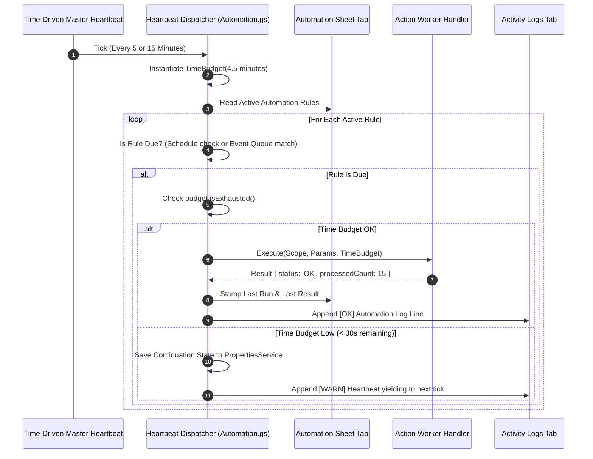

# Design Specification: Table-Driven Automation Engine

* **Design ID**: `DSGN-AUT-001`
* **Status**: `Under Review`
* **Current Revision**: `Rev 1.0`
* **Date Created**: `2026-10-01`
* **Last Updated**: `2026-10-01`
* **Author / Contributors**: `Rohitash / Antigravity AI`
* **Parent Design**: `None`
* **Child Designs**: `None`
* **Umbrella Module / Primary Code**: [`Code/Automation.gs`](file:///g:/My%20Drive/~RS2B/~Projects/ParaFlightLogProject/Code/Automation.gs)
* **Code Revision Stamp**: `Pending Implementation`
* **Related Requirements / CRs**: `RQ-SYS-001`, `CR-AUT-001`

---

## 1. Executive Summary & Intent

### Problem Statement
As the Paragliding Flight Log expands, recurring background tasks (Watch Folder scanning, Activity Log pruning, Trash folder maintenance, historical track enrichment, data backups) have historically been hardcoded into separate scripts or ad-hoc triggers. This creates critical operational and platform bottlenecks:
1. **Trigger Quota Exhaustion**: Google Apps Script enforces a strict limit of 20 installable triggers per user. Creating individual time-driven triggers for every recurring job quickly exhausts this quota.
2. **Code Dependency for Basic Scheduling**: Pilots cannot adjust scan intervals (e.g. changing from 15 min to 30 min) or toggle specific background routines without modifying code or navigating complex parameter lists.
3. **Execution Timeout Risks**: Long-running background processes (such as backfilling weather or geo for hundreds of flights) risk hitting Google's hard 6-minute execution wall if not strictly time-budgeted and chunked.
4. **Lack of Lifecycle Hooking**: Ingestion and maintenance workflows finish in the foreground, but cannot currently trigger asynchronous background jobs (e.g. running high-speed batch import and quietly enriching flights in the background).

### Proposed Solution
Implement a **Table-Driven Automation Engine** modeled on enterprise workflow rules engines (e.g. Zapier, ServiceNow, Salesforce Flow):
* **Single Master Heartbeat Trigger**: One single time-driven trigger (running every 5 or 15 minutes) acts as the central scheduler and dispatcher, entirely eliminating trigger quota issues.
* **The `Automation` Sheet Tab**: A user-facing spreadsheet tab where each row defines an automation rule across standard primitives: `[ Active? | Automation Name | Action | Trigger Type | Trigger Config | Scope | Parameters | Last Run | Last Result ]`.
* **Metadata-Driven Registry (`Code/Automation.gs`)**: A rich central registry defining all Triggers, Events, Actions, Scopes, Parameters, and **Predefined Rule Templates**.
* **Interactive Rule Builder Modal (`AutomationDialog.html`)**: A guided wizard with a top-level **Template Picker** ("Predefined" vs "Custom"), dynamic field generation from registry metadata, and a live **"Test / Validate Rule"** button.
* **Scope Expression DSL**: A lightweight query grammar (`Status = Remove & Flight Date < 30d`) evaluated dynamically across sheet records.
* **Bounded Execution Guardrail (`TimeBudget` & Continuation)**: Every action operates under a strict execution time budget, saving checkpoint state to resume on the next tick if approaching time limits.
* **Dedicated Automation Guide (`Docs/Automation_Guide.md`)**: A complete manual documenting both dialog usage and advanced in-sheet hand-coding syntax.

---

## 2. Requirements & Scope

### Functional Requirements
* **REQ-1 (The `Automation` Sheet)**: Dedicated sheet tab with frozen headers, checkboxes, action dropdowns, and status feedback columns.
* **REQ-2 (Single Heartbeat Dispatcher)**: A single time-driven trigger inspecting the `Automation` sheet and dispatching due tasks with time-budgeting.
* **REQ-3 (Rich Central Registry)**: Centralized definitions in `Code/Automation.gs` for:
  1. *Triggers* (`TIME_MINS`, `TIME_DAYS`, `EVENT`, `MANUAL`)
  2. *Events* (`INGESTION_COMPLETED`, `FLIGHT_PURGED`, `CONFIG_RESTORED`) with durable queue storage in `PropertiesService`
  3. *Actions* with supported scopes and parameter schemas
  4. *Predefined Rule Templates* (e.g. Watch Folder, Log Clean, Deferred Geo/Weather, Stale Trash Clean)
* **REQ-4 (Predefined Template Picker in Rule Builder)**: Top-level dropdown in `AutomationDialog.html` allowing pilots to select from ready-to-run templates or choose `Custom Automation` to build from scratch.
* **REQ-5 (Scope Expression DSL)**: Grammar supporting `All`, `Recent`, exact matches (`Status = Remove`), logical OR (`|`), logical AND (`&`), relative age (`Date < 30d`), and blank checks (`Launch Site = BLANK`).
* **REQ-6 (Multi-Line Key-Value Parameters)**: Clean parser converting multi-line or delimited text cells into typed JavaScript objects.
* **REQ-7 (Test / Validate Rule Engine)**: Built-in syntax validator in the dialog and spreadsheet menu verifying trigger configurations, action compatibility, parameter keys, and calculating live matched scope row counts before execution.
* **REQ-8 (6-Minute Timeout Guardrail)**: Implementation of `TimeBudget` and persistent continuation cursors for all batch actions.
* **REQ-9 (Detailed Automation Guide)**: Publication of [`Docs/Automation_Guide.md`](file:///g:/My%20Drive/~RS2B/~Projects/ParaFlightLogProject/Docs/Automation_Guide.md) synchronizing with `Automation.gs`.

### Non-Goals (Out of Scope)
* **NON-GOAL-1**: Real-time sub-second cron scheduling. All time-based rules evaluate at the resolution of the Master Heartbeat (5 to 15 minutes).
* **NON-GOAL-2**: Arbitrary JavaScript code injection from spreadsheet cells. Actions must be explicitly registered and vetted in `Code/Automation.gs` for security and stability.

---

## 3. Architecture & Detailed Design

### 3.1 The `Automation` Sheet Specification

* **Sheet Name**: `'Automation'` *(registered in `CFG.sheets.automation` and `TABS.AUTOMATION`)*
* **Tab Color**: Dark Teal (`#00897B`)
* **Tab Position**: Index 6 (between `Config` and `Activity Logs`)
* **Frozen Rows**: 2 (Row 1: Title Banner, Row 2: Column Headers)
* **Default Dimensions**: 50 rows, 9 columns

| Col | Header | Width | Type / Control | Purpose & Example Content |
| :---: | :--- | :---: | :--- | :--- |
| **A** | **Active?** | `70 px` | Checkbox (`TRUE`/`FALSE`) | Master enable toggle for the rule. |
| **B** | **Automation Name** | `200 px` | Text, Bold | Descriptive rule name (e.g. `Poll Watch Folders`). |
| **C** | **Action** | `180 px` | Dropdown (Registry) | The registered backend action handler. |
| **D** | **Trigger Type** | `150 px` | Dropdown | `Time (Minutes)`, `Time (Days)`, `Event (Lifecycle)`, `Manual`. |
| **E** | **Trigger Config** | `140 px` | Text / Plain Number | Interval value (e.g. `15`, `3`) or Event ID (`INGESTION_COMPLETED`). |
| **F** | **Scope** | `260 px` | Text Wrap | Target records or DSL query (e.g. `All Watch Folders`, `Status = Remove & Date < 30d`). |
| **G** | **Parameters** | `260 px` | Text Wrap, Multi-line | Action tuning key-values (e.g. `MoveToTrash = Yes\nKeepDays = 90`). |
| **H** | **Last Run** | `160 px` | Timestamp (`yyyy-mm-dd hh:mm:ss`) | Stamped automatically by the dispatcher upon completion. |
| **I** | **Last Result** | `200 px` | Text Wrap | Stamped execution outcome (e.g. `OK (0 files)`, `OK (Cleaned 45 rows)`, `ERR: Syntax`). |

---

### 3.2 Metadata Registry Architecture (`Code/Automation.gs`)

The central registry in `Code/Automation.gs` serves as the single source of truth for both code execution and dynamic UI rendering:

```
┌────────────────────────────────────────────────────────┐
│               CFG.AUTOMATION_REGISTRY                  │
│  ┌──────────────┐ ┌──────────────┐ ┌────────────────┐  │
│  │   Triggers   │ │    Events    │ │    Actions     │  │
│  └──────────────┘ └──────────────┘ └────────────────┘  │
│  ┌──────────────────────────────────────────────────┐  │
│  │               Predefined Templates               │  │
│  └──────────────────────────────────────────────────┘  │
└────────────────────────────────────────────────────────┘
          │                                  │
          ▼                                  ▼
┌──────────────────────┐           ┌──────────────────────┐
│ Rule Builder Dialog  │           │ Dispatcher / Parser  │
│ (Dynamic UI from JSON│           │ (Evaluates & Runs    │
│  via google.script)  │           │  Rows from Sheet)    │
└──────────────────────┘           └──────────────────────┘
```

#### 1. Trigger Registry
```javascript
triggers: {
  'TIME_MINS': {
    label: 'Time (Minutes)',
    inputWidget: 'number',
    unit: 'min',
    validation: { min: 5, max: 1440, default: 15 },
    tooltip: 'Runs every X minutes via the heartbeat dispatcher (minimum 5 minutes).'
  },
  'TIME_DAYS': {
    label: 'Time (Days)',
    inputWidget: 'number',
    unit: 'days',
    validation: { min: 1, max: 365, default: 3 },
    tooltip: 'Runs every X days during off-peak windows.'
  },
  'EVENT': {
    label: 'Event (Lifecycle)',
    inputWidget: 'dropdown',
    eventSource: 'REGISTRY_EVENTS',
    tooltip: 'Executes automatically when a specific system action completes.'
  },
  'MANUAL': {
    label: 'Manual Execution Only',
    inputWidget: 'none',
    tooltip: 'Executes only when manually triggered by the pilot.'
  }
}
```

#### 2. Event Registry & Queue Lifecycle
```javascript
events: {
  'INGESTION_COMPLETED': {
    label: 'Flight Ingestion Finished',
    emittedBy: 'Code/Ingestion.gs',
    payloadSchema: { batchId: 'string', count: 'number', flightIds: 'array' },
    description: 'Triggered whenever flights are imported via Bulk Ingestion, Watch Folder, or URL.'
  },
  'FLIGHT_PURGED': {
    label: 'Flights Purged to Trash',
    emittedBy: 'Code/Code.gs:purgeRemoveFlights',
    payloadSchema: { count: 'number', fileIds: 'array' }
  },
  'CONFIG_RESTORED': {
    label: 'Configuration Restored from JSON',
    emittedBy: 'Code/Code.gs:importConfigJson_',
    payloadSchema: { sections: 'array' }
  }
}
```
* **Event Queue Storage**: Stored as a serialized JSON array in `PropertiesService.getScriptProperties().getProperty('AUTOMATION_EVENT_QUEUE')`.
* **Deprecation / TTL**: Events include a timestamp. Events older than 2 hours expire automatically, preventing accidental stale runs.

#### 3. Action Registry
```javascript
actions: {
  'SCAN_WATCH_FOLDER': {
    label: 'Scan Watch Folder',
    category: 'Ingestion',
    targetEntity: 'FILES',
    allowedTriggers: ['TIME_MINS', 'MANUAL'],
    defaultTrigger: { type: 'TIME_MINS', config: '15' },
    scopePresets: [
      { label: 'All Configured Watch Folders', value: 'All Watch Folders' }
    ],
    parametersSchema: {
      'MoveToTrash': { type: 'boolean', default: true, label: 'Move processed files to Trash' }
    },
    handler: function(scope, params, timeBudget) { return FileHandling.processWatchFolder(); }
  },

  'CLEAN_LOGS': {
    label: 'Clean Activity Logs',
    category: 'Maintenance',
    targetEntity: 'LOGS',
    allowedTriggers: ['TIME_DAYS', 'MANUAL'],
    defaultTrigger: { type: 'TIME_DAYS', config: '3' },
    scopePresets: [
      { label: 'Conservative Dual-Threshold Pruning', value: 'Conservative Pruning' }
    ],
    parametersSchema: {
      'KeepRows': { type: 'number', default: 2000, label: 'Minimum Rows to Keep' },
      'KeepDays': { type: 'number', default: 90, label: 'Minimum Days to Keep' }
    },
    handler: function(scope, params, timeBudget) { return LOG.cleanLogs(params.KeepRows, params.KeepDays); }
  },

  'ENRICH_FLIGHT_GEO': {
    label: 'Enrich Flight Sites & Geo',
    category: 'Enrichment',
    targetEntity: 'FLIGHTS',
    allowedTriggers: ['EVENT', 'TIME_DAYS', 'MANUAL'],
    defaultTrigger: { type: 'EVENT', config: 'INGESTION_COMPLETED' },
    scopePresets: [
      { label: 'Recently Imported Flights', value: 'Recent' },
      { label: 'All Flights Missing Launch Site', value: 'Launch Site = BLANK' },
      { label: 'All Un-enriched Flights', value: 'Launch Site = BLANK | Land Town = BLANK' }
    ],
    allowCustomScope: true,
    parametersSchema: {
      'Providers': { type: 'multi-select', options: ['Paragliding Earth', 'Overpass API'], default: 'Paragliding Earth' },
      'BatchLimit': { type: 'number', default: 20, label: 'Max flights per execution' }
    },
    handler: function(scopeRows, params, timeBudget) { return GeoService.batchEnrich(scopeRows, params, timeBudget); }
  }
}
```

#### 4. Predefined Rule Templates
```javascript
templates: [
  {
    id: 'TPL_WATCH_FOLDER',
    name: 'Poll Watch Folders (Every 15 Min)',
    action: 'SCAN_WATCH_FOLDER',
    triggerType: 'TIME_MINS',
    triggerConfig: '15',
    scope: 'All Watch Folders',
    parameters: 'MoveToTrash = Yes',
    description: 'Scans Google Drive watch folders every 15 minutes for new IGC flight logs.'
  },
  {
    id: 'TPL_CLEAN_LOGS',
    name: 'Activity Log Pruning (Every 3 Days)',
    action: 'CLEAN_LOGS',
    triggerType: 'TIME_DAYS',
    triggerConfig: '3',
    scope: 'Conservative Pruning',
    parameters: 'KeepRows = 2000\nKeepDays = 90',
    description: 'Prunes old log entries older than 90 days if the log exceeds 2,000 rows.'
  },
  {
    id: 'TPL_DEFERRED_ENRICH',
    name: 'Background Site & Geo Enrichment',
    action: 'ENRICH_FLIGHT_GEO',
    triggerType: 'EVENT',
    triggerConfig: 'INGESTION_COMPLETED',
    scope: 'Recent',
    parameters: 'Providers = Paragliding Earth\nBatchLimit = 20',
    description: 'Automatically enriches newly ingested flight tracks with takeoff/landing sites.'
  }
]
```

---

### 3.3 Scope Expression DSL & Evaluation Engine

The Scope engine parses human-readable queries into concrete spreadsheet row indices:

```
[ Field ] [ Operator ] [ Value ] (optional: [ Conjunction ] [ Field ] [ Operator ] [ Value ])
```

#### Grammar & Tokens
* **Keywords**:
  * `All`: Matches all populated flight rows (`row >= 5`).
  * `Recent`: Matches row indices returned by the active event payload (e.g. `payload.flightIds`).
* **Field Comparison**: Column Header matching (e.g. `Status`, `Date`, `Launch Site`).
* **Operators**:
  * `=` (Exact Match): `Status = Remove`
  * `!=` (Inequality): `Status != Valid`
  * `< Xd` / `> Xd` (Relative Age in Days): `Date < 30d` (flown $> 30$ days ago).
  * `= BLANK`: `Launch Site = BLANK`
  * `!= BLANK`: `Launch Site != BLANK`
* **Conjunctions**:
  * `|` (Logical OR): `Status = Dup-Primary | Dup-Others`
  * `&` (Logical AND): `Status = Remove & Date < 30d`

#### Execution Architecture
1. The parser reads Row 4 of `Flights` to map column names to column indices.
2. It fetches the active flight grid values (`getDisplayValues()`).
3. It evaluates the expression across memory arrays in $< 50$ ms.
4. Returns an array of matching row indices: `[5, 8, 14, 22]`.

---

### 3.4 Parameter Parsing Engine

Parameters are formatted as key-value pairs separated by newlines `\n` or semicolons `;`:

```
MoveToTrash = Yes
Providers = Paragliding Earth, Overpass API
BatchLimit = 20
```

#### Parsing Rules (`AUTOMATION.parseParams(text)`)
* Lines are split and trimmed.
* Key and value are split on the first `=`.
* Auto-casting:
  * `'Yes'` / `'No'` / `'true'` / `'false'` $\to$ `Boolean`
  * Numeric strings $\to$ `Number`
  * Comma-separated strings $\to$ `Array<String>`
* Returns a structured JavaScript object.

---

### 3.5 Rule Builder UI (`AutomationDialog.html`)

An intuitive, interactive modal wizard:

1. **Top-Level Template Picker**:
   * Dropdown: `[ Predefined Templates ]` $\to$ lists all registered templates (e.g. *Poll Watch Folders*, *Activity Log Pruning*, *Background Site Enrichment*) alongside `Custom Automation (Build from Scratch)`.
   * Selecting a template auto-populates all inputs with recommended defaults.
2. **Dynamic Schema-Driven Form**:
   * Form widgets are dynamically generated based on the selected Action's `parametersSchema` and Trigger's `inputWidget`.
3. **Interactive Scope Builder**:
   * Radio selection: Predefined Preset vs Custom Scope Expression.
4. **"Test / Validate Rule" Button**:
   * Real-time validation calling `google.script.run.validateRule(formData)`.
   * Evaluates syntax and reports instant visual feedback:
     * ✓ *Syntax Valid*: Matches 14 flight rows in current logbook.
     * ✗ *Syntax Error*: Unknown field `LaunchSite` (did you mean `Launch Site`?).
5. **Save Action**: Writes formatted row directly to the `Automation` sheet.

---

### 3.6 Single Heartbeat Dispatcher & 6-Minute Bounded Execution



---

## 4. Platform Constraints & Edge Cases

* **Google Apps Script 6-Minute Limit**: Bounded execution via `TimeBudget` guarantees the dispatcher yields before 4.5 minutes, saving cursors to resume on the next tick.
* **20 Trigger Limit**: Exactly **one** installable time-driven trigger powers the entire platform.
* **Spreadsheet Cell Protection**: The `Automation` tab is immune to formula recalculations and row shifts because it operates as a declarative configuration table.
* **Concurrency Protection**: Uses `LockService.getScriptLock()` with a 10-second timeout so overlapping triggers never execute the same action simultaneously.

---

## 5. Alternatives Considered & Trade-offs

| Decision | Chosen Architecture | Alternative Considered | Rationale |
| :--- | :--- | :--- | :--- |
| **Storage Model** | Dedicated `Automation` Sheet | Embedded inside `Config` Sheet | `Config` is for static parameters; `Automation` is a dynamic multi-row rules table with checkboxes and runtime results. |
| **Rule Definition** | Table-Driven in Spreadsheet | Pure Code Callbacks in JS | Empowers pilots to customize schedules, disable tasks, or adjust parameters without touching code. |
| **Parameter Format** | Multi-line `Key = Value` text | JSON formatted text | Plain `Key = Value` is clean and readable for human pilots; raw JSON is error-prone to edit manually in spreadsheet cells. |
| **Trigger Mechanism** | Single Master Heartbeat | Multiple Individual Triggers | Avoids hitting Google's 20-trigger limit and prevents race conditions. |

---

## 6. System Relationships & Dependencies

### 6.1 Upstream Consumers ("Who Uses This")
* **Time-Driven Master Heartbeat Trigger**: Primary execution engine invoking `masterHeartbeatDispatcher_()`.
* **Subsystem Event Publishers**:
  * `Code/Ingestion.gs`: Emits `INGESTION_COMPLETED`.
  * `Code/Code.gs:purgeRemoveFlights`: Emits `FLIGHT_PURGED`.
  * `Code/Code.gs:importConfigJson_`: Emits `CONFIG_RESTORED`.
* **Pilot / UI Actions**:
  * Spreadsheet menu: `Flight Log > Admin > Automation > Configure Automations...` (opens Rule Builder).
  * Spreadsheet menu: `Flight Log > Admin > Automation > Run Selected Automation Now`.
  * Spreadsheet menu: `Flight Log > Admin > Automation > Validate All Rules`.

### 6.2 Downstream Dependencies ("What This Uses")
* **Internal Code Services**:
  * [`Code/Logger.gs`](file:///g:/My%20Drive/~RS2B/~Projects/ParaFlightLogProject/Code/Logger.gs): Records all execution milestones to `Activity Logs`.
  * [`Code/Config.gs`](file:///g:/My%20Drive/~RS2B/~Projects/ParaFlightLogProject/Code/Config.gs): Resolves environmental constants (Folder IDs, API keys).
  * [`Code/FileHandling.gs`](file:///g:/My%20Drive/~RS2B/~Projects/ParaFlightLogProject/Code/FileHandling.gs): Invokes watch folder scanning and trash cleanup.
  * [`Code/Geo.gs`](file:///g:/My%20Drive/~RS2B/~Projects/ParaFlightLogProject/Code/Geo.gs) & [`Code/Weather.gs`](file:///g:/My%20Drive/~RS2B/~Projects/ParaFlightLogProject/Code/Weather.gs): Invoked for deferred background enrichment.
* **Google Workspace Services**:
  * `ScriptApp`: Manages the single master time-driven trigger.
  * `PropertiesService.getScriptProperties()`: Manages `AUTOMATION_EVENT_QUEUE` and continuation cursors.
  * `LockService`: Prevents concurrent execution collisions.

### 6.3 Storage & Schema Ripple Effects
* **New Sheet Created**: `'Automation'` tab with 9 columns.
* **Parameters Migrated from `Config`**:
  * `ENABLE_WATCH_FOLDER` $\to$ Governed by `Active?` on Watch Folder rule.
  * `LOG_AUTO_CLEAN` $\to$ Governed by `Active?` on Activity Log rule.
  * `LOG_CLEAN_FREQUENCY_DAYS` $\to$ Governed by `Trigger Config` on Activity Log rule.
  * `LOG_ROWS_TO_KEEP` & `LOG_TIME_TO_KEEP_DAYS` $\to$ Governed by `Parameters` on Activity Log rule.

### 6.4 Backward Compatibility & Migration
* Existing `Config` parameters remain supported as fallbacks if the `Automation` tab is not yet active.
* First Time Setup or Scaffolding automatically generates the pre-populated default rules.

---

## 7. Implementation Plan & Phasing

*Note: Code execution will only begin upon explicit user approval.*

- [ ] **Phase 1: Architecture & Registry (`Code/Automation.gs`)**:
  - Implement `CFG.AUTOMATION_REGISTRY` (Triggers, Events, Actions, Templates).
  - Implement Event Queue manager (`emitEvent`, `getPendingEvents`, `clearEvent`, TTL pruner).
  - Implement `TimeBudget` utility.
- [ ] **Phase 2: DSL Parsers & Validation Engine (`Code/Automation.gs`)**:
  - Implement `parseKeyValue` for multi-line parameters.
  - Implement Scope Query Expression Parser and evaluator.
  - Implement `validateRule(ruleData)` supporting live matched row counts.
- [ ] **Phase 3: Scaffolding & Sheet Setup (`Code/Scaffold.gs`)**:
  - Implement `scaffoldAutomation_` with frozen headers, checkboxes, action dropdowns, and pre-populated default templates.
- [ ] **Phase 4: Single Master Heartbeat Dispatcher (`Code/Automation.gs`)**:
  - Implement `masterHeartbeatDispatcher_` with lock handling, schedule due checking, event matching, execution, and result stamping.
  - Implement trigger setup/teardown functions.
- [ ] **Phase 5: Rule Builder Dialog (`Code/AutomationDialog.html`)**:
  - Build modal UI with Top-Level Template Picker, dynamic form fields, scope builder, live "Test Rule" validation button, and sheet writer.
- [ ] **Phase 6: Comprehensive Automation Guide (`Docs/Automation_Guide.md`)**:
  - Author full documentation for both dialog users and manual in-sheet hand-coders, reflecting all registered capabilities.
- [ ] **Phase 7: Testing & Verification**:
  - Add unit test suite in `Code/Test.gs` verifying scope parsing, parameter parsing, event queue TTL, and continuation logic.

---

## 8. Testing & Verification Strategy

* **Unit Tests (`Code/Test.gs`)**:
  * `testScopeQueryParser`: Verifies `All`, `Recent`, `Status = Remove`, and compound conjunctions `&` / `|`.
  * `testParameterParser`: Verifies multi-line key-value parsing, booleans, arrays, and numbers.
  * `testEventQueueLifecycle`: Verifies publishing, FIFO retrieval, and 2-hour TTL expiration.
  * `testTimeBudgetGuard`: Simulates timeout budget exhaustion and continuation state save.
* **Manual Smoke Test Checklist**:
  * Scaffolding $\to$ verify `Automation` tab appears with pre-populated default rows.
  * Rule Builder Dialog $\to$ select "Activity Log Pruning" template $\to$ verify fields auto-fill.
  * Click "Test Rule" $\to$ verify instant validation feedback and match counts.
  * Run Master Heartbeat $\to$ verify `Last Run` and `Last Result` are stamped cleanly in the sheet.

---

## 9. Documentation Impacts

* [`Docs/Automation_Guide.md`](file:///g:/My%20Drive/~RS2B/~Projects/ParaFlightLogProject/Docs/Automation_Guide.md): Dedicated pilot guide for no-code and advanced automation authoring.
* [`Docs/Technical_Specification.md`](file:///g:/My%20Drive/~RS2B/~Projects/ParaFlightLogProject/Docs/Technical_Specification.md): Document `Automation.gs` module and Single Heartbeat Dispatcher architecture.
* [`Docs/Features.md`](file:///g:/My%20Drive/~RS2B/~Projects/ParaFlightLogProject/Docs/Features.md): Add Section for Table-Driven Automation Engine.
* [`Docs/Backlog.md`](file:///g:/My%20Drive/~RS2B/~Projects/ParaFlightLogProject/Docs/Backlog.md): Track `CR-AUT-001` (Table-Driven Automation Engine).
* [`Docs/Design/README.md`](file:///g:/My%20Drive/~RS2B/~Projects/ParaFlightLogProject/Docs/Design/README.md): Register `DSGN-AUT-001`.

---

## 10. Revision History

| Revision | Date | Author | Revision Note |
| :---: | :---: | :--- | :--- |
| `Rev 1.0` | `2026-10-01` | `Rohitash / Antigravity AI` | Initial formal design draft: Table-Driven Automation Engine, Single Heartbeat Dispatcher, Scope DSL, Predefined Templates, and Rule Validation Engine. |
