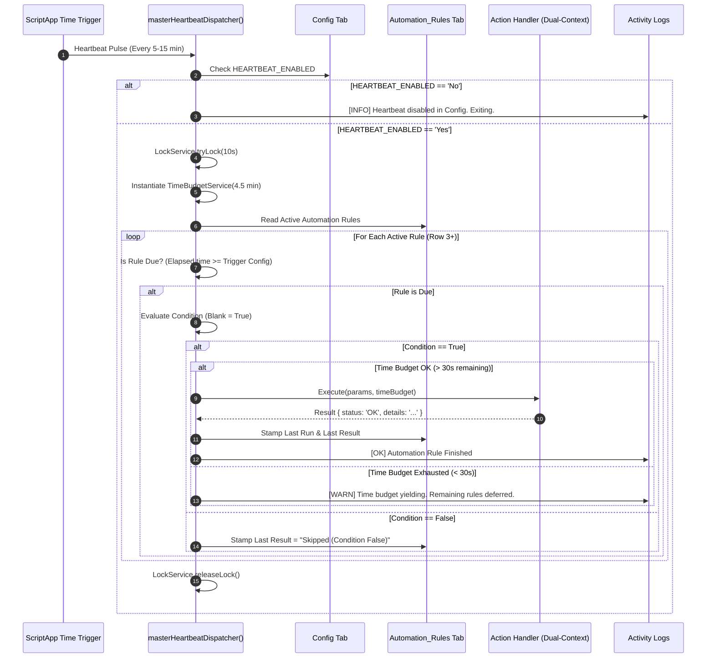

# Design Specification: Table-Driven Automation Engine

* **Design ID**: `DSGN-AUT-001`
* **Status**: `Approved / In Progress`
* **Current Revision**: `Rev 2.1`
* **Date Created**: `2026-10-01`
* **Last Updated**: `2026-10-03`
* **Author / Contributors**: `Rohitash / Antigravity AI`
* **Parent Design**: `None`
* **Child / Sibling Designs**: [`DSGN-UI-001`](./DSGN-UI-001_Tri_Mode_Execution_and_Universal_Sidebar.md) (Execution Substrate & QueueService), [`DSGN-SYS-003`](./DSGN-SYS-003_Reverse_Schema_Extraction_and_Personalization.md) (Personalization Manifest)
* **Umbrella Module / Primary Code**: [`Code/AutomationConfig.gs`](../../Code/AutomationConfig.gs) (Registry & Schemas), [`Code/Automation.gs`](../../Code/Automation.gs) (Engine & Runtime), [`Code/AutomationDialog.html`](../../Code/AutomationDialog.html) (Rule Builder Modal Wizard)
* **Code Revision Stamp**: `Pending Implementation`
* **Related Requirements / CRs**: `RQ-SYS-001`, `CR-AUT-001`, `CR-AUT-002`

---

## 1. Executive Summary & Intent

### Problem Statement
As the Paragliding Flight Log expands, recurring background tasks (Watch Folder scanning, Activity Log pruning, Trash folder maintenance, historical track enrichment, queue processing) have historically been hardcoded into separate scripts or ad-hoc triggers. This creates critical operational and platform bottlenecks:
1. **Trigger Quota Exhaustion**: Google Apps Script enforces a strict limit of 20 installable triggers per user. Creating individual time-driven triggers for every recurring job quickly exhausts this quota and risks trigger leakage.
2. **Scattered & Inflexible Configuration**: Automation parameters (e.g. `ENABLE_WATCH_FOLDER`, `WATCH_PERIOD_MIN`, `LOG_AUTO_CLEAN`, `LOG_CLEAN_FREQUENCY_DAYS`, `LOG_ROWS_TO_KEEP`, `LOG_TIME_TO_KEEP_DAYS`) clutter the static `Config` sheet tab. Pilots cannot easily adjust schedules, enable/disable specific rules, or configure action behaviors without modifying code or navigating complex parameter rows.
3. **Execution Timeout Risks**: Long-running background processes (such as multi-file watch folder imports or bulk status changes) risk hitting Google's hard 6-minute execution wall if not strictly time-budgeted and chunked.
4. **Lack of Lifecycle Hooking**: Ingestion and maintenance workflows finish in the foreground, but cannot currently trigger asynchronous background jobs (e.g. running high-speed batch import and quietly enriching flights in the background).

### Proposed Solution
Implement a **Table-Driven Automation Engine** modeled on enterprise workflow rules engines (e.g. Zapier, ServiceNow, Salesforce Flow), adhering to the classic automation paradigm:
$$\mathbf{TRIGGER} \longrightarrow \mathbf{CONDITION} \longrightarrow \mathbf{ACTION}$$

1. **Subsystem Domain Decoupling (Pattern 20)**: Cleanly isolates declarative metadata (registries, triggers, actions, schemas, templates) in `Code/AutomationConfig.gs` from operational execution logic in `Code/Automation.gs`.
2. **Single Master Heartbeat Trigger**: Exactly one installable time-driven trigger (`masterHeartbeatDispatcher`) serves as the central pulse for the entire platform, eliminating trigger quota issues.
3. **Master Switch in `Config`**:
   * `HEARTBEAT_ENABLED` (`Yes` / `No`): Master kill-switch governing all autonomous background processing.
   * `HEARTBEAT_INTERVAL_MIN` (`5`, `10`, `15`, `30`, `60`): Configurable heartbeat pulse frequency in minutes.
4. **Interactive Menu Controller**: A toggle menu item (`Flight Log > Admin > Automation & Services > [ ⚡ Start / Stop Master Heartbeat... ]`) that inspects active triggers, enforces `HEARTBEAT_ENABLED`, and cleanly installs or deletes the project trigger.
5. **The `Automation_Rules` Sheet Tab**: A dedicated user-facing spreadsheet tab where each row defines an automation rule across 9 standardized columns:
   `[ Active? | Automation Name | Action | Trigger Type | Trigger Config | Condition | Parameters | Last Run | Last Result ]`.
6. **Action-Centric Parameter Schemas**: Consolidates all operational knobs into `Parameters` using a clean semicolon-separated syntax (`KeepRows=2000; KeepDays=90`). Each Action defines rich parameter metadata (`parameterId`, `parameterLabel`, `valueType`, `valueInput`, `defaultValue`, `validation`), allowing omitted parameters to fall back gracefully to sensible defaults.
7. **Guard Conditions**: Replaces arbitrary scope terminology with a dedicated `Condition` column. If blank, it defaults to `True`. When specified, it acts as a guard clause preventing the Action from executing unless the condition evaluates to true.
8. **Progressive Feature Flagging (`actionAvailable: boolean` - Pattern 23)**: Registry actions explicitly declare whether they are production-ready (`actionAvailable: true`) or planned/under design (`actionAvailable: false`). User interfaces (modal wizard and sheet dropdowns) strictly filter to display only available actions.
9. **Interactive Rule Builder Modal Wizard (`AutomationDialog.html`)**: Guided wizard with Create/Edit modes, template picker, schema-driven dynamic inputs, and a live "Validate Rule" engine.
10. **Dual-Context Execution Invariant (Pattern 21)**: Handlers are guaranteed safe across foreground (interactive UI) and background (headless trigger) execution, eliminating unhandled `getUi()` exceptions.
11. **Retirement & Migration of Legacy Parameters**: 7 fragmented automation parameters are permanently retired from `Config` and migrated into pre-populated default rule templates on the `Automation_Rules` tab.
12. **Bounded Execution Guardrail (`TimeBudgetService`)**: Every heartbeat tick runs under a strict 4.5-minute time ceiling, deferring remaining tasks to the next tick if approaching limits.

---

## 2. Requirements & Scope

### Functional Requirements
* **REQ-1 (The `Automation_Rules` Sheet)**: Dedicated sheet tab with frozen headers, Dark Teal theme (`#00897B`), `Yes` / `No` active toggles, registered Action dropdowns (filtered by `actionAvailable: true`), Trigger Type dropdowns, Condition, and Parameters.
* **REQ-2 (Single Heartbeat Dispatcher)**: A single time-driven trigger inspecting the `Automation_Rules` sheet and dispatching due tasks with time-budgeting and `LockService` concurrency protection.
* **REQ-3 (Config Master Switch)**: `HEARTBEAT_ENABLED` and `HEARTBEAT_INTERVAL_MIN` parameters in `Config` under `[ Ingestion & Automation ]`.
* **REQ-4 (Interactive Start / Stop Menu Toggle)**: Menu controller in `Flight Log > Admin > Automation & Services` that verifies `HEARTBEAT_ENABLED` before installing the trigger, or deletes active triggers on demand.
* **REQ-5 (Rich Action Registry with Parameter Metadata)**: Centralized Action definitions in `Code/AutomationConfig.gs` defining:
  * `actionAvailable`, `parameterId`, `parameterLabel`, `valueType`, `valueInput`, `valueLabel`, `valueSet`, `defaultValue`, `validation`.
* **REQ-6 (Semicolon-Delimited Parameter Parsing Engine)**: Parses strings like `KeepRows=2000; KeepDays=90` into typed JavaScript objects, auto-coercing booleans, numbers, and comma-separated lists, and backfilling omitted parameters with defaults.
* **REQ-7 (Condition Evaluation)**: Evaluates guard conditions. If blank or empty, evaluates to `True`.
* **REQ-8 (Pre-Populated Out-of-the-Box Rule Templates)**: Automatically seeds default rules for Watch Folder Scanning, Activity Log Pruning, and Background Queue Processing.
* **REQ-9 (Rule Builder Modal Wizard - `AutomationDialog.html`)**: Interactive modal dialog for creating/editing rules with dynamic form fields generated from schema, template selection, and live validation.
* **REQ-10 (6-Minute Timeout Guardrail)**: Implementation of `TimeBudgetService` (4.5 min ceiling) guaranteeing zero unhandled 6-minute GAS timeouts.
* **REQ-11 (System Maintenance Orchestrator Integration)**: Registered in `SYSTEM_MANIFEST` and `Scaffold.gs` with atomic updaters preserving user-added rules.

### Non-Goals (Out of Scope)
* **NON-GOAL-1**: Real-time sub-second cron scheduling. All time-based rules evaluate at the resolution of the Master Heartbeat (5 to 15 minutes).
* **NON-GOAL-2**: Arbitrary JavaScript code execution from spreadsheet cells. Actions must be explicitly registered and vetted in `Code/AutomationConfig.gs` for security and stability.

---

## 3. Architecture & Detailed Design

### 3.1 The `Automation_Rules` Sheet Specification

* **Sheet Name**: `'Automation_Rules'` *(registered in `CFG.sheets.automationRules`, with legacy alias `'Automation'`)*
* **Tab Color**: Dark Teal (`#00897B`)
* **Banner Title**: Merged A1:I1 (`Automation Rules & Scheduled Tasks`, `#004D40`, font `#FFFFFF`, bold, height 38px)
* **Tab Position**: Index 6 (between `Config` and `Automation_Queue`)
* **Frozen Rows**: 2 (Row 1: Title Banner, Row 2: Column Headers)
* **Default Dimensions**: 50 rows $\times$ 9 columns

| Col | Header | Width | Type / Control | Purpose & Example Content |
| :---: | :--- | :---: | :--- | :--- |
| **A** | **Active?** | `75 px` | `Yes` / `No` Dropdown (`.setAllowInvalid(true)`) | Master rule enable/disable toggle. Resilient against key deletion per `CR-SYS-013`. |
| **B** | **Automation Name** | `220 px` | Text, Bold | Human-readable rule name (e.g. `Poll Watch Folders`). |
| **C** | **Action** | `180 px` | Dropdown (Registry: `actionAvailable=true`) | Registered backend action handler (`SCAN_WATCH_FOLDER`, `CLEAN_LOGS`, `PROCESS_QUEUE`). |
| **D** | **Trigger Type** | `140 px` | Dropdown | `Time (Minutes)`, `Time (Days)`, `Event (Lifecycle)`, `Manual`. |
| **E** | **Trigger Config** | `130 px` | Text / Plain Number | Interval value (`15`, `3`) or Event ID (`INGESTION_COMPLETED`). |
| **F** | **Condition** | `200 px` | Text Wrap (Optional) | Guard clause. **Blank = Always True**. (e.g. `QueueLength > 0`). |
| **G** | **Parameters** | `260 px` | Text Wrap | Action settings (`KeepRows=2000; KeepDays=90`). Semicolon-separated key-values. |
| **H** | **Last Run** | `150 px` | Timestamp (`yyyy-MM-dd HH:mm:ss`) | Stamped automatically by the dispatcher upon completion. |
| **I** | **Last Result** | `200 px` | Text Wrap | Stamped execution outcome (e.g. `OK (0 files)`, `OK (Pruned 42 rows)`, `ERR: ...`). |

---

### 3.2 Configuration Tab Master Switch (`Config`)

Two master parameters are added to `Config` under section `[ Ingestion & Automation ]`:

```javascript
// Config.gs -> CFG.parameters
{ 
  section: 'Ingestion & Automation', 
  key: 'HEARTBEAT_ENABLED', 
  val: 'Yes', 
  desc: 'Enable autonomous background processing? (Yes/No)' 
},
{ 
  section: 'Ingestion & Automation', 
  key: 'HEARTBEAT_INTERVAL_MIN', 
  val: 15, 
  desc: 'Master heartbeat pulse interval in minutes (5, 10, 15, 30, 60)' 
}
```

#### Migration & Retirement of Legacy Parameters
The following 7 parameters are permanently removed from `Config` and migrated into default rule templates:

| Retired Parameter | Old Location | New Location in `Automation_Rules` |
| :--- | :--- | :--- |
| `ENABLE_WATCH_FOLDER` | `Config!A:C` | Governed by `Active?` on `Poll Watch Folders` rule |
| `WATCH_PERIOD_MIN` | `Config!A:C` | Governed by `Trigger Config` on `Poll Watch Folders` rule |
| `MOVE_FROM_WATCH_FOLDER` | `Config!A:C` | Governed by `Parameters` (`MoveToTrash = Yes`) |
| `LOG_AUTO_CLEAN` | `Config!A:C` | Governed by `Active?` on `Prune Activity Logs` rule |
| `LOG_CLEAN_FREQUENCY_DAYS` | `Config!A:C` | Governed by `Trigger Config` on `Prune Activity Logs` rule |
| `LOG_ROWS_TO_KEEP` | `Config!A:C` | Governed by `Parameters` (`KeepRows = 2000`) |
| `LOG_TIME_TO_KEEP_DAYS` | `Config!A:C` | Governed by `Parameters` (`KeepDays = 90`) |

---

### 3.3 Menu Controller & Heartbeat Lifecycle

Located under `Flight Log > Admin > Automation & Services`:

```
Flight Log
  └── Admin
        └── Automation & Services
              ├── [ ⚡ Start / Stop Master Heartbeat... ]  <-- Interactive Toggle Controller
              ├── Run Master Heartbeat Now                 <-- Immediate Manual Dispatch
              ├── Configure Automation Rules...            <-- Opens AutomationDialog.html
              └── View Automation Rules Tab
```

#### Lifecycle Logic (`toggleMasterHeartbeat_`)
```javascript
function toggleMasterHeartbeat_() {
  var ui = SpreadsheetApp.getUi();
  var triggers = ScriptApp.getProjectTriggers();
  var activeTrigger = null;
  
  for (var i = 0; i < triggers.length; i++) {
    if (triggers[i].getHandlerFunction() === 'masterHeartbeatDispatcher') {
      activeTrigger = triggers[i];
      break;
    }
  }

  // 1. If currently RUNNING -> Prompt to STOP
  if (activeTrigger) {
    var resp = ui.alert('Master Heartbeat is ACTIVE', 
      'The Master Heartbeat is currently running in the background.\n\nDo you want to STOP it?', 
      ui.ButtonSet.YES_NO);
    if (resp === ui.Button.YES) {
      ScriptApp.deleteTrigger(activeTrigger);
      LOG.write('AUTOMATION', '[INFO] Master Heartbeat stopped by user', 'Trigger deleted');
      SpreadsheetApp.getActive().toast('🛑 Master Heartbeat stopped.', 'Automation Engine');
    }
    return;
  }

  // 2. If currently STOPPED -> Check Config & START
  var config = getParameters_();
  var enabled = String(config.HEARTBEAT_ENABLED || 'Yes').toUpperCase();
  if (enabled !== 'YES' && enabled !== 'TRUE') {
    ui.alert('Heartbeat Disabled in Config', 
      'Cannot start Heartbeat: HEARTBEAT_ENABLED is set to "No" in the Config tab.\n\nPlease set it to "Yes" before starting the trigger.', 
      ui.ButtonSet.OK);
    return;
  }

  var intervalMin = Number(config.HEARTBEAT_INTERVAL_MIN) || 15;
  var allowedIntervals = [5, 10, 15, 30, 60];
  if (allowedIntervals.indexOf(intervalMin) === -1) intervalMin = 15;

  ScriptApp.newTrigger('masterHeartbeatDispatcher')
    .timeBased()
    .everyMinutes(intervalMin)
    .create();

  LOG.write('AUTOMATION', '[START] Master Heartbeat installed', 'Interval: ' + intervalMin + ' min');
  SpreadsheetApp.getActive().toast('⚡ Master Heartbeat started (every ' + intervalMin + ' min).', 'Automation Engine');
}
```

---

### 3.4 Action Registry & Progressive Feature Flagging (`Code/AutomationConfig.gs`)

The central registry in `Code/AutomationConfig.gs` defines the metadata catalog. Every action declares `actionAvailable: boolean`:

```javascript
var AUTOMATION_REGISTRY = {
  triggers: {
    'TIME_MINS': {
      label: 'Time (Minutes)',
      unit: 'min',
      validation: { min: 5, max: 1440, default: 15 },
      tooltip: 'Runs every X minutes via the heartbeat dispatcher (minimum 5 minutes).'
    },
    'TIME_DAYS': {
      label: 'Time (Days)',
      unit: 'days',
      validation: { min: 1, max: 365, default: 3 },
      tooltip: 'Runs every X days during off-peak windows.'
    },
    'EVENT': {
      label: 'Event (Lifecycle)',
      eventSource: 'REGISTRY_EVENTS',
      tooltip: 'Executes automatically when a specific system action completes.'
    },
    'MANUAL': {
      label: 'Manual Execution Only',
      tooltip: 'Executes only when manually triggered by the pilot.'
    }
  },

  events: {
    'INGESTION_COMPLETED': {
      label: 'Flight Ingestion Finished',
      emittedBy: 'Code/Ingestion.gs',
      payloadSchema: { batchId: 'string', count: 'number', flightIds: 'array' }
    },
    'FLIGHT_PURGED': {
      label: 'Flights Purged to Trash',
      emittedBy: 'Code/Code.gs:purgeRemoveFlights',
      payloadSchema: { count: 'number', fileIds: 'array' }
    },
    'CONFIG_RESTORED': {
      label: 'Configuration Restored from JSON',
      emittedBy: 'Code/Code.gs:importConfigJson_',
      payloadSchema: { sections: 'array' }
    }
  },

  actions: {
    // -------------------------------------------------------------------------
    // PRODUCTION-READY ACTIONS (actionAvailable: true)
    // -------------------------------------------------------------------------
    'SCAN_WATCH_FOLDER': {
      actionAvailable: true,
      label: 'Scan Watch Folder',
      category: 'Ingestion',
      description: 'Scans configured Google Drive watch folders for new flight log files.',
      parametersSchema: {
        'MoveToTrash': {
          parameterId: 'MoveToTrash',
          parameterLabel: 'Move to Trash After Success',
          valueType: 'Boolean',
          valueInput: 'Unique',
          valueLabel: 'Flag',
          valueSet: 'Yes, No',
          defaultValue: true,
          validation: function(v) { return typeof v === 'boolean'; }
        },
        'MaxFiles': {
          parameterId: 'MaxFiles',
          parameterLabel: 'Max Files per Scan',
          valueType: 'Number',
          valueInput: 'Unique',
          valueLabel: 'Files',
          valueSet: '1-100',
          defaultValue: 20,
          validation: function(v) { return !isNaN(v) && v > 0; }
        }
      },
      handler: 'executeWatchFolderScan_'
    },

    'CLEAN_LOGS': {
      actionAvailable: true,
      label: 'Clean Activity Logs',
      category: 'Maintenance',
      description: 'Prunes old log entries older than KeepDays if the log exceeds KeepRows.',
      parametersSchema: {
        'KeepRows': {
          parameterId: 'KeepRows',
          parameterLabel: 'Rows to Retain',
          valueType: 'Number',
          valueInput: 'Unique',
          valueLabel: 'Rows',
          valueSet: '0-50000',
          defaultValue: 2000,
          validation: function(v) { return !isNaN(v) && v >= 0; }
        },
        'KeepDays': {
          parameterId: 'KeepDays',
          parameterLabel: 'Days to Retain',
          valueType: 'Number',
          valueInput: 'Unique',
          valueLabel: 'Days',
          valueSet: '1-3650',
          defaultValue: 90,
          validation: function(v) { return !isNaN(v) && v > 0; }
        }
      },
      handler: 'executeCleanLogs_'
    },

    'PROCESS_QUEUE': {
      actionAvailable: true,
      label: 'Process Background Queue',
      category: 'System',
      description: 'Executes pending batch jobs from the Automation_Queue sheet.',
      parametersSchema: {
        'BatchSize': {
          parameterId: 'BatchSize',
          parameterLabel: 'Items per Step',
          valueType: 'Number',
          valueInput: 'Unique',
          valueLabel: 'Items',
          valueSet: '1-20',
          defaultValue: 5,
          validation: function(v) { return !isNaN(v) && v > 0; }
        },
        'MaxExecutionSeconds': {
          parameterId: 'MaxExecutionSeconds',
          parameterLabel: 'Time Budget Ceiling',
          valueType: 'Number',
          valueInput: 'Unique',
          valueLabel: 'Seconds',
          valueSet: '30-270',
          defaultValue: 240,
          validation: function(v) { return !isNaN(v) && v >= 30; }
        }
      },
      handler: 'executeProcessQueue_'
    },

    // -------------------------------------------------------------------------
    // CANDIDATE / PLANNED ACTIONS (actionAvailable: false)
    // Gated until parameters and overwrite safeguards are finalized
    // -------------------------------------------------------------------------
    'ENRICH_FLIGHT_GEO': {
      actionAvailable: false, // Under design: evaluating non-destructive overwrite guards
      label: 'Enrich Flight Sites & Geo',
      category: 'Enrichment',
      description: 'Backfills takeoff/landing site names and reverse geocoding on flight tracks.',
      parametersSchema: {
        'OverwriteSite': {
          parameterId: 'OverwriteSite',
          parameterLabel: 'Overwrite Existing Site',
          valueType: 'Boolean',
          valueInput: 'Unique',
          defaultValue: false
        },
        'OverwriteCountry': {
          parameterId: 'OverwriteCountry',
          parameterLabel: 'Overwrite Existing Country',
          valueType: 'Boolean',
          valueInput: 'Unique',
          defaultValue: false
        },
        'Providers': {
          parameterId: 'Providers',
          parameterLabel: 'Geo Providers',
          valueType: 'Multi',
          valueInput: 'Multi',
          defaultValue: ['paragliding_earth']
        },
        'BatchLimit': {
          parameterId: 'BatchLimit',
          parameterLabel: 'Max Flights per Batch',
          valueType: 'Number',
          valueInput: 'Unique',
          defaultValue: 20
        }
      },
      handler: 'executeEnrichGeo_'
    },

    'ENRICH_FLIGHT_WEATHER': {
      actionAvailable: false, // Under design: evaluating observation preservation
      label: 'Enrich Historical Weather',
      category: 'Enrichment',
      description: 'Backfills historical weather at launch coordinates for unpopulated flights.',
      parametersSchema: {
        'OverwriteObservations': {
          parameterId: 'OverwriteObservations',
          parameterLabel: 'Overwrite Existing Observations',
          valueType: 'Boolean',
          valueInput: 'Unique',
          defaultValue: false
        },
        'BatchLimit': {
          parameterId: 'BatchLimit',
          parameterLabel: 'Max Flights per Batch',
          valueType: 'Number',
          valueInput: 'Unique',
          defaultValue: 20
        }
      },
      handler: 'executeEnrichWeather_'
    },

    'PURGE_STAGED_FLIGHTS': {
      actionAvailable: false, // Under design: evaluating automatic trash thresholds
      label: 'Purge Flights Marked Remove',
      category: 'Maintenance',
      description: 'Trashes Master IGC files and permanently deletes flight rows marked Remove.',
      parametersSchema: {
        'MoveToTrash': {
          parameterId: 'MoveToTrash',
          parameterLabel: 'Move to Google Drive Trash',
          valueType: 'Boolean',
          valueInput: 'Unique',
          defaultValue: true
        }
      },
      handler: 'executePurgeFlights_'
    }
  },

  templates: [
    {
      id: 'TPL_WATCH_FOLDER',
      active: true,
      name: 'Poll Watch Folders',
      action: 'SCAN_WATCH_FOLDER',
      triggerType: 'Time (Minutes)',
      triggerConfig: 15,
      condition: '',
      parameters: 'MoveToTrash=Yes; MaxFiles=20',
      description: 'Scans Google Drive watch folders every 15 minutes for new IGC flight logs.'
    },
    {
      id: 'TPL_CLEAN_LOGS',
      active: true,
      name: 'Prune Activity Logs',
      action: 'CLEAN_LOGS',
      triggerType: 'Time (Days)',
      triggerConfig: 3,
      condition: '',
      parameters: 'KeepRows=2000; KeepDays=90',
      description: 'Prunes old log entries older than 90 days if the log exceeds 2,000 rows.'
    },
    {
      id: 'TPL_PROCESS_QUEUE',
      active: true,
      name: 'Process Background Queue',
      action: 'PROCESS_QUEUE',
      triggerType: 'Time (Minutes)',
      triggerConfig: 5,
      condition: '',
      parameters: 'BatchSize=5; MaxExecutionSeconds=240',
      description: 'Processes pending background queue jobs (bulk imports, updates, purges).'
    }
  ]
};
```

---

### 3.5 Semicolon Parameter Parsing Engine

Parameters are specified in cell Column G using semicolon-separated `Key = Value` syntax:
```
KeepRows = 2000; KeepDays = 90
```

#### Parsing Rules (`AUTOMATION.parseParams(text, actionDef)`)
1. **Default Seeding**: Clones default parameter values from `actionDef.parametersSchema`.
2. **Splitting**: Splits the input string on `;`. For each pair, splits on the first `=`.
3. **Key Resolution**: Trims keys and matches against registered `parameterId`s (case-tolerant).
4. **Type Coercion**:
   * `Boolean`: Maps `'Yes'`, `'True'`, `'Y'`, `'1'` $\to$ `true`; `'No'`, `'False'`, `'N'`, `'0'` $\to$ `false`.
   * `Number`: Parses clean numeric values via `Number(val)`.
   * `Multi`: Splits comma-separated values into a trimmed `Array<String>`.
   * `String`: Stores trimmed string.
5. **Fallback Safety**: Any parameter omitted from the cell cleanly adopts its schema `defaultValue`.

---

### 3.6 Guard Condition Evaluation

The `Condition` column provides an optional guard clause evaluated prior to Action invocation:
* **Blank / Empty**: Evaluates unconditionally to **`True`** (Action proceeds).
* **Future Grammar**: Evaluates condition expressions against system metrics or action context:
  * `QueueCount > 0`
  * `FolderNotEmpty = Yes`
  * `LastResult != OK`

```javascript
function evaluateCondition_(conditionText, actionKey, context) {
  if (!conditionText || String(conditionText).trim() === '') {
    return true; // Blank always evaluates to true
  }
  var expr = String(conditionText).trim();
  if (expr === 'QueueCount > 0') {
    return QueueService.hasActiveJobs();
  }
  return true;
}
```

---

### 3.7 Master Heartbeat Dispatcher & Dual-Context Execution Loop



---

### 3.8 Rule Builder Modal Dialog (`AutomationDialog.html`)

An intuitive, interactive modal wizard:

1. **Dual Operating Modes**:
   * **Create Mode (Default)**: Opens blank or with a template selected. Appends a new row to `Automation_Rules`.
   * **Edit Mode (Context-Aware)**: If opened while a rule row is selected on `Automation_Rules` (Row 3+), loads that rule's data and updates that row in place upon saving.
2. **Template Preset Picker**:
   * Top dropdown: `[ Select from Predefined Templates ▾ ]` populates fields instantly from `AUTOMATION_REGISTRY.templates`.
3. **Dynamic Schema-Driven Form Generation**:
   * Form fields under **Section 3 (Action Parameters)** are rendered dynamically via JavaScript based on the selected Action's `parametersSchema`.
   * Filtered strictly to display actions where `actionAvailable === true`.
4. **Live "Validate Rule" Engine**:
   * Invokes `google.script.run.validateAutomationRule(ruleData)`.
   * Checks parameter types and boundary ranges; displays green/red status banner with generated semicolon serialization.
5. **Semicolon Serialization & Save**:
   * Serializes inputs to `Key=Val;` string and writes to the sheet via `saveAutomationRule(ruleData, targetRowIndex)`.

---

## 4. Platform Constraints & Concurrency Protection

* **Google Apps Script 6-Minute Execution Limit**: Bounded execution via `TimeBudgetService` guarantees the dispatcher yields before 4.5 minutes (270,000 ms), deferring remaining tasks to the next pulse.
* **20 Trigger Quota Ceiling**: Exactly **one** installable time-driven trigger powers all scheduled background tasks across the entire application.
* **Concurrency Locking (`LockService`)**: The dispatcher uses `LockService.getScriptLock().tryLock(10000)`. If a prior tick is still processing, the new tick yields immediately, preventing duplicate execution and race conditions.
* **Rule-Level Error Isolation**: Each rule execution is wrapped in a dedicated `try / catch`. If one rule throws an exception (e.g. an inaccessible Drive folder), the error is recorded on that specific row (`Last Result = ERR: ...`) and the dispatcher proceeds to evaluate the remaining rules.

---

## 5. Storage & Schema Ripple Effects

### Schema Additions
1. **New Tab**: `'Automation_Rules'` added to workbook (Theme: Dark Teal `#00897B`, 9 columns).
2. **Config Additions**: `HEARTBEAT_ENABLED` and `HEARTBEAT_INTERVAL_MIN` added to `Config` under `[ Ingestion & Automation ]`.

### Schema Migrations & Retirements
1. **Parameters Retired from `Config`**:
   `ENABLE_WATCH_FOLDER`, `WATCH_PERIOD_MIN`, `MOVE_FROM_WATCH_FOLDER`, `LOG_AUTO_CLEAN`, `LOG_CLEAN_FREQUENCY_DAYS`, `LOG_ROWS_TO_KEEP`, `LOG_TIME_TO_KEEP_DAYS`.
2. **Backward Compatibility Bridge**:
   `Config.gs` maintains fallback resolvers so that if an active spreadsheet has not yet been upgraded with the `Automation_Rules` tab, legacy parameter reads continue to work without runtime errors.

---

## 6. Implementation Plan & Phasing

- [ ] **Phase 1: Configuration & Registry Foundation (`Code/AutomationConfig.gs` & `Code/Config.gs`)**:
  - Create `Code/AutomationConfig.gs` containing `AUTOMATION_REGISTRY` (Triggers, Events, Actions with `actionAvailable`, and Templates).
  - Add `HEARTBEAT_ENABLED` and `HEARTBEAT_INTERVAL_MIN` to `CFG.parameters` in `Code/Config.gs`.
  - Add `CFG.sheets.automationRules = 'Automation_Rules'`.
  - Update `SYSTEM_MANIFEST` to include `Automation_Rules` components.
- [ ] **Phase 2: Scaffolding & Sheet Setup (`Code/Scaffold.gs`)**:
  - Implement `scaffoldAutomation_` with 9 columns, Teal theme, and dropdowns (filtering actions by `actionAvailable: true`).
  - Pre-populate the 3 default out-of-the-box rule templates.
  - Wire safe parameter migration (inherit legacy values if present).
- [ ] **Phase 3: Core Engine & Dispatcher (`Code/Automation.gs`)**:
  - Implement `masterHeartbeatDispatcher()` with `LockService` and `TimeBudgetService`.
  - Implement rule due evaluator (Time Minutes, Time Days, Events, Manual).
  - Implement semicolon parameter parser with rich metadata and default fallbacks.
  - Implement dual-context action handlers (`SCAN_WATCH_FOLDER`, `CLEAN_LOGS`, `PROCESS_QUEUE`).
- [ ] **Phase 4: Rule Builder Modal Dialog (`Code/AutomationDialog.html` & RPC Gateways)**:
  - Build `AutomationDialog.html` with Create/Edit modes, template picker, and dynamic form generation.
  - Implement RPC gateways in `Automation.gs`: `getAutomationDialogData()`, `validateAutomationRule()`, `saveAutomationRule()`.
- [ ] **Phase 5: Menu Controls & Orchestration (`Code/Code.gs`)**:
  - Add `toggleMasterHeartbeat_()` with start/stop inspection and Config gating.
  - Add `runMasterHeartbeatNow_()` for immediate manual dispatch.
  - Add `showAutomationDialog_()` to launch the Rule Builder modal.
  - Add menu items to `Flight Log > Admin > Automation & Services`.
- [ ] **Phase 6: Automated Testing, Documentation & Clasp Deployment**:
  - Add offline unit test suites in `tests/Test.gs` verifying parameter parsing, default fallbacks, condition evaluation, and interval calculation.
  - Run `tools/run_all_offline_tests.js` and `tools/code_check_audit.js` to verify zero regressions.
  - Push 35 production files via `@google/clasp push -f` and commit to Git master.

---

## 7. Revision History

| Revision | Date | Author | Revision Note |
| :---: | :---: | :--- | :--- |
| `Rev 1.0` | `2026-10-01` | `Rohitash / Antigravity AI` | Initial formal design draft: Table-Driven Automation Engine, Single Heartbeat Dispatcher, Scope DSL, Predefined Templates, and Rule Validation Engine. |
| `Rev 1.1` | `2026-10-01` | `Rohitash / Antigravity AI` | Synchronized execution substrate with `DSGN-UI-001`: Event/Job queueing and continuation cursors now leverage `QueueService` and `Automation_Queue` tab, replacing the 9 KB-limited `PropertiesService`. Linked `DSGN-UI-001` as foundational execution layer. |
| `Rev 2.0` | `2026-10-03` | `Rohitash / Antigravity AI` | Comprehensive overhaul: (1) Added `HEARTBEAT_ENABLED` and `HEARTBEAT_INTERVAL_MIN` master switches to `Config`, (2) Added interactive Start/Stop menu toggle controller, (3) Consolidated `Scope` into `Parameters` with rich metadata schemas and semicolon parsing (`Key=Val;`), (4) Replaced `Scope` with `Condition` guard clause (blank = True), (5) Retired 7 legacy parameters from `Config` into out-of-the-box templates, (6) Standardized `Automation_Rules` 9-column sheet layout. |
| `Rev 2.1` | `2026-10-03` | `Rohitash / Antigravity AI` | Domain decoupling & safety hardening: (1) Split into `Code/AutomationConfig.gs` (Registry & Schemas) and `Code/Automation.gs` (Runtime & Dispatcher) per Pattern 20, (2) Added `actionAvailable: boolean` progressive feature flag per Pattern 23, gating unvetted actions (`ENRICH_FLIGHT_GEO`, `ENRICH_FLIGHT_WEATHER`) while keeping the catalog intact, (3) Formalized Dual-Context Execution Invariant (Pattern 21) guaranteeing headless background safety, (4) Fully detailed Rule Builder Modal Wizard (`AutomationDialog.html`) with Create/Edit modes and live validation. |
