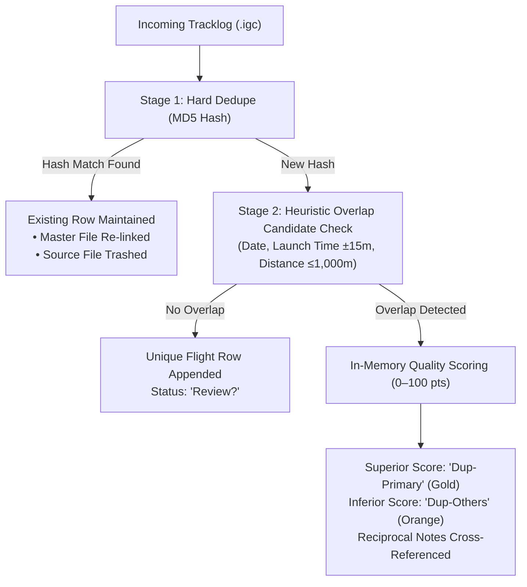

# Design Specification: Flight Ingestion & Intelligent Deduplication Engine

* **Design ID**: `DSGN-CORE-001`
* **Status**: `Implemented`
* **Current Revision**: `Rev 2.1`
* **Date Created**: `2026-10-02`
* **Last Updated**: `2026-10-02`
* **Author / Contributors**: `Rohitashwa / Antigravity AI`
* **Parent Design**: `None` (Core Subsystem)
* **Child Designs**: `None`
* **Umbrella Module / Primary Code**: [`Code/Ingestion.gs`](../../Code/Ingestion.gs), [`Code/FileHandling.gs`](../../Code/FileHandling.gs)
* **Code Revision Stamp**: `Core v2.1.0 Implemented`
* **Related Requirements / CRs**: `[RQ-ING-001]`, `[RQ-ING-002]`, `[CR-ING-008]`, `[CR-ING-009]`, `[Bug-ING-007]`, `[Bug-ING-008]`, `[Bug-ING-009]`

---

## 1. Executive Summary & Intent

### Problem Statement
Paraglider pilots capture flight tracks across diverse recording hardware and apps (dedicated varios, smartphones running XCTrack, smartwatches, GPS trackers). This creates three major challenges:
1. **Multi-Source Fragmentation**: Logs originate in watch folders, browser uploads, Google Drive links, and bulk ZIP archives.
2. **Duplicate Inflation**: Running multiple instruments during the same flight produces multiple IGC files for one physical flight.
3. **Execution Timeouts**: Traditional Apps Script file parsers that fetch Google Drive files in a loop hit Google's 6-minute execution cutoff and quota throttles.

### Proposed Solution
An intelligent, multi-source ingestion pipeline featuring:
* **Two-Stage Deduplication**: Instant MD5 content matching (Hard Dedupe) followed by an in-memory heuristic candidate quality scoring engine (0–100 pts) that identifies `Dup-Primary` vs `Dup-Others` with zero Google Drive round-trips.
* **Master Mirroring & Drive Isolation**: Automatic mirroring to `MASTER_LOG_FOLDER_ID` for SeeYou Cloud 3D integration with strict quarantine for corrupt files.
* **Timezone-Immune Precision**: Extracts sheet date/time representations via `getDisplayValues()`, eliminating script-timezone date rollovers.

---

## 2. Requirements & Scope

### Functional Requirements
* **REQ-1 (Multi-Source Ingestion)**: Ingest `.igc`, `.igx`, `.zip`, and `.gz` archives from Watch Folders, Drag-and-Drop modals, Drive URLs, and High-Speed Bulk Batching.
* **REQ-2 (Zero Drive Round-Trips in Triage)**: Evaluate track overlap and quality scores strictly from sheet row telemetry in memory (`scoreFlightQualityFromRow_`).
* **REQ-3 (Candidate Pairing & Reciprocal Notes)**: Group duplicate clusters under throwaway IDs (`D01`, `D02`) and write reciprocal cross-references on flight notes.
* **REQ-4 (Dashboard Isolation)**: Default unreviewed flights to `Review?`, and ensure only `Valid` flights feed Dashboard statistics.

### Non-Goals
* Centralized server-side file hosting or third-party cloud database persistence.

---

## 3. Architecture & Detailed Design

### 3.1 Two-Stage Deduplication Pipeline

### 3.2 Quality Scoring Breakdown (0–100 pts)
Evaluated strictly in memory via `scoreFlightQualityFromRow_`:
* **Device Authority (Max 40 pts)**: Dedicated Vario (25 pts), XCTrack (35 pts), Generic phone app (15 pts), Unknown (10 pts).
* **Barometric Integrity (Max 30 pts)**: Authentic pressure curve (30 pts), single max altitude (15 pts).
* **Duration & Distance (Max 20 pts)**: Duration $> 30\text{ min}$ (15 pts), $> 10\text{ min}$ (10 pts).
* **Equipment Richness (Max 10 pts)**: Glider model populated (+10 pts).

---

## 4. Implementation & Code Mapping

* **Ingestion Pipeline**: [`Code/Ingestion.gs`](../../Code/Ingestion.gs)
* **Google Drive Pipeline**: [`Code/FileHandling.gs`](../../Code/FileHandling.gs)
* **Modal Dialogs**: [`Code/BulkIngestDialog.html`](../../Code/BulkIngestDialog.html), [`Code/UploadDialog.html`](../../Code/UploadDialog.html), [`Code/URLDialog.html`](../../Code/URLDialog.html)
* **Automated Unit Tests**: [`tests/Test.gs`](../../tests/Test.gs) (`testDedupeAndQualityScoring_`, `testDedupeEngineEnhancements_`)
