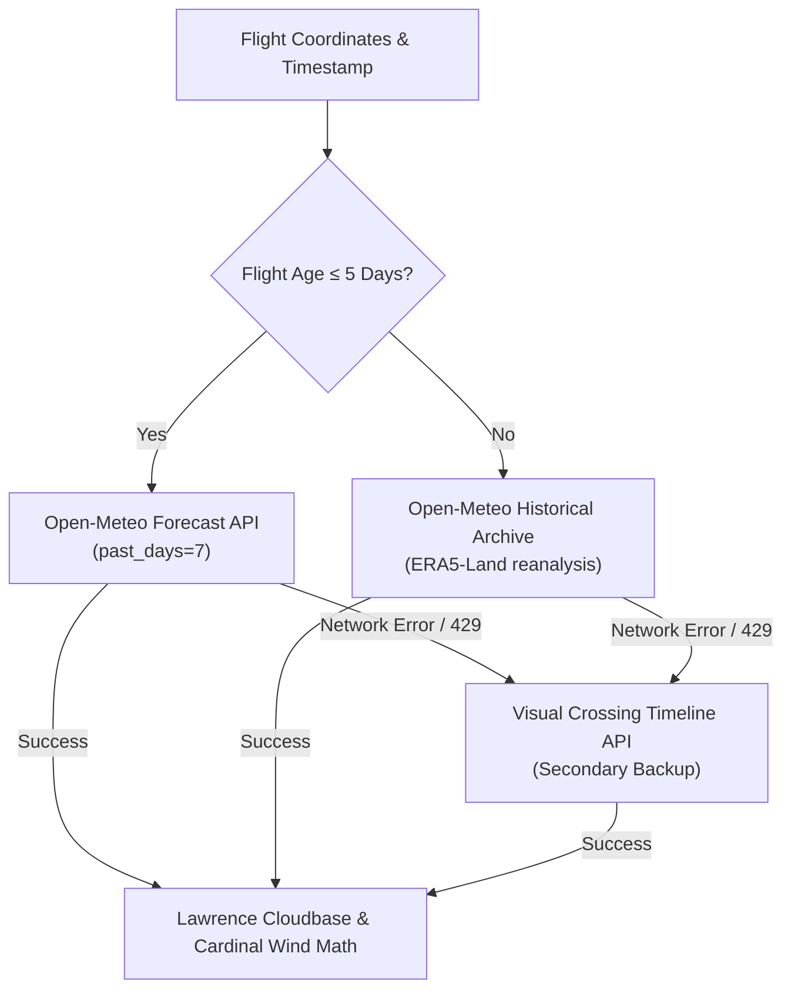

# Design Specification: Meteorological, Geocoding & League Gateways

* **Design ID**: `DSGN-CORE-003`
* **Status**: `Implemented`
* **Current Revision**: `Rev 2.1`
* **Date Created**: `2026-10-02`
* **Last Updated**: `2026-10-02`
* **Author / Contributors**: `Rohitashwa / Antigravity AI`
* **Parent Design**: `None` (Core Subsystem)
* **Child Designs**: `None`
* **Umbrella Module / Primary Code**: [`Code/Weather.gs`](../../Code/Weather.gs), [`Code/Geo.gs`](../../Code/Geo.gs), [`Code/XContest.gs`](../../Code/XContest.gs)
* **Code Revision Stamp**: `Core v2.1.0 Implemented`
* **Related Requirements / CRs**: `[RQ-SCR-002]`, `[RQ-SCR-003]`, `[RQ-SCR-004]`, `[Bug-SCR-002]`, `[Bug-GEO-001]`, `[Bug-GEO-002]`

---

## 1. Executive Summary & Intent

### Problem Statement
Manually searching for weather conditions, takeoff site names, regional towns, and contest status for every logged flight is tedious and error-prone. However, automated external querying faces severe platform challenges: external API rate limiting, network latency timeouts, quota exhaustion, and client-side web token protections (e.g. Cloudflare Turnstile on XContest).

### Proposed Solution
A resilient gateway architecture providing:
* **Multi-Provider Weather Chain**: Queries Open-Meteo Forecast API for recent flights ($\le 5\text{ days}$) and Historical Archive for older flights, with automatic fallback to Visual Crossing.
* **Cached Reverse Geocoding**: Resolves coordinates to Town, Region, and Country via OpenStreetMap Nominatim with a mandatory $1.0\text{s}$ throttle and a 6-hour `CacheService` TTL.
* **Direct Flight Probing for XContest**: Bypasses browser JavaScript scraping to verify flights on XContest.org, extract permanent database flight IDs, and enforce the 14-day competition claim deadline.

---

## 2. Requirements & Scope

### Functional Requirements
* **REQ-1 (Atmospheric Observations)**: Fetch temperature, dew point, wind speed, gust speed, wind direction, and surface pressure at takeoff.
* **REQ-2 (Lawrence Cloudbase Calculation)**: Compute convective cloudbase using the Lawrence spread formula: $(T - T_d) \times 125\text{ m}$.
* **REQ-3 (Reverse Geocoding & Sites)**: Extract city, region, and country from launch/landing coordinates; match takeoff against cataloged paragliding sites.
* **REQ-4 (XContest Verification)**: Probe flight URLs on XContest.org with UTC launch tolerance ($\pm 2\text{ min}$) and calculate 14-day claim status (`Claim soon!` vs `Expired`).

---

## 3. Architecture & Detailed Design

### 3.1 Weather Provider Chain (`Weather.gs`)

### 3.2 Geocoding & Site Matching (`Geo.gs`)
* Coordinates are rounded to 4 decimal places (~$11\text{m}$ precision) and hashed into `CacheService`.
* Nominatim queries enforce a $1.0\text{s}$ pause to strictly respect OpenStreetMap community usage policies.
* Overpass queries search for `sport=paragliding` and `sport=hang_gliding` nodes within $1{,}500\text{m}$.

### 3.3 Direct Flight Probing (`XContest.gs`)
* Probes deterministic XContest URLs: `https://www.xcontest.org/world/en/flights/detail:<username>/<YYYY-MM-DD>/<HH:MM>`.
* **UTC Midnight Protection**: Evaluates flight start times across UTC date boundaries to prevent Western hemisphere timezones from shifting dates.
* Matches permanent internal flight IDs (`fl=...`) and creates direct hyperlinks.

---

## 4. Implementation & Code Mapping

* **Weather Gateway**: [`Code/Weather.gs`](../../Code/Weather.gs)
* **Geocoding & Site Gateway**: [`Code/Geo.gs`](../../Code/Geo.gs)
* **XContest Gateway**: [`Code/XContest.gs`](../../Code/XContest.gs)
* **Automated Unit Tests**: [`tests/Test.gs`](../../tests/Test.gs) (`testXContest_`, `testWeather_`, `testGeo_`)
