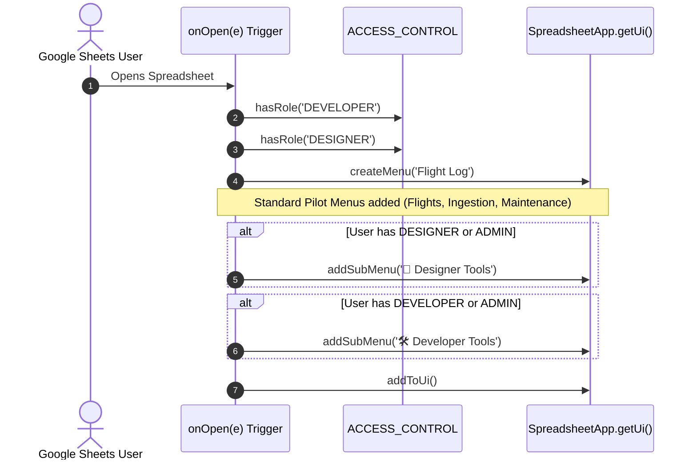
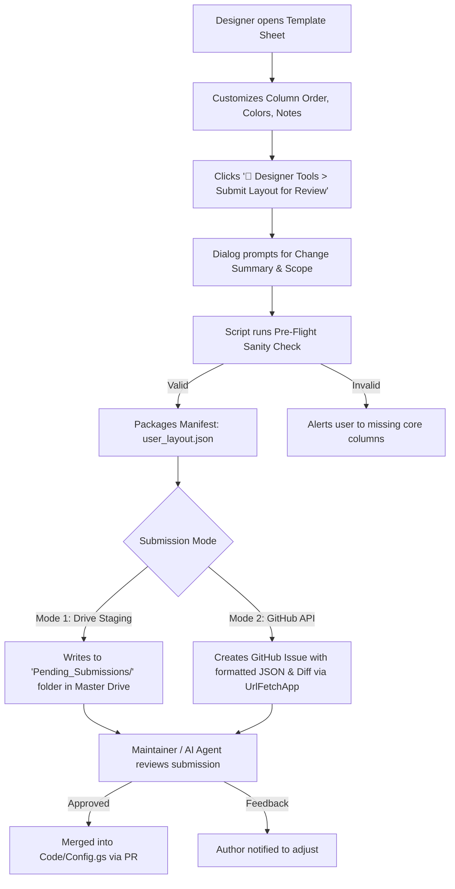

# Design Specification: Platform Role-Based Access Control (RBAC) & Contributor Framework

* **Design ID**: `DSGN-SYS-002`
* **Status**: `Draft`
* **Current Revision**: `Rev 1.0`
* **Date Created**: `2026-10-02`
* **Last Updated**: `2026-10-02`
* **Author / Contributors**: `Rohitashwa / Antigravity AI`
* **Parent Design**: `None` (Root Platform Architecture)
* **Child Designs**: [`DSGN-SYS-003_Reverse_Schema_Extraction_and_Personalization.md`](./DSGN-SYS-003_Reverse_Schema_Extraction_and_Personalization.md)
* **Umbrella Module / Primary Code**: [`Code/Access.gs`](../../Code/Access.gs) *(Proposed)*
* **Code Revision Stamp**: `Pending Implementation`
* **Related Requirements / CRs**: `[RQ-SYS-001]`, `[RQ-SYS-002]`, `[RQ-SYS-011]`, `[CR-SYS-007]`

---

## 1. Executive Summary & Intent

### Problem Statement
As ParaFlightLog evolves toward an open-source, multi-pilot community platform, different users interact with the spreadsheet in distinct roles: standard pilots logging flights, power users/designers customizing layouts, and developers maintaining core code. Currently:
1. **Uncurated Menu Clutter**: All users see every Admin and Developer tool regardless of technical expertise, increasing cognitive overhead and risk of accidental system resets.
2. **High Contributor Barrier ("The GitHub Hurdle")**: Talented UI designers, flight instructors, and testers cannot contribute layout tweaks, column notes, or metric improvements without learning Git, Markdown, Clasp, and pull requests.
3. **No Centralized Identity & Permissions Layer**: There is no programmatic mechanism to restrict sensitive utilities (schema restructuring, dangerous resets, inspection internals) based on Google account identity.

### Proposed Solution
This design introduces a **Platform Role-Based Access Control (RBAC) and Contributor Framework**:
* **Centralized Access Authority (`Code/Access.gs`)**: Maps authenticated Google accounts to standardized roles (`ADMIN`, `DEVELOPER`, `DESIGNER`, `PILOT`).
* **Dynamic Menu Curation**: Intelligently renders persona-specific custom menus (e.g. `🛠️ Developer Tools`, `🎨 Designer Tools`) based on the authenticated user's permissions, while keeping everyday menus clean for standard pilots.
* **Dual-Layer Security Guardrail**: Enforces permissions at both the UI menu display level and the server-side RPC execution level.
* **"No-GitHub" Contributor Pipeline**: Enables designated Designers and Beta Contributors to experiment directly in Google Sheets, inspect their changes, and submit structured proposals (via Drive staging or direct GitHub Issue creation) for maintainer review.

---

## 2. Requirements & Scope

### Functional Requirements
* **REQ-1 (Identity Resolution)**: Resolve the authenticated Google account email via `Session.getActiveUser().getEmail()` with fallback handling for restricted auth modes.
* **REQ-2 (Role Hierarchy)**: Support 4 distinct role tiers:
  1. `ADMIN`: Full authority over all system, developer, and designer functions.
  2. `DEVELOPER`: Access to inspection diagnostics, automation debugging, synthetic test triggers, and raw schema dumps.
  3. `DESIGNER`: Access to layout extraction, UI styling tools, column helper notes editors, and submission dialogs.
  4. `PILOT`: Standard flight logging, personal maintenance, and profile management.
* **REQ-3 (Menu Personalization)**: Dynamically inject or suppress `Developer Tools` and `Designer Tools` submenus during `onOpen()`.
* **REQ-4 (Server-Side Hard Gating)**: Ensure all privileged RPC functions verify caller authorization before executing, preventing direct script execution bypasses.
* **REQ-5 (Contributor Submission Dialog)**: Provide an interactive submission modal allowing Designers to bundle proposed sheet modifications into a versioned JSON payload with user notes and submit for core review.

### Non-Goals (Out of Scope)
* **NON-GOAL-1**: Building a full enterprise IAM / OAuth identity provider. Google Account authentication via Google Apps Script is the sole identity provider.
* **NON-GOAL-2**: Dynamic runtime role grants via complex database schemas. Roles are defined declaratively in `Access.gs` (with optional Google Workspace Group / Domain checks).

---

## 3. Architecture & Detailed Design

### 3.1 Role Hierarchy & Permission Matrix

```
                     ┌────────────────┐
                     │     ADMIN      │
                     │  (Full System) │
                     └───────┬────────┘
                             │
            ┌────────────────┴────────────────┐
            ▼                                 ▼
   ┌─────────────────┐               ┌─────────────────┐
   │    DEVELOPER    │               │    DESIGNER     │
   │ (Code, Tests,   │               │ (UI, Layouts,   │
   │  Raw Inspection)│               │  Notes, Themes) │
   └────────┬────────┘               └────────┬────────┘
            │                                 │
            └────────────────┬────────────────┘
                             ▼
                     ┌────────────────┐
                     │     PILOT      │
                     │ (Daily Flights)│
                     └────────────────┘
```

| Capability / Menu Item | `PILOT` | `DESIGNER` | `DEVELOPER` | `ADMIN` |
| :--- | :---: | :---: | :---: | :---: |
| Flight Ingestion, Inspector, Maintenance | ✅ | ✅ | ✅ | ✅ |
| Personal Configuration Management (Save/Load) | ✅ | ✅ | ✅ | ✅ |
| Column Note / Tooltip Editor | ❌ | ✅ | ✅ | ✅ |
| Reverse Schema Layout Extractor | ❌ | ✅ | ✅ | ✅ |
| In-Sheet Contributor Proposal Submission | ❌ | ✅ | ❌ | ✅ |
| Automation Queue & Synthetic Ingestion Testing | ❌ | ❌ | ✅ | ✅ |
| Raw API Tracing & RPC Diagnostic Inspector | ❌ | ❌ | ✅ | ✅ |
| Dangerous Reset & Master Log Folder Repointing | ❌ | ❌ | ❌ | ✅ |

### 3.2 Service Architecture & Code Contracts (`Code/Access.gs`)

```javascript
/**
 * Role-Based Access Control Authority
 */
var ACCESS_CONTROL = {
  ROLES: {
    ADMIN: [
      'rohitashs@gmail.com'
    ],
    DEVELOPER: [
      'rohitashs@gmail.com'
    ],
    DESIGNER: [
      'rohitashs@gmail.com'
    ]
  },

  /**
   * Evaluates if the active user possesses the requested role.
   * Admin role automatically satisfies Developer and Designer checks.
   * @param {string} role - 'ADMIN', 'DEVELOPER', 'DESIGNER', or 'PILOT'
   * @return {boolean}
   */
  hasRole: function(role) {
    if (!role || role === 'PILOT') return true;
    var email = this.getCurrentUserEmail();
    if (!email) return false;

    var adminList = (this.ROLES.ADMIN || []).map(function(e) { return e.toLowerCase().trim(); });
    if (adminList.indexOf(email) > -1) return true;

    var roleList = (this.ROLES[role] || []).map(function(e) { return e.toLowerCase().trim(); });
    return roleList.indexOf(email) > -1;
  },

  /**
   * Retrieves sanitized, lowercase email of the active user.
   * @return {string}
   */
  getCurrentUserEmail: function() {
    try {
      return (Session.getActiveUser().getEmail() || '').toLowerCase().trim();
    } catch (e) {
      return '';
    }
  },

  /**
   * Enforces role authorization at the start of privileged server RPCs.
   * @param {string} role - Required role
   * @throws {Error} if unauthorized
   */
  enforceRole: function(role) {
    if (!this.hasRole(role)) {
      throw new Error('Access Denied: Action requires ' + role + ' privileges. Current user: ' + (this.getCurrentUserEmail() || 'Anonymous'));
    }
  }
};
```

### 3.3 Dynamic Menu Construction Sequence



### 3.4 The "No-GitHub" Contributor Lifecycle



---

## 4. Platform Constraints & Edge Cases

* **Simple Trigger Security Restrictions**: In Google Apps Script, simple triggers (`function onOpen(e)`) run in `AuthMode.LIMITED` or `NONE`. In certain shared multi-domain scenarios, `Session.getActiveUser().getEmail()` may return an empty string until the user interacts with the sheet.
  * *Mitigation*: In addition to menu-level filtering, all sensitive operations must enforce `ACCESS_CONTROL.enforceRole(role)` upon button click or dialog invocation, where full user permissions are 100% established.
* **Open Source Secrets Scrubbing**: Personal email addresses in `Access.gs` must be kept generic or driven by a private configuration in public repositories.
  * *Mitigation*: Support reading authorized emails from `ScriptProperties` or a dedicated restricted configuration tab if present.

---

## 5. Implementation Plan

1. **Phase 1: Foundation**: Create [`Code/Access.gs`](../../Code/Access.gs) with `ACCESS_CONTROL` authority, role checking, and email sanitization.
2. **Phase 2: Menu Integration**: Refactor `createCustomMenu_()` in [`Code/Code.gs`](../../Code/Code.gs) to conditionally append `Designer Tools` and `Developer Tools`.
3. **Phase 3: Execution Gating**: Wrap privileged Admin and maintenance routines with `ACCESS_CONTROL.enforceRole()`.
4. **Phase 4: Contributor Dialog**: Implement the `SubmitLayoutDialog.html` allowing in-sheet proposal packaging.

---

## 6. Revision History

| Revision | Date | Author | Description / Notes |
| :---: | :---: | :--- | :--- |
| `Rev 1.0` | 2026-10-02 | Rohitashwa / Antigravity AI | Initial design specification drafted following architectural review. |
