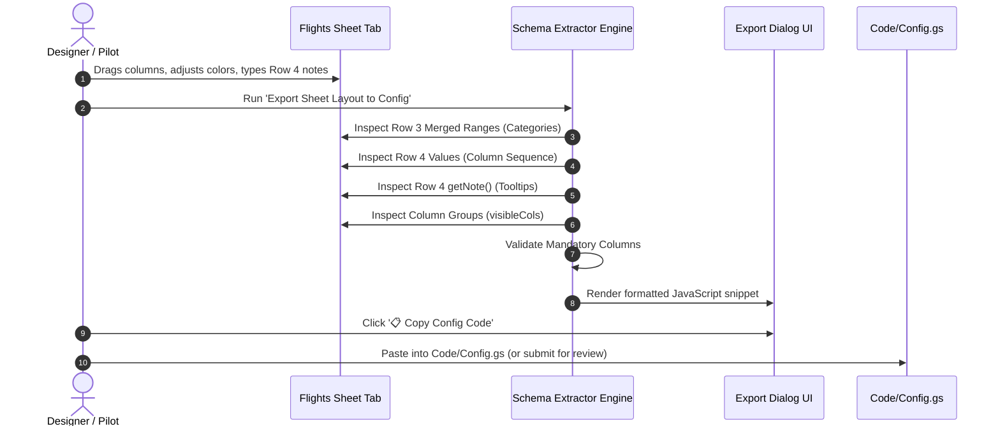
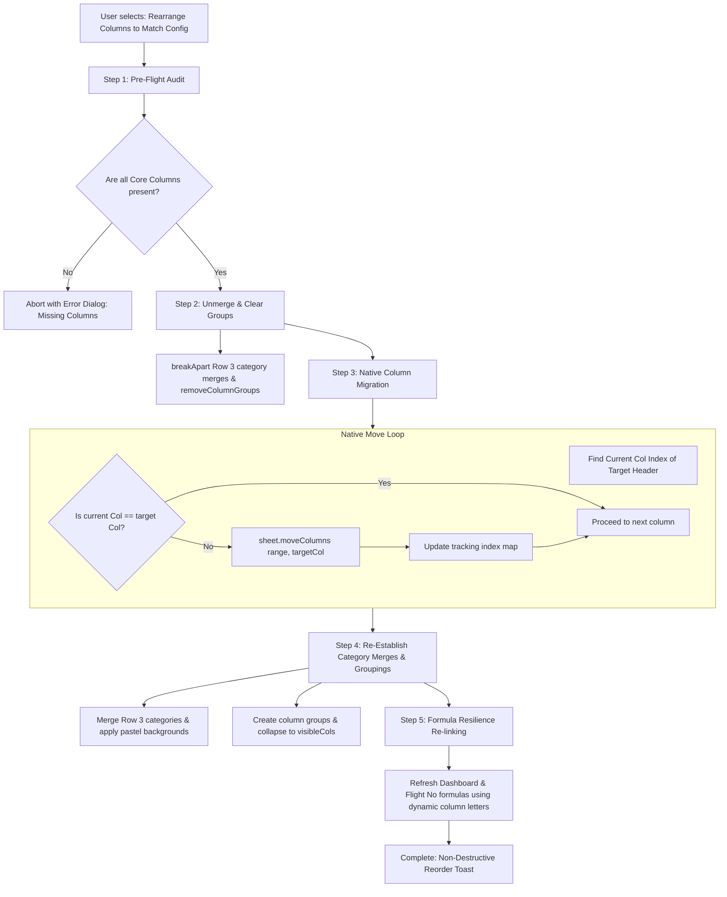

# Design Specification: Reverse Schema Extraction, Personalization & Column Rearrangement

* **Design ID**: `DSGN-SYS-003`
* **Status**: `Draft`
* **Current Revision**: `Rev 1.0`
* **Date Created**: `2026-10-02`
* **Last Updated**: `2026-10-02`
* **Author / Contributors**: `Rohitashwa / Antigravity AI`
* **Parent Design**: [`DSGN-SYS-002_Platform_Access_Control_and_Contributor_Framework.md`](file:///g:/My%20Drive/~RS2B/~Projects/ParaFlightLogProject/Docs/Design/DSGN-SYS-002_Platform_Access_Control_and_Contributor_Framework.md)
* **Child Designs**: `None`
* **Umbrella Module / Primary Code**: [`Code/Config.gs`](file:///g:/My%20Drive/~RS2B/~Projects/ParaFlightLogProject/Code/Config.gs), [`Code/Scaffold.gs`](file:///g:/My%20Drive/~RS2B/~Projects/ParaFlightLogProject/Code/Scaffold.gs)
* **Code Revision Stamp**: `Pending Implementation`
* **Related Requirements / CRs**: `[RQ-SYS-001]`, `[RQ-SYS-002]`, `[CR-SYS-005]`, `[CR-SYS-008]`, `[CR-SCH-002]`

---

## 1. Executive Summary & Intent

### Problem Statement
In Google Sheets application development, the visual grid is an exceptionally intuitive design environment for arranging columns, tweaking pastel palettes, grouping metrics, and drafting header notes. However:
1. **One-Way Code-to-Sheet Synchronization**: Currently, schema definition flows strictly from `Code/Config.gs` down to the spreadsheet. If a user customizes their column layout or adds helper notes directly in the Google Sheet UI, there is no mechanism to extract those improvements back into the codebase.
2. **Destructive Header Reapplication**: If `TABS.FLIGHTS.groups` is modified in `Config.gs`, running `reapplyFormatting_()` simply overwrites Row 4 header names while leaving rows 5:N data cells in place, immediately scrambling historical flight records.
3. **Hardcoded String Literals in Formulas**: Dashboard formulas and sequence counters reference static column letters (e.g. `INDIRECT("Flights!M5:M")`, `INDIRECT("Flights!B5:B")`, `INDIRECT("C" & (ROW()+1) & ":C")`). Moving columns breaks these formulas because string literals inside `INDIRECT()` are not adjusted by Google Sheets.
4. **Upgrade Amnesia**: When a pilot updates their sheet to a newer software version, their personal preferences (which columns are collapsed, hidden, or reordered) are wiped out by standard scaffolding.

### Proposed Solution
This design introduces a **Reverse Schema Extraction, Personalization Manifest, and Non-Destructive Column Reordering Engine**:
* **"Sheet as Visual Designer" Pattern**: Enables designers and pilots to drag columns, edit Row 4 tooltips, and format groupings in a template sheet, then extract the complete layout back into `Config.gs` via a 1-click introspection utility.
* **Separation of Core Schema vs. User Layout Manifest**: Distinguishes between mandatory system fields (which the platform requires) and user presentation preferences (`user_layout.json`).
* **Safe, Non-Destructive Column Movement**: Utilizes native Google Apps Script `sheet.moveColumns(columnSpec, destinationIndex)` combined with an automated unmerge/re-merge wrapper that safely moves entire columns without data loss.
* **Dynamic Formula Resilience**: Replaces fragile hardcoded column letter literals in formulas with dynamic name-based column resolution (`getColumnLetter_('Track Length (km)')`).

---

## 2. Requirements & Scope

### Functional Requirements
* **REQ-1 (Reverse Layout Extractor)**: Implement an interactive utility (`Export Sheet Layout to Config`) that scans the active `Flights` tab, reads Row 3 merged categories, Row 4 column headers, cell notes (`getNote()`), and column groups (`getColumnGroup()`), generating a ready-to-use `TABS.FLIGHTS.groups` and `colNotes` object.
* **REQ-2 (Native Non-Destructive Column Mover)**: Implement a safe column reordering orchestrator utilizing `sheet.moveColumns()`. The engine must:
  1. Temporarily unmerge Row 3 categories (`breakApart()`) and remove column groups.
  2. Map current column indices to target positions.
  3. Iteratively execute native `sheet.moveColumns()` to reposition data, validations, notes, and formats intact.
  4. Re-apply Row 3 category merges, colors, and `+/-` collapse groups.
* **REQ-3 (Dynamic Formula Resilience)**: Audit and eliminate all hardcoded column letter strings from formula generators in `Scaffold.gs` and `Code.gs`. Formulas must resolve column letters dynamically at runtime via `getColumnLetter_(colName)` or structured references.
* **REQ-4 (Personalization Manifest Storage)**: Support exporting and restoring `user_layout.json` alongside `Config` export, allowing pilots to back up their custom UI presentation and restore it after system updates.
* **REQ-5 (Pre-Flight Sanity Checker)**: Validate that all required core columns (e.g. `FlightID`, `Status`, `Date`, `Launch Lat`, `Launch Lon`, `IGC Hash`) remain present before allowing a layout reordering or extraction.

### Non-Goals (Out of Scope)
* **NON-GOAL-1**: Deleting or renaming core telemetry columns. Moving columns and changing visibility/groupings is fully supported; deleting mandatory system columns is rejected by the sanity checker.

---

## 3. Architecture & Detailed Design

### 3.1 The "Sheet as Visual Designer" Reverse Extractor



### 3.2 Non-Destructive Column Reordering Architecture



### 3.3 Dynamic Formula Resilience (Decoupling from Hardcoded Letters)

Currently, [`Code/Scaffold.gs`](file:///g:/My%20Drive/~RS2B/~Projects/ParaFlightLogProject/Code/Scaffold.gs) contains static column letter strings inside `INDIRECT()`:
```javascript
// FRAGILE: Breaks if Duration (Col L), Distance (Col M), or Status (Col B) move:
var fTotalDist = '=SUMIF(INDIRECT("' + fSheet + '!B5:B"), "Valid", INDIRECT("' + fSheet + '!M5:M"))';
var fFlightNo = '=IFERROR(MAX(INDIRECT("C" & (ROW()+1) & ":C")), 0) + 1';
```

Under the **Dynamic Formula Resilience** architecture:
```javascript
/**
 * Resolves column letter dynamically from current column map.
 * @param {Object} map - Column name to 1-based index mapping.
 * @param {string} colName - Header name.
 * @return {string} Column letter (e.g. 'B', 'M', 'AB').
 */
function getColLetter_(map, colName) {
  var idx = map[colName];
  if (!idx) throw new Error('Missing required column: ' + colName);
  var letter = '';
  while (idx > 0) {
    var rem = (idx - 1) % 26;
    letter = String.fromCharCode(65 + rem) + letter;
    idx = Math.floor((idx - 1) / 26);
  }
  return letter;
}

// RESILIENT: Dynamically generated using actual sheet positions:
var bCol = getColLetter_(map, 'Status');
var mCol = getColLetter_(map, 'Track Length (km)');
var cCol = getColLetter_(map, 'Flight No');
var fTotalDist = '=SUMIF(INDIRECT("' + fSheet + '!' + bCol + '5:' + bCol + '"), "Valid", INDIRECT("' + fSheet + '!' + mCol + '5:' + mCol + '"))';
var fFlightNo = '=IFERROR(MAX(INDIRECT("' + cCol + '" & (ROW()+1) & ":' + cCol + '")), 0) + 1';
```

---

## 4. Platform Constraints & Edge Cases

* **Google Apps Script `moveColumns` Limitations**:
  - `moveColumns` throws an exception if the selected range intersects any merged cells. Unmerging Row 3 prior to movement and re-merging afterwards completely eliminates this failure mode.
  - Column indices shift dynamically during iterative movement. The migration algorithm must either maintain a virtual position tracker or execute backwards (right-to-left).
* **Formula Caching**: When formulas using `INDIRECT()` are updated, Google Sheets may occasionally serve cached evaluation results. Running `SpreadsheetApp.flush()` ensures recalculation.

---

## 5. Implementation Plan

1. **Phase 1: Dynamic Formula Resilience Audit**:
   - Scan `Scaffold.gs` and `Code.gs` for literal column letters (`!B`, `!C`, `!L`, `!M`, etc.).
   - Replace with dynamic `getColLetter_(map, colName)` resolver.
2. **Phase 2: Safe Column Movement Utility**:
   - Implement `reorderFlightsColumnsNonDestructive_()` in `Scaffold.gs`.
   - Add Admin menu item: `Flight Log > Admin > Sheet Maintenance & Views > Rearrange Columns to Match Config`.
3. **Phase 3: Reverse Schema Extractor**:
   - Implement `exportSheetLayoutToConfig_()` and `ExportLayoutDialog.html`.
   - Add Designer menu item: `🎨 Designer Tools > Export Sheet Layout to Config`.
4. **Phase 4: Personalization Manifest**:
   - Integrate `user_layout.json` into Save/Load Configuration.

---

## 6. Revision History

| Revision | Date | Author | Description / Notes |
| :---: | :---: | :--- | :--- |
| `Rev 1.0` | 2026-10-02 | Rohitashwa / Antigravity AI | Initial design specification drafted following architectural discussion. |
