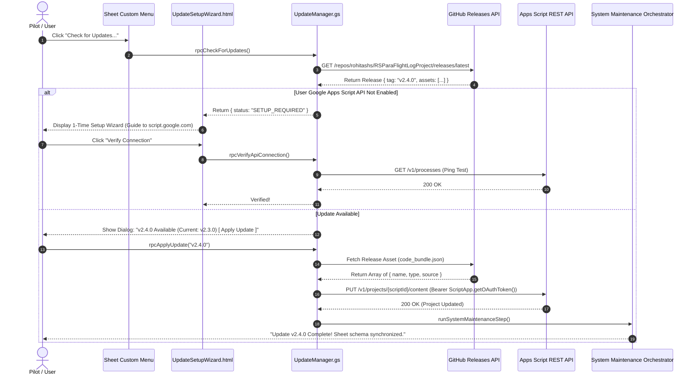

# Design Specification: Multi-Environment Lifecycle & Distribution Architecture

* **Design ID**: `DSGN-SYS-004`
* **Status**: `Under Review`
* **Current Revision**: `Rev 1.0`
* **Date Created**: `2026-10-04`
* **Last Updated**: `2026-10-04`
* **Author / Contributors**: `Antigravity AI / Rohitash S`
* **Parent Design**: `None`
* **Child Designs**: `None`
* **Umbrella Module / Primary Code**: [`Code/UpdateManager.gs`](../../Code/UpdateManager.gs)
* **Code Revision Stamp**: `Pending Implementation`
* **Related Requirements / CRs**: [`RQ-SYS-010`](../Backlog.md#L131), [`RQ-SYS-013`](../Backlog.md#L142), [`CR-SYS-015`](../Backlog.md#L450)

---

## 1. Executive Summary & Intent

### Problem Statement
Currently, the ParaFlightLog development workflow is bound directly to a single Google Spreadsheet via a singular `.clasp.json` project configuration. As the system reaches operational maturity and stores actual pilot production flight logs (with hundreds of GPS track records, hardware associations, and custom notes), developing directly against that same live sheet introduces severe operational risks:
1. **Accidental Flight Data Corruption**: Experimental code pushed via `clasp push` or uncommitted schema refactors can break live formulas, overwrite user columns, or clobber production flight records.
2. **Lack of Staging & Testing Isolation**: There is no isolated intermediate environment where multi-feature changes can be deployed, tested, and validated against sample datasets before reaching production.
3. **No Distribution & Code Update Mechanism for Pilots**: When an independent pilot copies the project sheet, Google Apps Script isolates that container-bound script. Without an automated update pipeline, distributed pilot sheets suffer permanent code drift—unable to receive bug fixes, performance improvements, or new features without manual, error-prone copy-pasting.

### Proposed Solution
This specification establishes a robust, 4-tier environment topology and a phased 2-stage distribution architecture:
* **Multi-Environment Pipeline**: Establishes 4 distinct Google Sheets (**Dev**, **Test**, **Personal Production**, and **Demo Showcase**) synchronized across 3 Git branches (`dev`, `test`, `master`) using multi-target `clasp` configurations.
* **Phase 1 Distribution (Immediate / Horizon 3 - Method 1)**: An **In-Sheet REST API Self-Patcher** (`UpdateManager.gs`). Pilots enable the Google Apps Script API once via a guided in-sheet wizard (`UpdateSetupWizard.html`). From that point forward, clicking *Check for Updates...* calls GitHub Releases to fetch the latest code payload, updates its own project files via the Google Apps Script REST API (`projects.updateContent`), and hands off execution to the **System Maintenance Orchestrator** to non-destructively apply sheet schema updates.
* **Phase 2 Distribution (Long-Term / Horizon 4 - Method 2)**: Transition to a **Google Workspace Editor Add-on**. The central code is published once via the Google Workspace Marketplace. Distributed pilot sheets contain zero bound code; they inherit updates instantaneously in the cloud upon deployment.

```
[ Developer Machines ]            [ Git Branches ]               [ Distribution Engine ]                   [ Target Google Sheets ]

  Antigravity IDE ──────────────► dev branch ────────(clasp)─────────────────────────────────────────────► 1. DEV SHEET
                                                                                                              (Rapid prototyping, test data)

  Pre-Release PRs ──────────────► test branch ───────(clasp)─────────────────────────────────────────────► 2. TEST SHEET
                                                                                                              (Pre-release validation)

  Release Tag (v2.4.0) ─────────► master branch ───► GitHub Releases API 
                                                            │
                                              [ Method 1: UpdateManager.gs ]
                                              (Apps Script REST API Self-Patcher)
                                                     ┌──────┴──────┐
                                                     ▼             ▼
                                           3. PERSONAL PROD   4. DEMO PROD
                                              (Real Flights)     (Sample Flights)
```

---

## 2. Requirements & Scope

### Functional Requirements
* **REQ-ENV-1 (4-Sheet Topology)**: The system must support 4 distinct, fully isolated Google Sheet environments:
  1. `ParaFlightLog - DEV`: Active development and experimental sandbox.
  2. `ParaFlightLog - TEST`: Pre-release staging and regression testbed.
  3. `ParaFlightLog - Personal Production`: The maintainer's real flight logbook, permanently severed from local `clasp push`.
  4. `ParaFlightLog - Demo`: A publicly accessible showcase sheet seeded with curated sample flight data.
* **REQ-ENV-2 (Git Branch Isolation)**: Git repository must maintain 3 primary branches: `dev` (feature development), `test` (staging integration), and `master` (official production releases).
* **REQ-ENV-3 (Multi-Target Clasp)**: Local developer environment must support switching push targets cleanly (`.clasp.dev.json`, `.clasp.test.json`) without commiting sensitive project IDs or user credentials to version control.
* **REQ-DIST-1 (Method 1 In-Sheet Self-Patcher)**: Sheet instances must be able to inspect GitHub Releases for newer version tags, download the published code asset, and call `https://script.googleapis.com/v1/projects/{scriptId}/content` using the active session OAuth token to patch its own `.gs` and `.html` files in-place.
* **REQ-DIST-2 (Update Setup Wizard)**: Provide an interactive 2-step setup modal (`UpdateSetupWizard.html`) that detects whether the user's account has enabled the Google Apps Script API, provides a direct link to `script.google.com/home/usersettings`, and tests/verifies connectivity.
* **REQ-DIST-3 (Zero-Data-Loss Schema Hand-off)**: Upon successful code patching, the update manager must immediately invoke the **System Maintenance Orchestrator** ([`DSGN-MNT-001`](./DSGN-MNT-001_Unified_Update_Manager_and_Maintenance_Orchestrator.md)) to update column definitions, formulas, and validations on Rows 1–4 while preserving 100% of flight rows on Row 5+.
* **REQ-DIST-4 (Phase 2 Add-on Readiness)**: The codebase must maintain modular separation between UI presentation, server RPCs, and data access so it can be packaged as a Google Workspace Editor Add-on with zero architectural rewrites.

### Non-Goals (Out of Scope)
* **NON-GOAL-1 (Remote Code Execution via `eval`)**: The system will NOT download raw JavaScript strings and execute them via `eval()` or `new Function()`. All code updates must be formally written to the Apps Script project files via the official Google REST API to guarantee security compliance and trigger registration.
* **NON-GOAL-2 (Direct Database Synchronization)**: This design does NOT sync flight log data between sheets. Each sheet's flight rows remain strictly private and local to that sheet's owner.

---

## 3. Architecture & Detailed Design

### 3.1 The 4-Sheet Environment Topology

| Environment | Sheet Name | Script ID Origin | Deployment Pathway | Primary Use Case |
| :--- | :--- | :--- | :--- | :--- |
| **1. Development** | `ParaFlightLog - DEV` | Bound Project (Current) | Local `clasp push` from `dev` branch | Feature prototyping, refactoring, test data |
| **2. Testing / Staging** | `ParaFlightLog - TEST` | Bound Project (New Copy) | Local/CI `clasp push` from `test` branch | Pre-release validation, full test suites |
| **3. Personal Production** | `ParaFlightLog - Personal Production` | Bound Project (New Copy) | Method 1 Self-Patcher via GitHub Release | Maintainer's real flight logbook & master IGCs |
| **4. Demo Showcase** | `ParaFlightLog - Demo` | Bound Project (New Copy) | Method 1 Self-Patcher via GitHub Release | Public demonstration, dummy flight data |

---

### 3.2 Git Branching & Local Clasp Configuration

#### Branch Model:
* `dev`: Default working branch. All day-to-day coding, unit testing, and experimental commits happen here. Pushes to **Dev Sheet**.
* `test`: Staging branch. Stable feature milestones are merged here from `dev`. Pushes to **Test Sheet**.
* `master`: Production release branch. Merged strictly from `test` after validation. Tagged with semantic release numbers (`v2.4.0`). Powers GitHub Releases.

#### Multi-Target Clasp Configuration:
To prevent accidental pushes to production or test environments, the active `.clasp.json` is added to `.gitignore`. Instead, environment templates are maintained:
* `.clasp.dev.json`: `{"scriptId": "<DEV_SCRIPT_ID>", "rootDir": "Code/"}`
* `.clasp.test.json`: `{"scriptId": "<TEST_SCRIPT_ID>", "rootDir": "Code/"}`
* `.clasp.json.example`: Clean template committed to Git for new developers.

Deployment commands:
* Push to Dev: `clasp push --project .clasp.dev.json`
* Push to Test: `clasp push --project .clasp.test.json`

---

### 3.3 Method 1: In-Sheet REST API Self-Patcher Architecture

Method 1 provides an automated in-sheet software updater for container-bound Google Sheets without requiring Google Workspace Marketplace publication or local developer tooling.



#### The `UpdateManager.gs` Service Contract:
```javascript
var UpdateManager = {
  GITHUB_REPO: 'rohitashs/RSParaFlightLogProject',
  API_BASE_URL: 'https://script.googleapis.com/v1/projects/',

  /**
   * Checks GitHub Releases for a newer version than current SYSTEM_MANIFEST.version.
   * @return {Object} Status containing available update details, changelog, and API readiness.
   */
  checkForUpdates: function() {},

  /**
   * Verifies if the active user has enabled the Google Apps Script API in account settings.
   * @return {boolean} True if Google REST API returns 200 OK.
   */
  verifyApiEnabled: function() {},

  /**
   * Downloads the release code payload and calls projects.updateContent to patch project files.
   * @param {string} releaseTag - The target version tag (e.g. 'v2.4.0').
   * @return {Object} Outcome summary.
   */
  applyCodeUpdate: function(releaseTag) {}
};
```

---

### 3.4 Method 2: Google Workspace Editor Add-on Architecture (Phase 2 / Horizon 4)

When the project reaches public open-source launch (Horizon 4), the distribution shifts to an **Editor Add-on**:
1. **Zero Container-Bound Code**: The Golden Template sheet contains no script files.
2. **Centralized Deployment**: Code resides in a single standalone Google Apps Script project attached to a Google Cloud Project (GCP) with the Google Workspace Marketplace SDK enabled.
3. **Automatic Fleet Updates**: Every `clasp push` to the production deployment immediately updates all pilot sheets globally without user intervention.
4. **Schema Synchronization**: When an updated Add-on opens an older sheet, `SystemMaintenanceDialog` automatically flags schema drift and applies header/formula upgrades.

---

## 4. Platform Constraints & Security Guardrails

### 4.1 The Google Apps Script API User Toggle
Google enforces an account-level security toggle at `https://script.google.com/home/usersettings` (**"Google Apps Script API: On / Off"**).
* **Security Invariant**: Apps Script cannot programmatically toggle this switch for the user.
* **Mitigation**: The `UpdateSetupWizard.html` provides a 1-click external navigation button to the settings page accompanied by visual instructions. The wizard verifies the state with an automated API ping before allowing updates.

### 4.2 OAuth Scope Management
To allow self-patching, `appsscript.json` must declare the specific REST API scope:
```json
"oauthScopes": [
  "https://www.googleapis.com/auth/script.projects",
  "https://www.googleapis.com/auth/script.external_request",
  "https://www.googleapis.com/auth/spreadsheets",
  "https://www.googleapis.com/auth/drive"
]
```
`ScriptApp.getOAuthToken()` automatically supplies the necessary Bearer token for Google API calls, eliminating the need for pilots to generate custom API keys or GCP client secrets.

### 4.3 Zero-Data-Loss Contract
Code updates strictly modify project script files (`.gs` and `.html`). The spreadsheet database grid is never touched during the code patching phase. Schema migrations are handled downstream by the proven atomic Sheet Specialists in `Scaffold.gs`, which enforce the preservation of all user flight rows (Row 5+).

---

## 5. Implementation Roadmap

### Phase 1: Environment Isolation & Clasp Multi-Target Setup (Current)
* [ ] Create `ParaFlightLog - Personal Production` copy in Google Drive to safeguard real flight logs.
* [ ] Create `ParaFlightLog - TEST` copy in Google Drive and obtain its Script ID.
* [ ] Configure `.clasp.dev.json` and `.clasp.test.json`.
* [ ] Update `.gitignore` to protect `.clasp.json` and local credentials.
* [ ] Establish `dev`, `test`, and `master` branches in Git.

### Phase 2: Method 1 In-Sheet Self-Patcher Implementation
* [ ] Build `Code/UpdateManager.gs` (GitHub Release fetcher, OAuth token dispatcher, REST API patcher).
* [ ] Build `Code/UpdateSetupWizard.html` (1-time API enablement guide and verification ping).
* [ ] Create GitHub Action workflow (`.github/workflows/package-release.yml`) to compile `.gs`/`.html` files into a release JSON asset on release tag creation.
* [ ] Wire menu entry: `Flight Log > Admin > System Maintenance & Health > Check for Software Updates...`.
* [ ] Test end-to-end self-patching on the **Test Sheet**.

### Phase 3: Production Rollout & Demo Seeding
* [ ] Deploy finalized Method 1 code to `master` and create initial release tag `v2.4.0`.
* [ ] Create `ParaFlightLog - Demo` sheet seeded with realistic sample flight data.
* [ ] Verify 1-click self-updating on both Personal Production and Demo sheets.

### Phase 4: Long-Term Horizon 4 Preparation (Method 2 Add-on)
* [ ] Configure GCP project and enable Google Workspace Marketplace SDK.
* [ ] Prepare store listing assets, privacy policy, and scope justification video.
* [ ] Submit for Google Editor Add-on verification.

---

## 6. Revision History

| Revision | Date | Author | Description / Revision Note |
| :---: | :---: | :--- | :--- |
| `Rev 1.0` | 2026-10-04 | Antigravity AI / Rohitash S | Initial formal architectural specification for 4-sheet environment topology, Git branching strategy, Method 1 In-Sheet REST API Self-Patcher, and Phase 2 Google Workspace Editor Add-on roadmap. |
