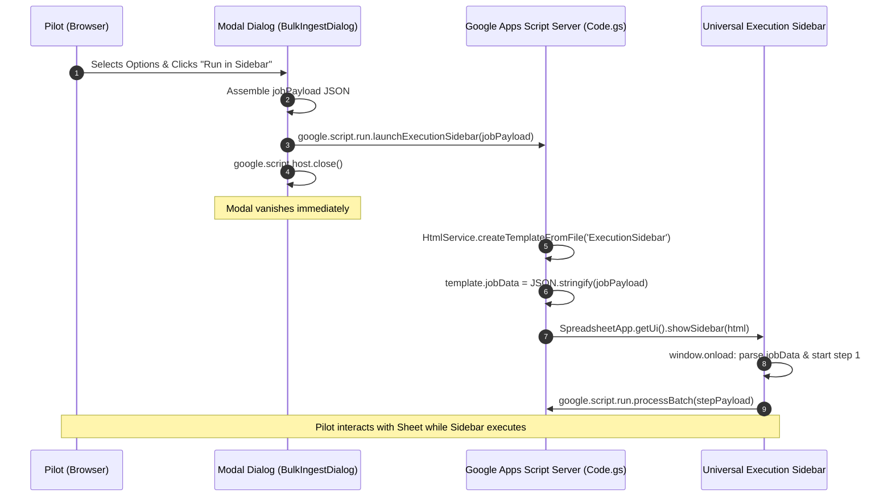
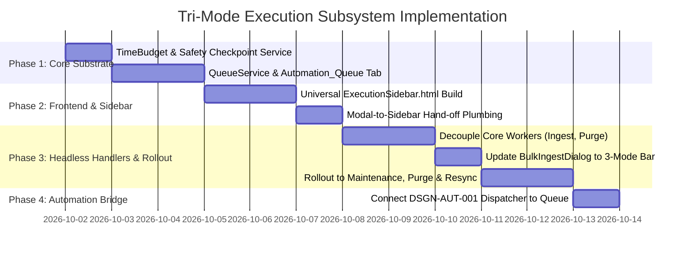

# Design Specification: Tri-Mode Execution Subsystem & Universal Execution Sidebar

* **Design ID**: `DSGN-UI-001`
* **Status**: `Under Review`
* **Current Revision**: `Rev 1.0`
* **Date Created**: `2026-10-01`
* **Last Updated**: `2026-10-01`
* **Author / Contributors**: `Rohitash / Antigravity AI`
* **Parent Design**: `None`
* **Child / Sibling Designs**: [`DSGN-AUT-001`](./DSGN-AUT-001_Table_Driven_Automation_Engine.md) (Sibling / Automation Engine), [`DSGN-LOG-001`](./DSGN-LOG-001_Activity_Logging_System.md) (Sibling / Telemetry Sink)
* **Umbrella Module / Primary Code**: [`Code/ExecutionSidebar.html`](../../Code/ExecutionSidebar.html), [`Code/QueueService.gs`](../../Code/QueueService.gs), [`Code/TimeBudget.gs`](../../Code/TimeBudget.gs)
* **Code Revision Stamp**: `Pending Implementation`
* **Related Requirements / CRs**: `RQ-SYS-002`, `CR-UI-019`, `CR-AUT-001`

---

## 1. Executive Summary & Intent

### Problem Statement
In Google Sheets, operations that process multiple files or flight rows (Bulk Ingestion, Master Folder Re-sync, Maintenance Backfill, Purge, and Watch Folder Scanning) present a fundamental user experience dilemma:
1. **The Modal Lockdown Dilemma**: Complex operations require significant screen real estate for Stage 1 (Discovery & Configuration)—browsing Drive folder hierarchies, toggling API enrichments, previewing matched flight rows, and verifying targets. However, once execution begins, standard Google Sheets modal dialogs (`showModalDialog`) dim the backdrop and lock the entire spreadsheet grid. The pilot cannot inspect other flights, review the Dashboard, or check formulas while a 2-to-5-minute batch job runs.
2. **Duplicated UI Components Across Dialogs**: Currently, 7 distinct HTML dialogs (`BulkIngestDialog`, `URLDialog`, `ResyncDialog`, `PurgeDialog`, `FlightMaintenanceDialog`, `ScanDialog`, `MarkDuplicatesDialog`) duplicate their own activity log consoles, "📋 Copy Log" buttons, progress bar CSS, and status line code. This creates massive frontend redundancy and inconsistent user interactions.
3. **Execution Wall (Google 6-Minute Limit)**: Long-running jobs that process 100+ files or rows risk hitting Google Apps Script's hard 6-minute execution limit if running synchronously on the server, resulting in sudden `Exceeded maximum execution time` crashes.
4. **Missing Autonomous Background Execution**: While pilots want to trigger operations on demand, they frequently do not want to wait for them. There is currently no mechanism to hand off a configured job to headless background execution with zero UI footprint while monitoring progress via the `Activity Logs` tab.

### Proposed Solution
Implement a unified **Tri-Mode Execution Subsystem** paired with a reusable **Universal Execution Sidebar**:

```
+─────────────────────────────────────────────────────────────────────────────+
| STAGE 1: Discovery & Configuration (Wide Modal Dialog)                      |
| - Drive Folder Browser / URL Input / Batch Settings / Enrichment Toggles    |
+─────────────────────────────────────────────────────────────────────────────+
                                       │
                    Pilot Selects Execution Modality
                                       │
     ┌─────────────────────────────────┼─────────────────────────────────┐
     ▼                                 ▼                                 ▼
┌───────────────────┐       ┌──────────────────────┐       ┌──────────────────┐
│  MODE 1: Run Here │       │ MODE 2: Run Sidebar  │       │ MODE 3: Run Bkg  │
│  (In Modal)       │       │ (Modeless 300px)     │       │ (Headless Cloud) │
│                   │       │                      │       │                  │
│ • Synchronous UI  │       │ • Modal closes       │       │ • Modal closes   │
│ • Locked sheet    │       │ • Sheet interactive! │       │ • Zero UI        │
│ • Immediate close │       │ • Dashboard active   │       │ • Enqueued       │
│ • Best for <30s   │       │ • Common Sidebar     │       │ • Logs to Sheet  │
└───────────────────┘       └──────────────────────┘       └──────────────────┘
```

1. **Two-Stage Standardized Lifecycle**:
   * *Stage 1 (Discovery & Options)*: Wide modal dialog (e.g. 680px) dedicated to setup, folder navigation, parameter tuning, and pre-flight validation.
   * *Stage 2 (Tri-Mode Execution Choice)*: When ready, the pilot chooses how to execute via 3 standardized action buttons: **`[ Run Here ]`**, **`[ Run in Sidebar ]`**, and **`[ Run in Background ]`**.
2. **Universal Execution Sidebar (`Code/ExecutionSidebar.html`)**:
   * A single, modular, 300px modeless sidebar replacing all duplicated progress bars, copy buttons, status lines, and log consoles across the entire project.
   * When the pilot clicks *"Run in Sidebar"*, the modal vanishes and the sidebar immediately opens on the right rail, streaming real-time execution while leaving the spreadsheet grid 100% interactive.
3. **Persistent Job Queue Service (`Code/QueueService.gs`)**:
   * A resilient, visible queue stored in a dedicated `Automation_Queue` sheet tab. Eliminates the 9 KB per-property storage ceiling of `PropertiesService`.
   * Serves as the immediate backend for Mode 3 (*Run in Background*) and establishes the exact execution substrate for the upcoming **Table-Driven Automation Engine (`DSGN-AUT-001`)**.
4. **Bounded 4.5-Minute Time Budget (`Code/TimeBudget.gs`) & Self-Continuation**:
   * All background jobs enforce a 4.5-minute safety threshold. When time is exhausted, the worker flushes data, commits rows, serializes queue state, and programmatically spawns a 30-second continuation trigger.
   * Allows multi-hundred-flight operations to run across continuous cloud waves unattended without timeout errors.

---

## 2. Architecture & Subsystem Relationship

### 2.1 Cohesion with the Table-Driven Automation Engine (`DSGN-AUT-001`)

This design directly fulfills the execution substrate required by `DSGN-AUT-001`. The relationship is partitioned into two clear operational layers:

```
┌─────────────────────────────────────────────────────────────────────────────┐
│ LAYER 2: Rule Dispatcher & Trigger Scheduling (DSGN-AUT-001)                │
│ • Automation Sheet Tab (User Rules: Triggers, Conditions, Scope, Actions)   │
│ • Single Master Heartbeat Cron (Every 5 or 15 Minutes in Google Cloud)      │
│ • Metadata Registry & Scope Expression DSL                                  │
└─────────────────────────────────────────────────────────────────────────────┘
                                       │
                      Enqueues Jobs / Evaluates Rules
                                       │
                                       ▼
┌─────────────────────────────────────────────────────────────────────────────┐
│ LAYER 1: Tri-Mode Execution Subsystem (DSGN-UI-001 - THIS DESIGN)           │
│ • Persistent Job Queue (QueueService & Automation_Queue Tab)                │
│ • Universal Execution Sidebar (ExecutionSidebar.html)                       │
│ • Headless Core Worker Engine (runBulkIngestCore, runPurgeCore, etc.)       │
│ • Bounded 4.5-Minute Time Budget & Self-Continuation Triggers               │
│ • Centralized Activity Logging Integration (LoggerService)                  │
└─────────────────────────────────────────────────────────────────────────────┘
```

* **Immediate Benefit**: The 3-mode execution model is fully functional today without waiting for the full automation dispatcher.
* **Zero Rework**: When `DSGN-AUT-001` is implemented, the Master Heartbeat Dispatcher will simply call `QueueService.enqueue(action, scope, params)`. The entire execution, checkpointing, continuation, and logging machinery is already built and battle-tested.

---

## 3. Detailed Component Specifications

### 3.1 The Universal Execution Sidebar (`Code/ExecutionSidebar.html`)

Google Sheets strictly restricts sidebars to **300 CSS pixels in width**. `ExecutionSidebar.html` is engineered specifically for this compact vertical rail.

```
┌──────────────────────────────────────────────┐
│  ⚡ Bulk Flight Ingestion: 42 Flights        │ <- 1. Context Header
│  Folder: Drive/Paragliding/2026              │
├──────────────────────────────────────────────┤
│  [📂 42 Staged] [✅ 18 Done] [⚡ 2] [❌ 0]    │ <- 2. Metric Pills
├──────────────────────────────────────────────┤
│  Activity Log                      [📋 Copy] │ <- 3. Activity Console
│ ┌──────────────────────────────────────────┐ │    (Fixed 260px height,
│ │ [22:15:02] Batch 1/9: Processing 5 files │ │     color-coded text,
│ │ [22:15:06] F20261001_01: Ingested (PGE)  │ │     auto-scrolling)
│ │ [22:15:10] F20261001_02: Ingested (O-M)  │ │
│ └──────────────────────────────────────────┘ │
├──────────────────────────────────────────────┤
│  Status: Processing batch 4/9 (42%)          │ <- 4. Footer & Progress
│  [==================>                      ] │
├──────────────────────────────────────────────┤
│  [ Cancel Operation ]                        │ <- 5. Dynamic Controls
│  (Swaps to [ Done / Close ] on completion)   │
└──────────────────────────────────────────────┘
```

#### Sidebar Component Breakdown:
1. **Context Header**:
   * Job Icon & Title (e.g. `⚡ Bulk Flight Ingestion`, `🧹 Flight Purge`, `🔄 Master Sync`).
   * Sub-context line: Folder path, selection scope, or batch settings.
2. **Metric Pills Container**:
   * Dynamic status pills rendered based on job type:
     * Ingestion: `Staged`, `Imported`, `Duplicates`, `Errors`.
     * Maintenance: `Targeted`, `Updated`, `Skipped`, `Errors`.
     * Purge: `Identified`, `Trashed`, `Rows Deleted`.
3. **Unified Activity Log Console**:
   * Fixed-height container (`height: 260px; overflow-y: auto; font-family: monospace; font-size: 11px;`).
   * Color-coded line styling: Success (Green `#2E7D32`), Info (Blue `#1565C0`), Warn (Amber `#E65100`), Error (Red `#C62828`).
   * Standardized `📋 Copy Log` clipboard integration.
4. **Universal Progress Bar**:
   * Status text line (Left: current action, Right: percentage `42%`).
   * Smooth animated CSS fill bar (`height: 8px; border-radius: 4px; background: #1976D2;`).
5. **Dynamic Control Buttons**:
   * During execution: Secondary `Cancel` button (aborts stepping or flags queue).
   * Upon completion: Replaced by Primary Green `Done / Close` button (`google.script.host.close()`).

---

### 3.2 Modal to Sidebar Hand-off Protocol

The transition from modal dialog to sidebar executes seamlessly in under 100 milliseconds:



#### The `jobPayload` Data Contract:
```javascript
{
  "jobId": "JOB_20261001_221530",
  "jobType": "BULK_INGEST",
  "title": "Bulk Flight Ingestion",
  "contextText": "Drive/Paragliding/2026",
  "totalItems": 42,
  "queue": ["fileId_1", "fileId_2", ...],
  "batchSize": 5,
  "options": {
    "siteLookup": true,
    "geoLookup": true,
    "weatherLookup": false,
    "xcScoring": true,
    "analytics": true,
    "deleteSource": false
  }
}
```

---

### 3.3 The Persistent Queue Architecture (`Automation_Queue` Tab)

To eliminate the fragile 9 KB ceiling of `PropertiesService` and provide 100% human-in-the-loop visibility, queue state is persisted in a dedicated, hidden or visible management tab:

* **Sheet Name**: `'Automation_Queue'` *(registered in `CFG.sheets.queue` and `TABS.QUEUE`)*
* **Tab Color**: Dark Slate Gray (`#455A64`)
* **Default Dimensions**: 20 rows, 8 columns

| Col | Header | Width | Type | Purpose & Example Content |
| :---: | :--- | :---: | :--- | :--- |
| **A** | **Job ID** | `170 px` | Text, Monospace | Unique identifier: `JOB_YYYYMMDD_HHMMSS`. |
| **B** | **Type** | `130 px` | Dropdown | `BULK_INGEST`, `PURGE`, `RESYNC`, `MAINTENANCE`, `LOG_CLEANUP`. |
| **C** | **Status** | `120 px` | Dropdown | `QUEUED`, `RUNNING`, `CHECKPOINT_PAUSED`, `COMPLETED`, `CANCELLED`, `FAILED`. |
| **D** | **Progress** | `100 px` | Center Text | Current progress indicator: `45 / 120 (37%)`. |
| **E** | **Started At** | `150 px` | Timestamp | Job kickoff timestamp (`yyyy-mm-dd hh:mm:ss`). |
| **F** | **Updated At** | `150 px` | Timestamp | Last active heartbeat or checkpoint timestamp. |
| **G** | **Payload & State**| `350 px` | Text Wrap (JSON) | Serialized remaining queue items, cursor indices, and active options. |
| **H** | **Last Error** | `200 px` | Text Wrap | Stack trace or failure description if status is `FAILED`. |

#### Why the Spreadsheet Queue Outperforms `PropertiesService`:
1. **Capacity**: Individual Google Sheets cells hold up to **50,000 characters**, allowing queues with hundreds of file paths or JSON payloads without truncation.
2. **Auditability & Live Progress**: Pilots can open `Automation_Queue` and watch background execution progress row by row.
3. **Instant User Cancellation**: If a pilot wants to halt a running background task, they simply edit cell C from `RUNNING` to `CANCELLED`. On the next batch check, the worker cleanly aborts and logs the cancellation to `Activity Logs`.

---

### 3.4 Bounded 4.5-Minute Time Budget & Self-Continuation (`TimeBudget.gs`)

Google Apps Script terminates any execution that reaches 6 minutes (360s). `TimeBudget.gs` provides a deterministic guardrail:

```javascript
var TimeBudgetService = {
  // Safe ceiling: 4.5 minutes (270,000 ms), leaving a 90-second buffer
  MAX_EXECUTION_MS: 270000,

  create: function() {
    var start = new Date().getTime();
    return {
      startTime: start,
      isExhausted: function() {
        return (new Date().getTime() - start) >= TimeBudgetService.MAX_EXECUTION_MS;
      },
      elapsedSeconds: function() {
        return Math.round((new Date().getTime() - start) / 1000);
      }
    };
  }
};
```

#### The Continuation Loop:
1. The background worker processes items in a loop.
2. After each item/batch, it checks `budget.isExhausted()`.
3. If exhausted:
   * Commits all sheet rows (`SpreadsheetApp.flush()`).
   * Serializes the remaining queue back to the `Automation_Queue` row.
   * Updates Job Status to `CHECKPOINT_PAUSED`.
   * Logs checkpoint to `Activity Logs`: `"[INFO] Reached 4.5m safety budget. 45/120 items complete. Scheduling continuation."`
   * Programmatically schedules an immediate continuation trigger:
     ```javascript
     ScriptApp.newTrigger('processBackgroundQueue')
              .timeBased()
              .after(1000 * 30) // Resume in 30 seconds
              .create();
     ```
4. 30–60 seconds later, Google Cloud executes `processBackgroundQueue`, deletes the temporary trigger, starts a fresh 6-minute execution clock, and resumes from item 46.

---

## 4. Headless Core Worker Contract

To allow the exact same flight logic to be driven by either the **Modal Dialog (Mode 1)**, the **Execution Sidebar (Mode 2)**, or the **Headless Queue (Mode 3 & Automation)**, all business logic is decoupled from HTML/DOM into pure `.gs` core workers:

```javascript
// Universal Worker Signature
function executeWorkerCore_(jobType, currentBatchItems, options, stepIndex) {
  switch (jobType) {
    case 'BULK_INGEST':
      return Ingestion.processBulkBatchCore(currentBatchItems, options);
    case 'PURGE':
      return Ingestion.processPurgeStepCore(currentBatchItems);
    case 'RESYNC':
      return Ingestion.processResyncStepCore(currentBatchItems);
    case 'MAINTENANCE':
      return Ingestion.processMaintenanceStepCore(currentBatchItems, options);
    case 'LOG_CLEANUP':
      return LoggerService.cleanLogs(options.keepRows, options.keepDays);
    default:
      throw new Error('Unknown jobType: ' + jobType);
  }
}
```

* **Mode 1 (Modal)**: Client calls `google.script.run.executeWorkerCore_()` step by step; updates modal DOM.
* **Mode 2 (Sidebar)**: Client calls `google.script.run.executeWorkerCore_()` step by step; updates sidebar DOM.
* **Mode 3 (Background) & Automation Engine**: Server executes `executeWorkerCore_()` in a while loop inside `processBackgroundQueue()`; updates `Automation_Queue` row and streams rows to `Activity Logs`.

---

## 5. UI Normalization Across Existing Dialogs (`CR-UI-019`)

As part of this subsystem implementation, all 7 existing dialogs are standardized to eliminate redundant inner headers and present the unified 3-mode action button bar:

| Dialog | Stage 1: Discovery & Setup | Stage 2: Tri-Mode Execution Bar |
| :--- | :--- | :--- |
| **`BulkIngestDialog.html`** | Folder picker (height: 200px), URL input, batch dropdown, 6 enrichment checkboxes. | `[ Run Here ]` `[ Run in Sidebar ]` `[ Run in Background ]` `[ Cancel ]` |
| **`FlightMaintenanceDialog.html`** | Scope selector (All vs Selected), operation checkboxes (Geo, Weather, XC, Sort). | `[ Run Here ]` `[ Run in Sidebar ]` `[ Run in Background ]` `[ Cancel ]` |
| **`ResyncDialog.html`** | Scans Master Folder, displays missing count and restored target preview. | `[ Run Here ]` `[ Run in Sidebar ]` `[ Run in Background ]` `[ Cancel ]` |
| **`PurgeDialog.html`** | Scans Flights sheet, identifies flights with Status = 'Remove'. | `[ Run Here ]` `[ Run in Sidebar ]` `[ Run in Background ]` `[ Cancel ]` |
| **`URLDialog.html`** | URL input, browse Google Drive folders, delete source checkbox. | `[ Run Here ]` `[ Run in Sidebar ]` `[ Run in Background ]` `[ Cancel ]` |
| **`ScanDialog.html`** | Displays configured Watch Folder count and target paths. | `[ Run Here ]` `[ Run in Sidebar ]` `[ Run in Background ]` `[ Cancel ]` |
| **`MarkDuplicatesDialog.html`** | Checkboxes for `Dup - Others` and `Dup - Primary` with live counts. | `[ Stage to Remove ]` `[ Cancel ]` *(Fast staging, no batch execution needed)* |

---

## 6. Implementation Plan & Phases



### Phase 1: Foundational Execution Substrate
1. Implement `Code/TimeBudget.gs`: `TimeBudgetService.create()` with 4.5-minute timeout checks.
2. Implement `Code/QueueService.gs`: CRUD operations on `Automation_Queue` tab (`enqueue`, `updateProgress`, `checkpoint`, `resumeNext`, `cancel`).
3. Scaffold `Automation_Queue` tab in `Code/Scaffold.gs` with column formatting and data validation.

### Phase 2: The Universal Execution Sidebar
1. Create `Code/ExecutionSidebar.html`: Single 300px layout with Context Header, Metric Pills, Activity Log Console, Progress Bar, and Copy Log button.
2. Implement `launchExecutionSidebar(jobPayload)` in `Code/Code.gs`.
3. Verify modeless spreadsheet interactivity during active client-stepping.

### Phase 3: Decoupling Workers & Tri-Mode Rollout
1. Decouple `BulkIngestDialog` execution logic into `executeWorkerCore_('BULK_INGEST', ...)`.
2. Add `[ Run Here ]`, `[ Run in Sidebar ]`, and `[ Run in Background ]` buttons to `BulkIngestDialog.html`.
3. Verify Mode 1, Mode 2, and Mode 3 end-to-end.
4. Normalize remaining dialogs (`FlightMaintenanceDialog`, `PurgeDialog`, `ResyncDialog`, `URLDialog`, `ScanDialog`).

### Phase 4: Automation Engine Alignment
1. Update `DSGN-AUT-001` documentation to use `QueueService` for scheduled task execution.

---

## 7. Revision History

| Revision | Date | Author | Description / Revision Notes |
| :---: | :---: | :---: | :--- |
| **Rev 1.0** | `2026-10-01` | Rohitash / Antigravity AI | Initial detailed design specification for the Tri-Mode Execution Subsystem, Universal Execution Sidebar (`ExecutionSidebar.html`), Bounded Time Budget (`TimeBudget.gs`), and Persistent Job Queue (`QueueService.gs`). Fully synchronized with `DSGN-AUT-001`. |
