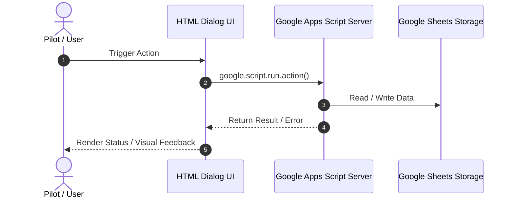

# Design Specification: [Feature / Subsystem Name]
<!-- INSTRUCTION: Replace [Feature / Subsystem Name] with a concise, descriptive title. -->

* **Design ID**: `DSGN-[MODULE]-[NUMBER]` <!-- E.g. DSGN-LOG-001, DSGN-ING-002, DSGN-SCR-001 -->
* **Status**: `Draft` <!-- Status Options: Draft | Under Review | Approved | In Development | Implemented | Deprecated | Superseded -->
* **Current Revision**: `Rev 1.0` <!-- Use Rev 1.0 for initial draft; bump Rev 1.1 for minor changes; Rev 2.0 for breaking/structural overhauls -->
* **Date Created**: `YYYY-MM-DD`
* **Last Updated**: `YYYY-MM-DD`
* **Author / Contributors**: `[Author Name] / Antigravity AI`
* **Parent Design**: `None` <!-- If part of a larger subsystem, link to parent design: [DSGN-ING-000_Ingestion_Subsystem](path/to/target.md) -->
* **Child Designs**: `None` <!-- List child component designs if this is an umbrella design: [DSGN-ING-001_Watch_Folder](path/to/target.md) -->
* **Umbrella Module / Primary Code**: [`Code/[Module].gs`](../../Code/[Module].gs) <!-- Primary code file containing the @design and @revision tags -->
* **Code Revision Stamp**: `Pending Implementation` <!-- Set to 'Rev X.Y' once implemented and stamped in code header -->
* **Related Requirements / CRs**: `[RQ-XXX-000]`, `[CR-XXX-000]` <!-- Link to Backlog IDs -->

---

## 1. Executive Summary & Intent
<!-- INSTRUCTION: Provide a concise (1-3 paragraph) explanation of what this design achieves, the core problem it solves, and why it is needed. -->

### Problem Statement
<!-- What is currently broken, missing, inefficient, or difficult to maintain? -->

### Proposed Solution
<!-- High-level summary of the architectural approach and user outcome. -->

---

## 2. Requirements & Scope

### Functional Requirements
* **REQ-1**: [Describe requirement clearly and testably]
* **REQ-2**: [Describe requirement clearly and testably]

### Non-Goals (Out of Scope)
* **NON-GOAL-1**: [Explicitly state what this design will NOT attempt to do to prevent scope creep]

---

## 3. Architecture & Detailed Design

### 3.1 Data Model & Schema Impact
<!-- INSTRUCTION: If this design adds or modifies spreadsheet tabs, columns, formulas, or parameters, detail the schema here. -->
* **Target Sheet(s)**: `[Sheet Name]`
* **Columns / Layout**:
  | Column | Field Name | Width | Format | Description / Rules |
  | :---: | :--- | :---: | :--- | :--- |
  | A | ... | ... | ... | ... |
* **Configuration Parameters**:
  * `PARAM_NAME`: [Type, Default, Description, Validation Rule]

### 3.2 Service Architecture & Code Contracts
<!-- INSTRUCTION: Detail new or modified functions, objects, and APIs. Include function signatures, parameter types, and return values. -->
```javascript
/**
 * Short description of service/module responsibility.
 */
var ServiceName = {
  /**
   * Method description.
   * @param {Type} paramName - Description.
   * @return {Type} Description.
   */
  methodName: function(paramName) {
    // ...
  }
};
```

### 3.3 Lifecycle & Sequence Flow
<!-- INSTRUCTION: Explain step-by-step how the data or user action flows through the system. Mermaid diagrams are encouraged where helpful. -->


### 3.4 User Interface & Dialog Interactions
<!-- INSTRUCTION: If this affects HTML dialogs, sidebar, or spreadsheet menus, describe visual layouts, buttons, progress indicators, and clipboard actions. -->

---

## 4. Platform Constraints & Edge Cases
<!-- INSTRUCTION: Critical for Open Source! Google Apps Script and Google Sheets have strict platform limitations. Document how this design handles them. -->
* **Execution Timeouts**: Apps Script limits custom functions and triggers (e.g. 6-minute trigger limit). How does this design prevent timeouts (e.g. batch chunking, client-side stepping)?
* **API Quotas & Rate Limits**: Drive API, UrlFetchApp, Sheets read/write batching (minimizing separate RPC calls).
* **Grid-Shifting & Formula Safety**: Does this insert rows? How are existing formulas, lookups, and formatting protected (e.g. INDIRECT, bottom-appending)?
* **Partial Failures & Error Recovery**: If an API call or sub-batch fails, how is the error contained and reported without corrupting state?

---

## 5. Alternatives Considered & Trade-offs
<!-- INSTRUCTION: Explain what other approaches were evaluated and why this specific design was chosen over them. -->
* **Alternative Approach A**: [Description and why it was rejected / trade-offs]
* **Chosen Approach**: [Rationale for chosen design]

---

## 6. System Relationships & Dependencies

### 6.1 Upstream Consumers ("Who Uses This")
<!-- INSTRUCTION: 
  - For domain-specific features: List the primary caller modules, triggers, or user dialogs that invoke this feature.
  - For generic infrastructure (e.g. Logger, Utils, Config): Do NOT attempt to list every individual call site. Instead, describe the INTENDED CONSUMER ARCHETYPES and illustrative integration examples (e.g. 'Background watcher triggers', 'Client dialog step loops', 'Batch processors').
-->
* **Primary Callers / Triggers**: `[e.g. Ingestion.gs, FlightMaintenanceDialog.html]`
* **Consumer Integration Patterns**: `[e.g. Calls LOG.createSession() at start of batch, flushes on completion]`

### 6.2 Downstream Dependencies ("What This Uses")
<!-- INSTRUCTION: List the internal modules, Google Workspace services, and external APIs this component requires to operate. -->
* **Internal Code Services**: `[e.g. Code/Utils.gs, Code/Config.gs]`
* **Google Workspace Services**: `[e.g. SpreadsheetApp (Activity Logs tab), DriveApp (Trash folder)]`
* **External APIs / Network**: `[e.g. Open-Meteo Archive API, Nominatim (None if purely internal)]`
* **Platform Permissions & Scopes**: `[e.g. https://www.googleapis.com/auth/drive]`

### 6.3 Storage & Schema Ripple Effects
* **Sheets Modified**: `[e.g. Flights (Rows appended), Activity Logs (Appended)]`
* **Formulas / Named Ranges Affected**: `[e.g. None (formula-free design)]`

### 6.4 Backward Compatibility & Migration
* **Existing Data / Upgrades**: `[e.g. Auto-renames App_Log to Activity Logs on first run]`

---

## 7. Implementation Plan & Phasing
<!-- INSTRUCTION: Provide a concrete, sequential checklist for implementation. -->
- [ ] **Phase 1: Configuration & Schema**: Update `Config.gs` and `Scaffold.gs`.
- [ ] **Phase 2: Core Logic**: Implement backend functions and services.
- [ ] **Phase 3: UI & Menus**: Update HTML dialogs, menus, and client-server RPCs.
- [ ] **Phase 4: Testing & Verification**: Write unit tests, run offline verification harness.
- [ ] **Phase 5: Documentation**: Synchronize documentation files and bump version.

---

## 8. Testing & Verification Strategy
* **Unit Tests (`Code/Test.gs`)**:
  * [Test Case 1: Description and expected assertion]
  * [Test Case 2: Description and expected assertion]
* **Manual / Smoke Test Checklist**:
  * [Step 1: User action and expected visual result]
  * [Step 2: User action and expected visual result]
* **Edge Case Verification**:
  * [Zero data, extreme values, network failure, duplicate handling]

---

## 9. Documentation Impacts
<!-- INSTRUCTION: List which persistent documents in Docs/ must be updated when this design is implemented. -->
* [`Docs/Technical_Specification.md`](../Technical_Specification.md): [Specific sections]
* [`Docs/Features.md`](../Features.md): [Specific sections]
* [`Docs/User_Guide.md`](../User_Guide.md): [Specific sections]
* [`Docs/Backlog.md`](../Backlog.md): [New CR or RQ status]
* [`Docs/ChangeLog.md`](../ChangeLog.md): [Session log]

---

## 10. Revision History

| Revision | Date | Author | Revision Note |
| :---: | :---: | :--- | :--- |
| `Rev 1.0` | `YYYY-MM-DD` | `[Author Name]` | Initial formal design draft. |
