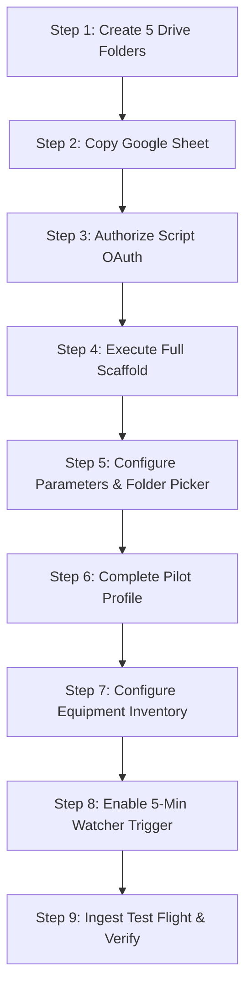

# Paragliding Flight Log - Pilot User Guide & Handbook

Welcome to the **Paragliding Flight Log System**. This document provides the complete, authoritative reference for installing, configuring, operating, and understanding your flight logbook.

Whether you are setting up your personal logbook for the first time or looking up how a specific thermal efficiency metric or FAI triangle is calculated, this guide covers everything you need.

---

# Table of Contents
1. [System Overview & Architecture](#1-system-overview--architecture)
2. [Prerequisites & Initial Setup Walkthrough](#2-prerequisites--initial-setup-walkthrough)
   * [Step 1: Create the 5 Designated Google Drive Folders](#step-1-create-the-5-designated-google-drive-folders)
   * [Step 2: Copy the Logbook Google Sheet](#step-2-copy-the-logbook-google-sheet)
   * [Step 3: Script Authorization (OAuth Permissions)](#step-3-script-authorization-oauth-permissions)
   * [Step 4: Execute First-Time Setup (Full Scaffold)](#step-4-execute-first-time-setup-full-scaffold)
   * [Step 5: Configure Parameters (Folder Picker & Settings)](#step-5-configure-parameters-folder-picker--settings)
   * [Step 6: Complete Your Pilot Profile](#step-6-complete-your-pilot-profile)
   * [Step 7: Configure Equipment Inventory & Sticky Defaults](#step-7-configure-equipment-inventory--sticky-defaults)
   * [Step 8: Set Up Automated Watcher Trigger](#step-8-set-up-automated-watcher-trigger)
   * [Step 9: Ingest Your First Flight & Verify Setup](#step-9-ingest-your-first-flight--verify-setup)
3. [Day-to-Day Flight Ingestion Workflows](#3-day-to-day-flight-ingestion-workflows)
   * [Method A: Automated Watch Folder Scanning](#method-a-automated-watch-folder-scanning)
   * [Method B: URL & Shared Google Drive Import](#method-b-url--shared-google-drive-import)
   * [Method C: Direct Browser File Upload](#method-c-direct-browser-file-upload)
   * [Method D: Manual Flight Entry (No GPS Track)](#method-d-manual-flight-entry-no-gps-track)
4. [Multi-Device Logging, Scoring & Overlap Triage](#4-multi-device-logging-scoring--overlap-triage)
5. [Flight Inspector Sidebar](#5-flight-inspector-sidebar)
6. [Flight Maintenance & Bulk Operations](#6-flight-maintenance--bulk-operations)
   * [Flight Updates Dialog](#flight-updates-dialog)
   * [Purging Discarded Flights](#purging-discarded-flights)
   * [Interactive Re-sync from Master Log Folder](#interactive-re-sync-from-master-log-folder)
   * [Chronological Sorting & Flight Re-numbering](#chronological-sorting--flight-re-numbering)
7. [Comprehensive Metric & Telemetry Dictionary](#7-comprehensive-metric--telemetry-dictionary)
   * [Flight Information & Status](#flight-information--status)
   * [Equipment Tracking](#equipment-tracking)
   * [Cross-Country (XC) League Scoring](#cross-country-xc-league-scoring)
   * [Flight Physics & Mode Analytics](#flight-physics--mode-analytics)
   * [Launch & Landing Telemetry](#launch--landing-telemetry)
   * [Atmospheric Weather Telemetry](#atmospheric-weather-telemetry)
   * [Validation Heuristics & Provenance Audit](#validation-heuristics--provenance-audit)
8. [Troubleshooting & Frequently Asked Questions (FAQ)](#8-troubleshooting--frequently-asked-questions-faq)

---

# 1. System Overview & Architecture

The Paragliding Flight Log is a serverless, cloud-native logbook built directly on Google Workspace. It combines the familiar accessibility of Google Sheets with automated Google Apps Script orchestration, providing pilots with automated track ingestion, flight physics analysis, thermal detection, cross-country league scoring, historical weather backfills, and 3D flight visualization.

| Component | Function | Architecture Details | Pilot Benefit |
| :--- | :--- | :--- | :--- |
| **Google Sheets UI** | Primary Interface | 8 organized tabs: `Dashboard`, `Flights`, `Pilot_Profile`, `Equipment`, `User Guide`, `Config`, `Activity Logs`, and `Automation_Queue`. | Zero install required; fully accessible on desktop browsers, tablets, and Google Sheets mobile apps. |
| **Google Apps Script** | Autonomous Engine | Modular scripts running inside Google's cloud infrastructure that parse IGC files, detect flight modes, query weather APIs, and calculate XC scores. | Free execution with zero server hosting costs, database subscription fees, or maintenance overhead. |
| **Master Flight Archive** | Permanent Cloud Storage | Designated Google Drive folder mirroring all valid flight tracks with standardized naming (`YYYY-MM-DD_HHMM_PilotName.igc`) and public viewing links. | Direct one-click downloads and instant 3D interactive replay via SeeYou Cloud. |
| **Automated Watchers** | Hands-Free Background Ingestion | Time-driven background triggers that poll your Google Drive watch folders every 5 minutes for newly synced flight tracks. | Drop files into Google Drive from your phone or flight instrument, and your logbook updates automatically. |

---

# 2. Prerequisites & Initial Setup Walkthrough

Setting up a fresh instance of the flight log takes approximately 10 to 15 minutes. Follow these sequential steps to establish your folders, copy the sheet, authorize scripts, run the initial scaffolding, and configure your profile.



### Step 1: Create the 5 Designated Google Drive Folders
Before setting up the spreadsheet, open [Google Drive](https://drive.google.com) and create five dedicated folders. We recommend placing them inside a dedicated parent folder (e.g., `Paragliding/FlightLog/`):

1. **`Watch Folder`**: Where flight instruments (e.g., Syride, Oudie, Flymaster) or mobile sync apps drop your raw `.igc`, `.zip`, or `.gz` files.
2. **`Master Log Folder`**: The permanent repository where cleaned and validated flight tracks are mirrored.
   > [!IMPORTANT]
   > Share the **Master Log Folder** as **"Anyone with the link can view"**. This allows the spreadsheet to generate direct download hyperlinks and SeeYou Cloud 3D visualization links for your flight log.
3. **`Upload Folder`**: Staging folder used when uploading flight files directly through the browser dialog.
4. **`Error Folder`**: Quarantine folder strictly for corrupt, truncated, or unparseable files that require pilot inspection.
5. **`Trash Folder`**: Discard folder where intentionally removed flights, purged tracks, and duplicate recordings are safely moved. *(Safe to empty periodically without impacting active flights).*

---

### Step 2: Copy the Logbook Google Sheet
1. Open the master Paragliding Flight Log template Google Sheet.
2. Click **File > Make a copy**.
3. Name your new spreadsheet (e.g., `My Paragliding Logbook`).
4. Save it to your Google Drive.

---

### Step 3: Script Authorization (OAuth Permissions)
Because the spreadsheet contains custom automation to read files, query weather services, and build sheet tabs, Google requires a one-time OAuth authorization:

1. In your copied spreadsheet, refresh the page in your browser.
2. In the top menu bar, click **Extensions > Apps Script**.
3. In the script editor toolbar, ensure `onOpen` is selected in the function dropdown and click **Run**.
4. An **Authorization Required** modal will appear. Click **Review Permissions**.
5. Select your Google account.
6. A warning stating *"Google hasn't verified this app"* will appear (this is standard for personal Google Apps Script projects). Click **Advanced**, then click **Go to FlightLogScript (unsafe)** at the bottom.
7. Click **Allow** to grant the script access to Google Sheets, Google Drive, and external web APIs (used for weather and geocoding).
8. Once execution finishes with `"Execution completed"`, close the Apps Script tab and return to your spreadsheet.

---

### Step 4: Execute First-Time Setup (Full Scaffold)
1. Switch back to your spreadsheet tab. You should now see the custom **Flight Log** menu in the top toolbar (refresh the browser if it does not appear immediately).
2. Click **Flight Log > Admin > System Setup & Reset (Danger Zone) > First Time Setup (Full Scaffold)**.
3. A confirmation dialog will warn you that this builds the initial system sheets. Click **Yes**.
4. The system will automatically generate and style all 7 core tabs:
   * **`Dashboard`**: KPI cards, rolling 6-month currency timeline, and 8 leaderboard rankings.
   * **`Flights`**: Pre-scaffolded flight log table with 69 categorized telemetry columns and frozen headers.
   * **`Pilot_Profile`**: Pilot ratings, emergency contacts, medical notes, and tracking links.
   * **`Equipment`**: Fleet inventory tracking hours, wings, harnesses, and reserves.
   * **`User Guide`**: In-sheet quick reference and metric explanations.
   * **`Config`**: Consolidated system settings table (Columns A:C for key-value parameters including `[ Logging & Admin ]` controls) and reference dropdown lookups (Columns E:N for equipment categories, wings, harnesses, reserves, flight statuses, types, and formats, separated by blank spacer Column D).
   * **`Activity Logs`**: Standardized 4-column audit log (`Process`, `Timestamp`, `Activity / Event`, `Additional Info`) recording all system operations, background jobs, and diagnostic traces with tiered log levels (`Brief`, `Normal`, `Debug`) and conservative retention pruning.

---

### Step 5: Configure Config Tab (Folder Picker & Settings)
Now link the 5 Google Drive folders you created in Step 1 to the spreadsheet:

1. **Folder Configuration (Using the In-App Picker)**:
   * Click **Flight Log > Admin > Folder Configuration > Set Watch Folder(s)...**. Use the visual folder browser to locate and select your `Watch Folder`.
   * Click **Flight Log > Admin > Folder Configuration > Set Master Log Folder...** and select your `Master Log Folder`.
   * Click **Flight Log > Admin > Folder Configuration > Set Upload Folder...** and select your `Upload Folder`.
   * Click **Flight Log > Admin > Folder Configuration > Set Error Folder...** and select your `Error Folder`.
   * Click **Flight Log > Admin > Folder Configuration > Set Trash / Discard Folder...** and select your `Trash Folder`.
2. **Review Parameter Settings**:
   Navigate to the **`Config`** tab (Columns A:C) and review the configuration organized under clear subheaders:
   * **`[ Geo & Time ]`**:
     * **`CONTACT_EMAIL`**: *[REQUIRED]* Enter your email address. Required by Nominatim, Overpass, and Open-Meteo as a polite `User-Agent` contact header to prevent rate-limiting or HTTP 403 errors.
     * **`GEO_REV_PROVIDERS`**: Reverse geocoding provider fallback chain (`google, big_data_cloud, nominatim_osm`).
     * **`GEO_SITE_PROVIDERS`**: Takeoff/landing site identification (`paragliding_earth, overpass_api`).
   * **`[ Integrations ]`**:
     * **`XCONTEST_USERNAME`**: Enter your public XContest pilot username (e.g. `rohitash`). Enables automatic flight verification, permanent flight ID linking (e.g. `XC#6952654`), and competition claim window tracking.
     * **`WEATHER_PROVIDERS`**: Defaults to `open_meteo, visual_crossing`. Open-Meteo runs automatically out of the box with zero API keys required.
     * **`VISUAL_CROSSING_API_KEY`**: *(Optional)* API key for Visual Crossing atmospheric backup.
   * **`[ Format and Units ]`**:
     * **`DATE_FORMAT`** (`yyyy-MM-dd`) and **`TIME_FORMAT`** (`h:mm a`) with enforced Plain Text formatting.
   * **`[ Dashboard & Currency ]`**:
     * **`TIMELINE_FLIGHTS_LOW` / `MED`**: Flight count thresholds (default `2` and `6`) for orange/yellow/green pilot currency color coding on the Dashboard rolling timeline.
     * **`TIMELINE_HOURS_LOW` / `MED`**: Flight hour thresholds (default `1.0` and `4.0` hours) for currency shading on the Dashboard.
   * **Controlled Vocabularies & Lookups (Columns E:N)**:
     * Manual lists on the left (Columns 5–10): `Equipment Categories`, `Flight Status`, `Flight Type`, `XC Classes`, `Date Formats`, `Time Formats`.
     * Dynamic queries on the right (Columns 11–14): `Wings (Auto)`, `Harnesses (Auto)`, `Reserves (Auto)`, `Other (Auto)` automatically populated from the `Equipment` tab.

---

### Step 6: Complete Your Pilot Profile
Navigate to the **`Pilot_Profile`** tab. The sheet is organized into a clean 3-column layout (`Field`, `Value`, `Notes / Instructions`) across 6 sections with 34 standardized fields:
* **`[ Identity ]`**: Full Legal Name, Callsign / Nickname, Email, Phone Number, Home Country & Town, and Other Identity Info.
* **`[ Licensing ]`**: National Association (e.g. USHPA, BHPA, FFVL, DHV), Pilot Rating, National Licence Info, FAI Sporting Licence Info, CIVL ID, and Other Licensing Info.
* **`[ Affiliations ]`**: Primary Flying Club, Secondary Clubs, National Federation Member #, and Other Affiliations Info.
* **`[ Emergency / SAR ]`**: Primary Emergency Contact Info, 2nd Emergency Contact Info, 3rd Emergency Contact Info, SAR / Evac Provider Info (e.g. Garmin SAR, GEOS, Global Rescue), Medical Insurance Info, Blood Type, Medical Conditions / Allergies, and Other Emergency Info.
* **`[ Tracking / Gear ]`**: Garmin inReach IMEI, Garmin MapShare URL, Flymaster Live URL, XContest Live URL, Emergency Beacon Hex ID, and Other Tracking / Gear Info.
* **`[ Progression ]`**: Current Season XC Goals, SIV / Maneuver Notes, General Flying Notes, and Other Progression Info.
> [!NOTE]
> All data entries in Column B (`Value`) are preserved automatically during scaffolding and JSON configuration restores. Section divider headers and instructions are never overwritten.

---

### Step 7: Configure Equipment Inventory & Sticky Defaults
Navigate to the **`Equipment`** tab:
1. Review or replace the pre-scaffolded sample equipment rows with your actual gear:
   * **Category**: Choose from `Wing`, `Harness`, `Reserve`, or `Other`.
   * **EquipmentID**: Enter a concise, distinct identifier (e.g., `Photon ML`, `Zeno 2`, `Submarine M`, `Beamer 3 Light`). This identifier will appear in the `Flights` sheet dropdowns.
   * **Make, Model, Size, Year**: Glider details, serial numbers, and acquisition date.
   * **Default?**: Set to **`TRUE`** for your primary glider, harness, and reserve.
2. **Sticky Defaults Behavior**: When new flights are ingested, the system automatically assigns your default equipment. When you log or manually change equipment on a flight row, subsequent imported flights will automatically inherit the most recently flown gear configuration.

---

### Step 8: Set Up Automated Watcher Trigger
To have your logbook automatically ingest new flight tracks in the background:
1. Click **Flight Log > Admin > Automation & Services > Setup / Reset 5-min Watcher Trigger**.
2. A confirmation prompt will notify you that the trigger has been scheduled.
3. The background engine will now check your designated `Watch Folder` every 5 minutes. Whenever new track files appear, they will be parsed, analyzed, scored, enriched with weather telemetry, and added to your logbook without opening the spreadsheet.

---

### Step 9: Ingest Your First Flight & Verify Setup
1. Download a sample `.igc` file to your computer.
2. In the spreadsheet, click **Flight Log > Add Flight > Add flight from Upload (Local File)...**.
3. Drag and drop your `.igc` file into the upload box and click **Upload & Process**.
4. A progress dialog will show real-time parsing, thermal detection, scoring, reverse geocoding, and weather lookups.
5. Once complete, click **Done**.
6. Verify that:
   * A new row appears at Row 5 of the **`Flights`** tab with status **`Review?`**.
   * Takeoff and landing locations, thermal percentages, glide ratio, and weather conditions are populated.
   * The **`FlightID`** links directly to SeeYou Cloud 3D replay.
   * The **`IGC File`** column contains a direct download link pointing to your `Master Log Folder`.
   * The **`Activity Logs`** tab shows a timestamped `[OK]` audit record.

---

# 3. Day-to-Day Flight Ingestion Workflows

The logbook provides five flexible ways to add flights depending on your setup and flight gear:

```
Flight Log > Add Flight
├── Scan Watch Folder Now                     (Instant trigger of automated watch folders)
├── Add files from URL (folder, igc, zip)...  (Import from Google Drive folders or web links)
├── Add flight from Upload (Local File)...    (Browser drag-and-drop modal dialog)
├── Add manual flight (blank row)             (Quick blank row for non-GPS flights)
└── [Admin] Bulk Flight Ingestion (Batch)...  (High-speed batch processor for large onboarding)
```

### Method A: Automated Watch Folder Scanning
* **How It Works**: Connect your flight computer or phone app (e.g., Syride USB sync, XCTrack Google Drive sync, Oudie transfer) to save track logs directly into your Google Drive `Watch Folder`.
* **Execution**: Flights are automatically ingested by the 5-minute background trigger. To force an immediate scan without waiting for the next timer, click **Flight Log > Add Flight > Scan Watch Folder Now**.
* **Source Handling**: Successfully ingested files are copied to the `Master Log Folder` and moved out of the watch folder to keep your sync directory tidy.

### Method B: URL & Shared Google Drive Import
* **Best For**: Bulk importing historical logbooks, downloading tracks from club Google Drive links, or importing from public contest URLs.
* **Execution**: Click **Flight Log > Add Flight > Add files from URL (folder, igc, zip)...**:
  * **Option A**: Paste a direct Google Drive folder URL, file URL, or direct web download link (`.igc` or `.zip`).
  * **Option B**: Browse your Google Drive interactively to select an existing folder.
  * **Optional Setting**: Check *"Delete files from source after processing"* if you wish to clear the source folder after successful imports.

### Method C: Direct Browser File Upload
* **Best For**: Manually logging flights downloaded to your laptop or desktop computer.
* **Execution**: Click **Flight Log > Add Flight > Add flight from Upload (Local File)...**:
  * Select or drag-and-drop one or multiple `.igc`, `.zip`, or `.gz` files.
  * Click **Upload & Process**. The interactive modal displays file-by-file progress, flight creation counts, and detailed error feedback.

### Method D: Manual Flight Entry (No GPS Track)
* **Best For**: Top-to-bottom sled rides, tandem passenger flights, coastal dune soaring without instruments, or flights where your battery died.
* **Execution**: Click **Flight Log > Add Flight > Add manual flight (blank row)**:
  * Inserts a pre-formatted row at Row 5 with an auto-generated flight ID (`FYYYYMMDD_01`), status set to `'Review?'`, and sticky gear pre-populated.
  * Enter your duration, takeoff site, and pilot notes directly in the row.

### Method E: High-Speed Bulk Flight Ingestion (Batch)
* **Best For**: Initial migration and onboarding of large flight archives (hundreds of `.igc`, `.zip`, `.gz` files across multiple instruments or seasons).
* **Execution**: Click **Flight Log > Admin > Bulk Flight Ingestion (Batch)...**:
  * **Select Source Folder**: Enter a Google Drive folder link or pick a folder interactively via the built-in Drive browser.
  * **Select Batch Size**: Choose **3**, **5**, or **10** files per execution (default: 5) to optimize execution speed within Apps Script quotas.
  * **Configure Enrichments**: Toggle non-critical web lookups (Takeoff/Landing Site Detection, Reverse Geocoding, Open-Meteo Weather, XContest Claims, XC Scoring, Analytics) to maximize throughput.
  * **Atomic Appending & Sorting**: Batches are written directly to the bottom of the `Flights` tab in single atomic spreadsheet operations. Upon completion, a single chronological sort (`sortFlightsByDate_`) re-indexes your entire logbook descending by date and launch time.

---

# 4. Multi-Device Logging, Scoring & Overlap Triage

Many pilots fly with multiple devices recording simultaneously—for example, a primary smartphone running **XCTrack** connected via Bluetooth to a dedicated vario, alongside a backup audio vario or smartwatch. 

The system features an autonomous deduplication and overlap triage engine that detects duplicate recordings and evaluates them objectively:

### 1. Exact Duplicate Detection (Hard Match)
* The system computes a cryptographic MD5 hash of every file upon import and stores it directly on the flight row in Column 70 (`IGC Hash`).
* If an identical file is imported again, it is immediately recognized, skipped from being added to the sheet, and moved to your Drive `TRASH_FOLDER_ID`.
* **Row-Based Hash Integrity**: Because hashes live on the flight rows rather than in a hidden cache, deleting a flight row automatically purges its hash, allowing you to re-import the file later without needing cache wipe tools.

### 2. Heuristic Overlap Detection (Multi-Device Match)
When distinct files are imported that represent the same flight, the system detects the overlap using multi-criteria flight matching:
* **Date Match**: Same local calendar date.
* **Time Match**: Takeoff timestamps within $\pm 15$ minutes of each other, or overlapping flight time intervals.
* **Location Match**: Takeoff coordinates within $1{,}000$ meters of each other.

### 3. Data Quality Scoring (0–100 Scale)
When an overlap is detected, both tracks are scored across four data quality criteria:

```
Total Quality Score (0–100 Points)
├── Primary Flight Computer / App (Max 40 pts)
│   ├── XCTrack (Primary BLE navigation instrument): +40 pts
│   ├── Dedicated Flight Vario (XC Tracer, UltraBliP, Flymaster, Oudie): +30 pts
│   ├── Generic Mobile Apps (Seeyou, Flyskyhy): +20 pts
│   └── Unknown Logger: +10 pts
├── Barometric Pressure Sensor Integrity (Max 30 pts)
│   ├── Authentic pressure sensor (calibrated baro altitude differing from GPS altitude): +30 pts
│   ├── Baro present but uncalibrated: +20 pts
│   └── GPS-only altitude (no baro sensor): +5 pts
├── Temporal Resolution & Duration (Max 20 pts)
│   ├── 1Hz high-frequency recording (≤ 1.2s intervals): +15 pts
│   ├── 2.5s recording interval: +10 pts
│   ├── 5.5s recording interval: +5 pts
│   └── Flight duration bonus (> 30 min): +5 pts
└── Metadata Richness (Max 10 pts)
    └── Populated glider type (+3), pilot name (+3), glider ID (+2), hardware/firmware headers (+2)
```

### 4. Candidate Tagging & Pairing Notes
* **`Dup-Primary` (Gold Highlight)**: Assigned to the higher-scoring track (the primary instrument).
* **`Dup-Others` (Orange Highlight)**: Assigned to the lower-scoring backup track(s).
* **Cross-Referencing Notes**: Both rows receive a standardized audit note in the `Notes` column:
  `[DupRef: DUP_20260930_1420 | Paired with F20260930_02 (Score: 85 vs 60)]`

### 5. Dashboard Protection
> [!NOTE]
> All Dashboard KPI banners (Total Flights, Total Hours, Total Distance), rolling currency charts, and top 5 leaderboard cards strictly filter for **`Status = "Valid"`**. Flights tagged as `Review?`, `Dup-Primary`, or `Dup-Others` will **never pollute your flight statistics** until you review and confirm them.

---

# 5. Flight Inspector Sidebar

The **Flight Inspector** provides a dedicated sidebar interface for in-depth flight review and editing without horizontal scrolling across 69 spreadsheet columns.

```
Flight Log > Flight Inspector
```

* **How to Open**: Highlight any cell in a flight row and select **Flight Log > Flight Inspector**.
* **Color-Coded Sections**:
  * **Core Information**: Flight ID (with SeeYou Cloud link), Flight No, Status, and Pilot Summary.
  * **Flight Mode Breakdowns**: Percentage and duration spent in **Thermals**, **Ridge Soaring**, **Glide Transitions**, and **Sink**.
  * **Thermal Performance**: Total thermal cores used, mean climb rate, and best integrated 30-second thermal climb.
  * **XC Competition Scoring**: League distance, multiplier, FAI triangle verification, and XContest claim status.
  * **Atmospheric Weather**: Launch and landing winds, gusts, cloudbase (AGL/MSL), temperature, and conditions.
* **Editing & Saving**: Modify equipment, pilot notes, flight type, or status directly inside the sidebar and click **Save Flight Details** to update the spreadsheet immediately.

---

# 6. Flight Maintenance & Bulk Operations

All flight logbook maintenance routines are consolidated under the **`Flight Log > Flight maintenance`** submenu:

```
Flight Log > Flight maintenance
├── Flight Updates...                              (Unified batch update modal)
├── Change Flight Status in Bulk...                 (Multi-scoped status conversion with multi-select safety filters)
├── Sort All Flights by Date                      (Chronological sort & re-numbering)
├── ───
├── Scan & Flag Duplicates in Logbook...          (In-memory heuristic audit & duplicate cluster tagging)
├── Mark Duplicates for Removal...                 (Batch mark triaged duplicates to 'Remove')
├── Purge Flights Marked 'Remove'...               (Interactive stepping modal with trash transfer & row deletion)
└── Re-sync Missing Flights from Master Folder...  (Interactive modal self-healing tool)
```

### Tri-Mode Execution Subsystem (Modal, Sidebar, Background Queue)
All major batch maintenance and ingestion dialogs (`Bulk Flight Ingestion`, `Flight Updates`, `Change Flight Status`, `Purge Flights`, `Re-sync Missing Flights`, `Watch Folder Scan`, `URL / Drive Import`, and `File Upload`) support **Tri-Mode Execution**, solving the Google Sheets modal lockdown problem:

| Execution Mode | Button | Best For | Behavior & Grid Interactivity |
| :--- | :--- | :--- | :--- |
| **1. In-Modal Stepping** | **`[ 🚀 Run Here ]`** | Quick jobs (< 30s) | Runs synchronously inside the dialog. Ideal when you want to quickly step through a handful of flights and close the dialog immediately. |
| **2. Universal Sidebar** | **`[ 📌 Run in Sidebar ]`** | Medium-to-large jobs | Closes the modal and launches the **Universal Execution Sidebar** (`300px`). The spreadsheet grid remains **100% interactive**—you can browse flight rows, edit comments, check the Dashboard, or inspect charts while watching live progress. Includes real-time metric pills, an activity console, and a `📋 Copy Log` button. |
| **3. Headless Cloud Queue** | **`[ ⚙️ Run in Background ]`** | Large batches (100+ flights) | Closes the modal instantly and registers the task in the **`Automation_Queue`** sheet tab. Execution runs headlessly on Google Cloud servers, streaming logs to the **`Activity Logs`** tab. Protected by `TimeBudgetService` (4.5-minute safety threshold) with automatic self-continuation triggers—it continues running even if you close the spreadsheet or browser! |

> [!TIP]
> **Monitoring Background Jobs**: You can check job progress anytime by switching to the `Automation_Queue` tab (Col C shows status: `QUEUED`, `PROCESSING`, `COMPLETED`, `FAILED`, `CANCELLED`) or by inspecting recent entries in `Activity Logs`. To ensure unattended jobs run automatically every 5 minutes, run **`Flight Log > Admin > Automation & Services > Setup 5-Min Queue Daemon Trigger`**.

### Change Flight Status in Bulk
Click **Flight Log > Flight maintenance > Change Flight Status in Bulk...** to batch update flight lifecycle states with strict safety guardrails:
1. **Target Scope**:
   * **Selected Rows (Default)**: Automatically detects highlighted rows on the `Flights` tab and shows range badge (e.g. `[12 selected (Rows 5-16)]`).
   * **All Flights**: Selects all flights in your logbook (e.g. `[263 flights]`).
2. **Filter by Current Status (Multi-Select Checkboxes)**:
   * Displays 7 source status checkboxes with real-time count badges reflecting flights in the active scope:
     * `[ ] Valid (count)`
     * `[ ] Review? (count)`
     * `[ ] Dup-Primary (count)`
     * `[ ] Dup-Others (count)`
     * `[ ] Invalid? (count)`
     * `[ ] Remove (count)`
     * `[ ] (Blank / Empty) (count)`: Targets flights where the status cell was accidentally cleared or left blank (since cell validation warns on delete but does not strictly prevent it).
   * > [!IMPORTANT]
     > **Intentional Selection Safety Rule**: By default, **all status checkboxes are unselected**. When none are checked, **0 flights match** and the Run buttons remain disabled. You must intentionally check one or more source statuses to target flights, eliminating accidental mass updates.
3. **Target Status Dropdown**:
   * Choose the new status to apply: `Valid`, `Review?`, `Dup-Primary`, `Dup-Others`, `Invalid?`, or `Remove`.
4. **Tri-Mode Execution**:
   * Click **`[ 🚀 Run Here ]`**, **`[ 📌 Run in Sidebar ]`**, or **`[ ⚙️ Run in Background ]`**. The system updates Column B (`Status`) in batches of 25 and automatically refreshes Dashboard KPIs.

### Scan & Flag Duplicates in Logbook
Click **Flight Log > Flight maintenance > Scan & Flag Duplicates in Logbook...** to audit your historical logbook for unflagged duplicate recordings:
* Scans all flights and pairs tracks matching spatial proximity ($\le 1000\text{ m}$) and time overlap ($\pm 20\text{ min}$ or interval overlap).
* Computes in-memory quality scores ($0\text{--}100$) evaluating instrument type, baro integrity, duration, and metadata.
* Tags primary flights as `Dup-Primary` (gold) and secondary tracks as `Dup-Others` (orange) with reciprocal cluster notes (`[DupRef: D01 | Others: ...]`).
* **Preserves Valid Flights**: Flights already marked `Valid` are never demoted, protecting confirmed logbook records.

### Flight Updates Dialog
Click **Flight Log > Flight maintenance > Flight Updates...** to open the unified operations dialog:
1. **Choose Scope**:
   * **Selected Rows Only**: Processes only the rows you highlighted in the sheet.
   * **All Flights**: Iterates across your entire logbook.
2. **Select Batch Operations**:
   * **Weather Backfill**: Queries historical atmospheric weather for flights missing weather telemetry.
   * **Geo & Site Backfill**: Re-runs reverse geocoding to resolve missing Takeoff/Landing sites or town/country names.
   * **XContest Verification**: Checks XContest.org for claimed flights, links permanent IDs, and flags 14-day competition claiming windows.
   * **Physics & XC Recompute**: Re-reads master IGC files to recalculate thermal circling, soaring efficiency, glide L/D, and optimal 3-turnpoint FAI triangles.
   * **Sort Flights by Date**: Chronologically re-indexes flights descending by date and time.
3. Click **Run Maintenance** to monitor live client-side progress.

### Mark Duplicates for Removal
After reviewing multi-instrument recordings tagged with `Dup-Primary` or `Dup-Others`, you can quickly stage duplicate rows for deletion:
1. Select **Flight Log > Flight maintenance > Mark Duplicates for Removal...**.
2. A modal dialog opens showing the real-time count of flights currently matching each status:
   * **`Dup - Others`**: Lower-scoring backup instrument tracks.
   * **`Dup - Primary`**: Higher-scoring primary instrument tracks.
3. Select the categories you wish to stage for removal (unselected by default for safety).
4. Click **Mark for Removal**. The system updates the selected flights to status **`Remove`**.
> [!TIP]
> This action deliberately stages flights without immediately deleting them, giving you a chance to inspect the sheet before running a final purge.

### Purging Discarded Flights
When you are ready to permanently purge flights marked with status **`Remove`**:
1. Select **Flight Log > Flight maintenance > Purge Flights Marked 'Remove'...**.
2. An interactive dialog with a **real-time progress bar and step-by-step console** opens.
3. The dialog automatically detects all candidate flights marked `Remove` and displays their count.
4. Click **Start Purge** to begin client-stepping execution:
   * Moves each flight's permanent IGC file from the `Master Log Folder` to your designated `Trash Folder`.
   * Deletes the rows from the spreadsheet from bottom to top to preserve index integrity.
   * Cleanses the in-memory deduplication cache.
   * Chronologically re-sorts and re-indexes remaining flights.
5. You can safely click **Cancel** at any point between steps.
6. Upon completion, a primary **Done** button appears to close the dialog.

### Interactive Re-sync from Master Log Folder
If rows were accidentally deleted from your spreadsheet, or if you added historical IGC files directly into your Google Drive `Master Log Folder`:
1. Select **Flight Log > Flight maintenance > Re-sync Missing Flights from Master Folder...**.
2. An interactive dialog with a **real-time progress bar and activity log** scans your master folder.
3. It compares all Drive file IDs and cryptographic MD5 hashes against your spreadsheet.
4. Any missing flights are reconstructed, analyzed, and appended to the `Flights` tab with status set to `'Review?'`—without generating duplicate files.
5. When complete, click the prominent **Done** button to close the dialog.

### Chronological Sorting & Flight Re-numbering
Selecting **Flight Log > Flight maintenance > Sort All Flights by Date**:
* Sorts all flight rows chronologically descending (newest flights at the top, oldest at the bottom).
* Uses Date as the primary sort key and Takeoff Time as the secondary sort key.
* Dynamically re-indexes sequential `Flight No` formulas from Flight #1 at the bottom to your latest flight at the top.

---

### Configuration Management (Save & Load Config)
All system parameters and lookup configurations can be exported and imported as portable JSON files under **`Flight Log > Admin > Configuration Management`**:

```
Flight Log > Admin > Configuration Management
├── Save Config...     (Export settings & lookups as JSON file)
└── Load Config...     (Import and restore settings from JSON file)
```

1. **`Save Config...`**:
   * Opens an interactive modal where you can select which components to export:
     * **Pilot Profile** (`Pilot_Profile` sheet)
     * **System Parameters** (Ingestion, Integrations, Scoring, UI & Display)
     * **Dropdown Lookups** (Flight statuses, types, XC classes, and date/time formats)
   * Generates a versioned, typed JSON file directly in your browser (`flightlog_config_YYYYMMDD_HHMM.json`).
2. **`Load Config...`**:
   * Select a previously exported `.json` configuration file.
   * The dialog inspects the file, detects which sections are present, and displays checkboxes.
   * Click **Apply Configuration** to safely write the restored settings directly into the `Config` and `Pilot_Profile` tabs.

---

# 7. Comprehensive Metric & Telemetry Dictionary

Below is the complete reference for every column in the logbook, categorized by group:

### Flight Information & Status
| Column Header | Group | Calculation / Formula | Description & Pilot Interpretation |
| :--- | :--- | :--- | :--- |
| **Status** | Flight Info | Dropdown List | Validation state: `Valid` (counted in KPIs), `Review?` (needs pilot check), `Dup-Primary` (gold overlap winner), `Dup-Others` (orange backup), `Invalid?` (failed checks), `Remove` (queued to purge). Note: Legacy `'Duplicate'` status is eliminated. |
| **FlightID** | Flight Info | `F{YYYYMMDD}_{DailySeq}` | Unique flight identifier formatted with direct hyperlink to 3D SeeYou Cloud interactive track replay. |
| **Flight No** | Flight Info | Dynamic Formula | Sequential flight counter from your first career flight (#1) to present. Automatically recalculates on sort. |
| **Auto Summary** | Flight Info | System Concatenation | Concise summary string (e.g., *"2h 15m XC at Bir Billing 3100m"*). |
| **Date** | Flight Info | `YYYY-MM-DD` | Calendar date of flight launch in local site time. |
| **Launch Time** | Flight Info | `HH:MM` | Local time of takeoff. |
| **Landing Time** | Flight Info | `HH:MM` | Local time of landing. |
| **Duration** | Flight Info | `Landing Time - Launch Time` | Total airborne duration formatted as `h:mm`. |
| **Track Length (km)** | Flight Info | Haversine summation | Cumulative distance flown along the 3D GPS track through the air. |
| **Straight Dist (km)** | Flight Info | `Haversine(Launch, Landing)` | Straight-line distance from launch coordinates directly to landing coordinates. |
| **Flight Type** | Flight Info | Dropdown List | Pilot classification: `XC`, `Local / Thermal`, `Soaring / Ridge`, `Hike & Fly`, `SIV / Acro`, `Tandem`, `Top-to-Bottom`. |

### Equipment Tracking
| Column Header | Group | Data Source | Description & Pilot Interpretation |
| :--- | :--- | :--- | :--- |
| **Wing** | Gear | `Equipment` Sheet Dropdown | Glider flown. Inherited via sticky defaults from previous flight or primary gear. |
| **Harness** | Gear | `Equipment` Sheet Dropdown | Harness flown on this flight. |
| **Reserves** | Gear | `Equipment` Sheet Dropdown | Reserve parachute(s) carried. |

### Cross-Country (XC) League Scoring
| Column Header | Group | Calculation / Algorithm | Description & Pilot Interpretation |
| :--- | :--- | :--- | :--- |
| **XC Distance (km)** | XC Scoring | Ramer-Douglas-Peucker (RDP) | Optimized distance across up to 3 turnpoints under international XC contest rules. |
| **XC Multiplier** | XC Scoring | League Multipliers | Scoring factor based on geometric classification: **1.0x** (Free Flight), **1.2x** (Out-and-Return / Flat Triangle), **1.4x** (FAI Triangle). |
| **XC Score** | XC Scoring | `XC Distance * Multiplier` | Official contest score points awarded for the flight. |
| **XC Flight Class** | XC Scoring | Geometric Analysis | Track classification: `Free Flight`, `Flat Triangle`, `FAI Triangle`, or `Out-and-Return`. |
| **FAI Triangle (km)** | XC Scoring | 28% Rule Verification | Triangle distance where the shortest leg is at least 28% of the total perimeter. |
| **Closed?** | XC Scoring | Gap Analysis | `Yes` if landing is within 20% of the total perimeter back to launch (circuit closed); `No` if open distance. |
| **XContest** | XC Scoring | Direct API Probing | Clickable hyperlink to public XContest flight (e.g. `XC#6952654`). Displays `"Claim soon!"` if within 14-day competition window, or `"Expired"` if older. |

### Flight Physics & Mode Analytics
| Column Header | Group | Detection Thresholds | Description & Pilot Interpretation |
| :--- | :--- | :--- | :--- |
| **Thermal %** | Analytics | `Vario > 0.3 m/s` & `Turn > 8°/s` | Percentage of total airborne time spent circling in thermals. |
| **Thermal Time** | Analytics | Sliding 10s Window | Cumulative duration spent thermalling (`h:mm`). |
| **Thermals Count** | Analytics | Core Ingress Transitions | Total number of discrete thermal cores entered during the flight. |
| **Thermal Avg (m/s)** | Analytics | Integrated Climb / Circling | Mean climb rate across all thermal circling periods. |
| **Thermal Best (m/s)** | Analytics | Peak 30s Integrated Climb | Strongest integrated vario core encountered during the flight. |
| **Soar %** | Analytics | `Vario > -0.2 m/s` & S-turns | Percentage of time spent ridge soaring along ridges in figure-8 turns. |
| **Soar Time** | Analytics | S-turn duration | Cumulative time spent ridge soaring (`h:mm`). |
| **Efficiency (m/km)**| Analytics | `Height Gain (m) / Dist (km)` | Soaring efficiency metric indicating energy conservation along ridges. |
| **Glide %** | Analytics | `Turn < 5°/s` & `Vario < 0.2 m/s` | Percentage of flight spent gliding straight in transitions between lift. |
| **Glide Time** | Analytics | Straight Flight Duration | Cumulative time spent in straight glide transitions (`h:mm`). |
| **Glide L/D** | Analytics | `Glide Dist (m) / Alt Lost (m)` | Realized in-flight lift-to-drag ratio over ground during transitions. |
| **Sink %** | Analytics | `Vario < -2.5 m/s` | Safety metric tracking percentage of flight spent in heavy sink or rotor. |
| **Sink Time** | Analytics | Heavy Sink Duration | Total duration spent in sink rates exceeding -2.5 m/s (`h:mm`). |
| **Max Sink (m/s)** | Analytics | Minimum 1s Vario Reading | Strongest instantaneous downward vertical speed recorded. |
| **Max Climb (m/s)**| Analytics | Maximum 1s Vario Reading | Strongest instantaneous upward vertical speed recorded. |
| **Max Speed (km/h)**| Analytics | GNSS Groundspeed Filter | Highest valid ground speed achieved (filtered for GNSS spikes). |
| **Mean Speed** | Analytics | `Track Length / Duration` | Average ground speed over the entire flight duration. |
| **Max Alt (m)** | Analytics | Maximum MSL Altitude | Highest altitude reached above mean sea level. |
| **Min Alt (m)** | Analytics | Minimum MSL Altitude | Lowest altitude recorded during the flight. |
| **Alt Gain (m)** | Analytics | `Max Alt - Launch Alt` | Maximum height gained above your takeoff elevation. |

### Launch & Landing Telemetry
| Column Header | Group | Source / Provider | Description & Pilot Interpretation |
| :--- | :--- | :--- | :--- |
| **Launch Lat / Lon** | Launch | First GPS Fix | Geographic coordinates of takeoff. |
| **Launch Alt (m)** | Launch | Barometric / GPS Elevation | Takeoff elevation above sea level. |
| **Launch Site** | Launch | Paragliding Earth / OSM | Matched official takeoff site name within search radius. |
| **Launch Town / Region / Country** | Launch | Reverse Geocoding | Administrative location of takeoff. |
| **Land Lat / Lon** | Landing | Final GPS Fix | Geographic coordinates of touchdown. |
| **Land Alt (m)** | Landing | Barometric / GPS Elevation | Landing elevation above sea level. |
| **Land Site** | Landing | Paragliding Earth / OSM | Matched landing field or LZ site name. |
| **Land Town / Region / Country** | Landing | Reverse Geocoding | Administrative location of landing. |
| **Timezone** | Site Info | Lat/Lon Lookup | IANA timezone of the launch site (e.g. `America/Denver`, `Europe/Zurich`). |

### Atmospheric Weather Telemetry
| Column Header | Group | Source / Model | Description & Pilot Interpretation |
| :--- | :--- | :--- | :--- |
| **Wind@Launch** | Weather | Open-Meteo / Visual Crossing | Surface/10m wind speed, cardinal direction, and gusts at takeoff (e.g. *"12 km/h WNW (gust 18)"*). |
| **Wind@Landing** | Weather | Open-Meteo / Visual Crossing | Wind conditions at touchdown coordinates and landing time. |
| **Cloud %** | Weather | Hourly Reanalysis | Total cloud cover fraction (0–100%) at flight time. |
| **Cloudbase** | Weather | Lawrence Spread Formula | Estimated convective cloudbase (MSL and AGL) calculated from surface temperature and dewpoint: `LaunchAlt + (Temp - DewPoint) * 125m`. |
| **Temp (°C)** | Weather | 2m Air Temperature | Ambient air temperature at takeoff in Celsius. |
| **Observations** | Weather | WMO Weather Interpretation | General atmospheric condition (e.g. *"Clear sky"*, *"Partly cloudy"*, *"Scattered showers"*). |

### Validation Heuristics & Provenance Audit
| Column Header | Group | Purpose | Description & Pilot Interpretation |
| :--- | :--- | :--- | :--- |
| **Validation Status** | Audit | Quality Guardrails | Automated integrity check: `Valid`, `Needs Review` (short duration, car driving detected, ground kiting), or `Invalid`. |
| **Val: Reason** | Audit | Guardrail Messages | Specific explanation if a flight is flagged for review. |
| **IGC Hash** | Audit | MD5 Digest | Row-level file hash in Column 70. Deleting a row removes its hash, enabling clean re-import. |
| **IGC File** | Audit | Drive Hyperlink | Clickable direct download link pointing to your cloud `Master Log Folder`. |
| **Import ID / File** | Audit | Provenance Tracking | Drive file ID and original filename of the ingested track. |
| **Notes** | Audit | Pilot & System Notes | Pilot notes, duplicate pairing references `[DupRef: ...]`, and system audit messages. |

---

# 8. Troubleshooting & Frequently Asked Questions (FAQ)

### Q: Why do my files end up in the Error Folder?
* **A**: The system places files into the `Error Folder` only when they cannot be parsed as valid flight tracks. Common causes include:
  1. Corrupt or truncated files that terminated unexpectedly before landing.
  2. Non-IGC file types or zero-byte text files.
  3. Empty `.zip` archives or archives containing unsupported formats.
* Check the **`Activity Logs`** tab to see the exact error reason (e.g. *"[ERR] Parse Fail: Invalid IGC structure"*), or use the **📋 Copy Log** button in modal dialog consoles to copy the full diagnostic stream to your clipboard.

### Q: Why are my newly imported flights showing status 'Review?' instead of 'Valid'?
* **A**: This is intentional. To ensure that your **Dashboard KPIs** reflect accurate, clean pilot statistics, all incoming flights default to `'Review?'` until you confirm them. Review the flight in the sheet or via the **Flight Inspector**, then change the status dropdown to **`Valid`**.

### Q: I recorded the same flight on both my phone and vario. How should I clean it up?
* **A**: The system automatically assigns **`Dup-Primary`** (gold) to the superior track and **`Dup-Others`** (orange) to the backup track. 
  1. Inspect both flights using **Flight Log > Flight Inspector**.
  2. Change your preferred flight's Status to **`Valid`**.
  3. Change the backup flight's Status to **`Remove`**.
  4. Select **Flight Log > Flight maintenance > Purge Flights Marked 'Remove'**. The backup row will be deleted, its file moved to the `Trash Folder`, and deduplication hashes updated.

### Q: Why did reverse geocoding or weather lookups fail on an imported flight?
* **A**: 
  1. Ensure you have entered your email in `CONTACT_EMAIL` under the **`Parameters`** tab. Open geocoding services block requests without an identifiable `User-Agent`.
  2. If flying in remote mountain regions without cell connectivity, the import might complete while external APIs are unreachable. Simply select the flight row and click **Flight Log > Flight maintenance > Flight Updates...** with **Weather Backfill** and **Geo Backfill** checked to backfill missing data.

### Q: How do I link my flights with XContest?
* **A**:
  1. Enter your exact XContest username in `XCONTEST_USERNAME` on the **`Parameters`** tab.
  2. Ensure your flight is uploaded to [XContest.org](https://www.xcontest.org).
  3. Open **Flight Log > Flight maintenance > Flight Updates...**, check **XContest Verification**, and run maintenance.
  4. The system probes XContest with UTC date and time candidates (+/- 2 minutes). When matched, the `XContest` column becomes a clickable hyperlink directly to your public flight (e.g., `XC#6952654`).

### Q: Can I safely rename or move files in Google Drive?
* **A**: Once a flight is imported, its permanent copy is preserved in your `Master Log Folder`. You should never manually rename or delete files inside the `Master Log Folder` using Google Drive's web interface, as this breaks spreadsheet hyperlinks. Always use **Flight Log > Flight maintenance > Purge Flights Marked 'Remove'** to delete flights safely.
